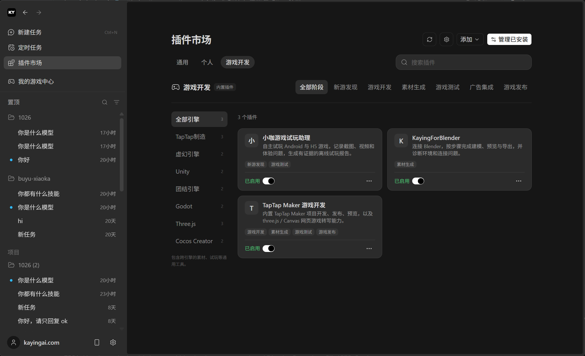
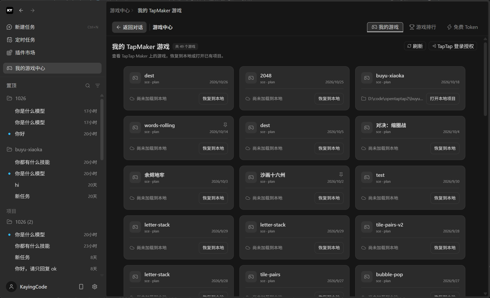
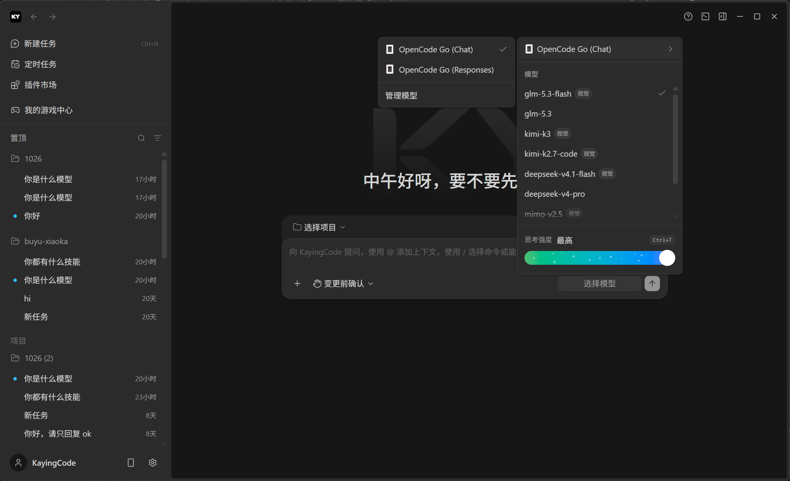

# KayingCode

<div align="center">
  
</div>
<p align="center">
  <a href="README.md">简体中文</a> | English
</p>

**KayingCode uses the ZCode harness as its foundation, bringing game development workflows into a harness designed for multiple game engines and platforms.** It connects agents, engine tools, running previews and tests to iterate from gameplay goals through implementation to verified results.

We retain and reuse ZCode's general coding capabilities, interactions and runtime logic wherever possible, focusing KayingCode's changes on game workflows, engine integration and platform validation. Multiple engines and platforms are an ongoing direction; application guides distinguish implemented capabilities and validated targets. This is an unofficial Apache-2.0 derivative of [official ZCode](https://github.com/zai-org/ZCode).

## Why KayingCode

General-purpose agent harnesses such as ZCode and WorkBuddy already handle coding and documentation tasks well, but their built-in right-hand panels mainly present results and expose limited extension points. Game development needs deep integration inside the harness: agents operating games and platform pages in the built-in browser, generating and processing assets, publishing projects to a game platform, then refining visuals against real screenshots. These loops are hard to assemble from a display-only panel plus a few external links.

KayingCode builds those capabilities into the workbench itself: the embedded browser and game preview share one interface, platform projects, builds and releases are called through tools, asset generation ships with plugins, and dual previews with pixel differences form a budgeted, stoppable visual repair loop. General coding capabilities stay intact, and the critical game development steps no longer take users out of the harness.

## Game development workflow

**Ready out of the box, so your time goes into ideas.** This release ships the game development plugins developers commonly need, integrated and tested with the build: TapTap Maker game development, Browser Use, Blender modelling and assets, and the game playtest assistant, all usable right after installation. Beginners do not have to spend time finding plugins, installing dependencies, configuring MCP and debugging environments; describe an idea and start a first project. Add more capabilities when needed.



*Game development plugin gallery*

**The first release focuses on a one-stop TapTap workflow.** After scanning a QR code to sign in with a TapTap account, project creation, gameplay development, preview and debugging, and build and release can all happen in one workbench (platform sign-in, authorization and publishing confirmation remain under user control). Toolchains, previews and the platform account are connected up front, with no switching between an editor, a browser and a platform console. The learning curve stays gentle.



*Game Center · My TapMaker games*

The full workflow consists of these stages:

- **Projects and engine tools:** Game Center connects project lists, local workspaces and development references. The current TapTap Maker plugin provides project, diagnostics, build and release tools.
- **Implementation and running previews:** Agents execute development tasks in the existing harness. Local Desktop provides game previews, screenshots and functional validation entry points.
- **Visual comparison and iteration:** Dual previews and pixel differences support comparison. Visual repair has budgets and stopping conditions; acceptance relies on actual runtime, gameplay and visual results.
- **Prototyping and porting:** Validate a three.js Web demo, adapt it to TapTap Maker module by module, and compare gameplay and visuals in actual previews.
- **Engine and platform integration:** Extend through plugins, MCP, Skills and existing interfaces while preserving general coding capabilities. Current support is documented per application and plugin.



*Model and Provider settings*

## Usage and connections

Choose an entry point based on how you work; no KayingCode account is needed:

- **Download and run on desktop:** For everyday PC development, install Desktop for the complete local workbench — Agent, game preview, screenshots and functional validation all run on the machine; CLI is also available.
- **Connect from a phone when needed:** Use the [Flutter client](apps/kayingcode-mobile-flutter/README.md) or [H5 and WeChat Mini Program](apps/kayingcode-mobile-taro/README.md) to join the Host and sessions already running on Desktop. Open remote control at the lower left of Desktop and scan the code; the browser or phone joins while tasks stay on Desktop.
- **Optional self-hosting for remote access, free and simple:** For access across networks, deploy your own Relay service — the Cloudflare free tier is sufficient. Serve Web and Relay on one HTTPS origin and follow the [Relay deployment guide](apps/kayingcode-relay-cloudflare/DEPLOYMENT.en.md). Local-only development needs no deployment at all.

Clients manage device identity and browser credentials automatically; users do not register, set passwords or enter tokens. Scan again after authorization expires, logout or browser-storage clearing. Application guides describe access methods and validated platforms for each mobile channel. Desktop targets Windows, macOS and Linux, including SSH/WSL/Docker development environments.

| Interface                         | Purpose                                                                 | Development command              |
| --------------------------------- | ----------------------------------------------------------------------- | -------------------------------- |
| Desktop                           | Local game development, preview and debugging workspace                 | pnpm run dev:desktop             |
| Web / KayingCode CLI distribution | Browser and terminal entry points combining Web, TUI, backend and Agent | pnpm run dev:web                 |
| Agent CLI                         | The kayingcode terminal interface and Desktop/Web runtime               | pnpm --filter @zcode/cli run dev |

## Reading guide

- [Deployment guide](docs/deploy.md) (Chinese): choose Desktop, Web, CLI or mobile access.
- [Relay documentation](apps/kayingcode-relay-cloudflare/README.en.md): implementation, flows and first deployment with Chinese/English navigation.
- [Contributing](CONTRIBUTING.md), [code of conduct](CODE_OF_CONDUCT.md) and [security reporting](SECURITY.md).

The documentation describes an initial release. Installer and platform availability depend on actual builds and acceptance. Local mode uses configured Providers and built-in or locally installed plugins. Model calls send context to the selected endpoint; TapTap and other platform tools have their own sign-in, authorization and publishing confirmation. Remote scanning authorizes a device connection rather than a subscription or quota account. See [NOTICE.md](NOTICE.md) for data and network behavior.

## Contact and community

Scan the QR code in WeChat to contact the KayingCode team or join the discussion group. You can also reach us at [service@kayingai.com](mailto:service@kayingai.com).


## Setup

Install Git, Node.js **24.14.0**, and pnpm **10.31.0**. [mise.toml](mise.toml) is the source of truth for tool versions. Run all development and packaging commands below from the repository root.

```bash
pnpm run bootstrap
```

`pnpm run bootstrap` installs workspace dependencies, prepares local desktop runtime assets, and runs `build:bootstrap`.

The Agent CLI and runtime source code lives in [apps/zcode-cli/packages/cli/](apps/zcode-cli/packages/cli/) as a regular directory included when you clone this repository. No separate checkout or Git submodule initialization is required.

Additional setup and build commands:

| Command                            | Purpose                                                                                                                             |
| ---------------------------------- | ----------------------------------------------------------------------------------------------------------------------------------- |
| `pnpm install`                     | Install dependencies                                                                                                                |
| `pnpm run prepare:desktop-runtime` | Prepare desktop runtime assets, including remote assets by default                                                                  |
| `pnpm run prepare:remote-assets`   | Prepare remote runtime assets separately                                                                                            |
| `pnpm run bootstrap:with-remote`   | Set up dependencies and local and remote assets, then build the relevant packages sequentially; skip the desktop application bundle |
| `pnpm run build`                   | Recursively run each workspace package's build script, including its asset preparation steps                                        |

The default `bootstrap` skips remote asset preparation and is suitable for local desktop development. Run the corresponding preparation command when working with remote workspaces or validating remote distribution assets.

## Development and Usage

### Desktop

```bash
pnpm run dev:desktop

# Use the test environment
pnpm run dev:desktop:test
```

`pnpm run dev:desktop` defaults to `pnpm run dev:desktop:prod` and uses production service configuration. The startup script prepares local runtime assets, builds the desktop Agent, then starts Electron and source watchers.

Set `KAYINGCODE_DATA_BASE_DIR` to use a separate development data directory. For example, on macOS / Linux:

```bash
KAYINGCODE_DATA_BASE_DIR="$HOME/.kayingcode-dev-home" pnpm run dev:desktop:test
```

### Web Development

For Web or backend development, install dependencies and build the TypeScript project references before starting the development servers. On Windows, use a short clone path such as `D:\src\KayingCode`.

```bash
pnpm install --frozen-lockfile --child-concurrency=1
pnpm run typecheck
pnpm run dev:web

# Set the backend workspace (macOS / Linux)
KAYINGCODE_SERVER_WORKSPACE=/path/to/project pnpm run dev:web
```

This starts both the Web development server (default: `http://localhost:5173`) and the backend (default: `http://localhost:3030`). Open the Web development server in your browser. `/ws` and general `/api` requests are proxied to the local backend; `/api/v1/oauth/token` is proxied separately to the configured product service.

After changing Agent source code, run `pnpm exec turbo run build --filter=@zcode/cli...` and restart the service. To validate the complete distribution, extract and run it as described under Packaging → KayingCode CLI distribution below.

### KayingCode CLI distribution

The command-line distribution includes the TUI, Web client, and Agent behind one `kayingcode` command. With no arguments it starts the TUI; a leading `--web` starts Web mode; all other arguments go to the existing Agent CLI. Both modes run locally without Electron.

```bash
# Start the terminal UI by default
kayingcode

# Start the Web interface
kayingcode --web

# Set the project and port without opening a browser automatically
kayingcode --web --workspace /path/to/project --port 3030 --no-open

# Show CLI or Web options
kayingcode --help
kayingcode --web --help
```

In Web mode, it uses the current directory as the workspace, listens on `127.0.0.1` without token authentication by default, selects an available port, and opens a browser. Use the URL printed in the terminal and press `Ctrl+C` to stop the service. For LAN access, use `--host 0.0.0.0`; listening on a non-local address generates an access token by default. Use the token-bearing URL printed in the terminal. Set a token with `--token`, or disable token authentication with `--no-token`.

When starting the general Web service's HTTP entry directly, configure API/WebSocket authentication with `KAYINGCODE_SERVER_AUTH_TOKEN`. When creating the service programmatically, use the `authToken` option.

See Packaging below for build instructions. `pnpm run build:kayingcode` only creates the distribution; it does not replace an existing `kayingcode` on `PATH`. If the command still points to an older installation or another checkout, check it with `command -v kayingcode` on macOS / Linux or `where.exe kayingcode` on Windows.

### CLI Source Development

Use the source entry when developing the TUI or Agent:

```bash
pnpm --filter @zcode/cli run dev --help
pnpm --filter @zcode/cli run dev

# Build the CLI and its workspace dependencies
pnpm exec turbo run build --filter=@zcode/cli...
node apps/zcode-cli/packages/cli/dist/kayingcode.cjs --help
```

This entry runs the Agent CLI directly and does not handle the distribution's `--web` switch. Use `pnpm run dev:web` for Web development, or the extracted `bin/kayingcode.mjs` shown below to test the unified command.

## Configuration

The root [.env.example](.env.example) provides sample service URLs and build configuration. Copy it to `.env` as needed and place local overrides in `.env.local`. Select the Desktop development environment with `dev:desktop:test` or `dev:desktop:prod`.

| Setting                                   | Purpose                                                                                 |
| ----------------------------------------- | --------------------------------------------------------------------------------------- |
| `KAYINGCODE_DATA_BASE_DIR`                | Base directory for application data, stored under its `.kayingcode/` subdirectory       |
| `KAYINGCODE_SERVER_WORKSPACE`             | Workspace path for the Web backend                                                      |
| `KAYINGCODE_BUILTIN_PROVIDER_CONFIG_FILE` | Path to a local provider configuration file; uses the built-in configuration when unset |
| `KAYINGCODE_DIST_BASE_URL`                | Download base URL used by the CLI distribution installer                                |

Runtime variables can be set explicitly in the environment of the startup command. See [config/README.md](config/README.md) for the default configuration shipped with the client.

## Packaging

See [third-party/README.md](third-party/README.md) for notice generation, distribution checks, and where the notices are included in each distribution.

### Desktop

```bash
pnpm run package

# Set the target platform and CPU architecture
pnpm run bundle:desktop -- --os win --arch x64

pnpm run bundle:desktop -- --help
```

Without explicit `--os` or `--arch` options, the default target is the current operating system and CPU architecture. The default output directory is `packages/desktop/dist/`. `--os` accepts `mac`, `win`, or `linux`; `--arch` accepts `x64` or `arm64`. Packaging and signing require the tools and configuration for the target platform.

### KayingCode CLI distribution

Run `pnpm run build:kayingcode` to build the CLI/TUI, backend, and Web client, collect the TUI native libraries, workers, and runtime dependencies, then assemble the distribution. Running the distribution still requires Node.js; use the version specified in `mise.toml`.

Before packaging, set the download base URL with `KAYINGCODE_DIST_BASE_URL` in `.env`, `.env.local`, or the process environment, or pass it through `--base-url`. The URL below is a placeholder; replace it with your hosting URL when publishing:

```bash
pnpm run build:kayingcode --base-url https://downloads.example.com/kayingcode/

# When KAYINGCODE_DIST_BASE_URL is already configured
pnpm run build:kayingcode

# Repackage existing Agent, backend, and Web build outputs
pnpm run build:kayingcode --skip-build

# Show options for the version, output directory, and more
pnpm run build:kayingcode --help
```

The version defaults to the root `package.json` version. Output is written to `dist/kayingcode/`:

- `releases/<version>/kayingcode-<version>.tar.gz`: runtime package.
- `releases/<version>/sha256.txt`: checksum file.
- `latest.json` and `install.sh`: version index and installer.

Upload the entire directory to the configured download base URL. The installer downloads the runtime package from that URL, installs it to `~/.kayingcode/runtime` by default, and creates the `kayingcode` command in `~/.local/bin`. Override these directories with `KAYINGCODE_DIST_HOME` and `KAYINGCODE_DIST_BIN_DIR`, respectively.

To test a packaged build locally, extract and run it directly without uploading or installing it:

```bash
kayingcode_version=$(node -p "require('./dist/kayingcode/latest.json').version")
mkdir -p dist/kayingcode/debug
tar -xzf "dist/kayingcode/releases/$kayingcode_version/kayingcode-$kayingcode_version.tar.gz" \
  -C dist/kayingcode/debug
# Start the TUI by default
node dist/kayingcode/debug/kayingcode/bin/kayingcode.mjs

# Start Web mode
node dist/kayingcode/debug/kayingcode/bin/kayingcode.mjs --web \
  --workspace "$PWD" --port 3030 --no-open
```

Open `http://127.0.0.1:3030` to validate the complete flow, with one backend serving the Web pages and running the Agent. The port must be available; if `pnpm run dev:web` is already running, choose another `--port`.

## Repository Structure

### apps: runnable and distributable entry points

| Directory                                                               | Current package or project entry | Responsibility                                                                             |
| ----------------------------------------------------------------------- | -------------------------------- | ------------------------------------------------------------------------------------------ |
| [`packages/desktop`](packages/desktop/)                                 | `@zcode/desktop`                 | Electron Main, window-scoped Local Host, Renderer, and desktop packaging                   |
| [`packages/web`](packages/web/)                                         | `@zcode/web`                     | Browser workbench and Relay Web interface                                                  |
| [`apps/kayingcode-site`](apps/kayingcode-site/)                         | `kayingcode-product-site`        | Standalone static product site and local preview                                           |
| [`apps/zcode-cli/packages/cli`](apps/zcode-cli/packages/cli/)           | `@zcode/cli`                     | Agent CLI/TUI entry point and SEA distribution                                             |
| [`packages/zcode-server-cli`](packages/zcode-server-cli/)               | `@zcode/server-cli`              | Upstream resident service, remote staging and proxy; SSH/WSL/Docker development containers |
| [`apps/kayingcode-relay-cloudflare`](apps/kayingcode-relay-cloudflare/) | `@kayingcode/relay-cloudflare`   | Relay, device authorization and same-origin Web hosting                                    |
| [`apps/kayingcode-mobile-taro`](apps/kayingcode-mobile-taro/)           | `@kayingcode/mobile`             | Taro WeChat Mini Program and H5 client                                                     |
| [`apps/kayingcode-mobile-flutter`](apps/kayingcode-mobile-flutter/)     | `pubspec.yaml`                   | Flutter Android/iOS client; uses Dart tooling outside the Bun workspace                    |

### packages: capabilities shared across entry points

| Directory                                          | Responsibility                                                                           |
| -------------------------------------------------- | ---------------------------------------------------------------------------------------- |
| `apps/zcode-cli/packages/adapters`                 | Agent I/O adapters for files, network, models, and plugins                               |
| `apps/zcode-cli/packages/bootstrap`                | Agent service and protocol assembly                                                      |
| `apps/zcode-cli/packages/shared-types`             | Shared Agent CLI types                                                                   |
| `apps/zcode-cli/packages/contracts`                | Agent ports, events, and tool contracts                                                  |
| `packages/agent-gateway`                           | HTTP/WS RPC ingress shared by Web Host and Agent Node                                    |
| `apps/zcode-cli/packages/i18n`                     | Agent localization resources                                                             |
| `apps/zcode-cli/packages/core`                     | Agent command, session, and tool runtime                                                 |
| `apps/zcode-cli/packages/telemetry`                | Agent telemetry events and processing                                                    |
| `packages/client`                                  | Agent client SDK and connection adapters                                                 |
| `apps/zcode-cli/packages/dynamic-workflow`         | Dynamic workflow engine core                                                             |
| `apps/zcode-cli/packages/dynamic-workflow-runtime` | Sandbox execution and host bridge for workflow scripts                                   |
| `packages/mobile-client-core`                      | Pairing, connection, and projection logic shared by mobile, H5, and Mini Program clients |
| `packages/model-option-map`                        | Parsing and evaluation of model option mappings                                          |
| `apps/zcode-cli/packages/node-repl-host`           | JavaScript execution and Browser Use host                                                |
| `packages/provider`                                | Shared Provider capabilities                                                             |
| `packages/provider-node`                           | Node implementations of Provider capabilities                                            |
| `packages/rpc`                                     | Cross-process RPC framework                                                              |
| `packages/server`                                  | Web Host HTTP, WebSocket, and remote connection services                                 |
| `packages/services`                                | Business services and persistence                                                        |
| `packages/shared`                                  | Protocols, platform interfaces, and types shared across clients                          |
| `apps/zcode-cli/packages/swift-bridge`             | Swift interoperability placeholder package                                               |
| `apps/zcode-cli/packages/tui`                      | Agent terminal UI                                                                        |
| `packages/ui`                                      | Shared React components, hooks, and Zustand state                                        |

### Other directories

| Directory                             | Responsibility                                                                              |
| ------------------------------------- | ------------------------------------------------------------------------------------------- |
| `plugins/`                            | User-managed built-in plugins and bundled assets, including the Computer Use runtime        |
| `tools/`                              | Development, debugging, research, and validation tools                                      |
| `scripts/`, `config/`, `third-party/` | Build and maintenance scripts, distribution configuration, and third-party notice materials |

See the [repository rules](AGENTS.md), [app directory guide](apps/README.md), and [generated package map](SOURCE_PACKAGES.md) for placement rules, public entry points, and distribution paths. After changing packages or plugin metadata, run `pnpm run source:plugins`, `pnpm run source:map`, and `pnpm run source:check`.

## Project Notice

See [NOTICE.md](NOTICE.md) for feature and promotion scope, maintenance policy, execution and data risks, licensing, and third-party copyright information.

## Branch workflow

| Branch | Purpose |
| --- | --- |
| `main` | The default KayingCode branch. Feature, fix, and release preparation PRs target this branch. |
| `zcode-main` | A read-only mirror of the official ZCode `main` that maintainers update by fast-forward. |
| Topic branches | Short branches from product `main`, such as `project-drag` or `fix/session-reconnect`. Delete them after merging. |

Clone the product from GitHub. New clones check out `main`.

```bash
git clone https://github.com/kaying-ai/KayingCode.git
cd KayingCode
```

Start a change from the latest product branch.

```bash
git switch main
git pull --ff-only origin main
git switch -c fix/session-reconnect
node scripts/check-workspace-freshness.mjs
```

Open your PR against GitHub `main`. Maintainers prepare releases on a short-lived `release/<version>` branch and tag the verified commit on `main` with `kaying-code-v<version>` after release acceptance.

In maintainer clones, `origin` points to GitHub and `upstream` points to official ZCode. The former Gitee development repository can be kept as `legacy`. Once a dedicated Gitee backup is available, configure it as `gitee` and mirror the product branch and selected release tags from GitHub. [Migration, mirror, and release guide](docs/deploy/github-gitee-repository.md)

### Connecting and syncing upstream

The `zcode-main` mirror contains the original ZCode source and docs. To review upstream changes, add the official remote once with `git remote add --no-tags -t main upstream https://github.com/zai-org/ZCode.git` and run `git fetch --no-tags upstream`. [Original ZCode docs](https://github.com/kaying-ai/KayingCode/tree/zcode-main/docs)

Start an adoption branch from the synced product `main`, such as `adopt-zcode-3-17-2`. Compare `UPSTREAM_BASE.json.commit` with `upstream/main`, adapt and test changes by module, and open a PR against product `main`. Advance the recorded base after all target changes have been reviewed and validated. KayingCode manages its product version independently.
