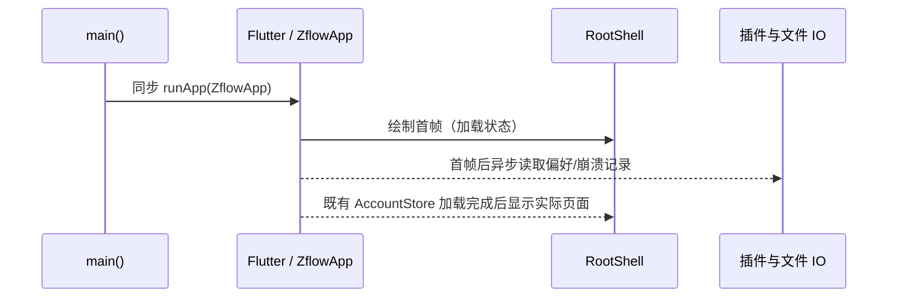

# Android 首帧启动

## 产品规则与所有者

- `main()` 只负责同步创建 Flutter binding、注册应用许可证并挂载 `ZflowApp`；首帧不得等待插件、文件系统或持久化 IO。
- `ZflowApp` / `RootShell` 拥有可见启动状态：安全存储读取期间展示 Flutter 加载/错误界面，不能让 Android 原生启动页长期充当应用界面。
- 启动诊断（协议帧日志偏好、崩溃记录）是尽力而为的后台初始化。其延迟或失败不得阻挡首帧、页面操作或凭据加载；诊断状态只更新其既有所有者。

## 顺序与失败语义

偏好与诊断读取失败时保留调试默认值并继续；任何诊断 IO 不拥有导航或设备连接状态。

## 验收

1. 即使 SharedPreferences 插件响应一直未返回，启动入口仍能在首帧显示 Flutter 加载 UI，而非停留在原生启动画面。
2. 偏好或崩溃记录不可用时应用仍可进入既有首屏；已有账户/安全存储加载行为不变。
3. Android release 包使用递增的 `versionCode`，并通过 Flutter 分析、测试及 Release 构建。

## 问题依据

Google Play 2026-10-19 的“功能异常”证据截图停留在黑底 KY 原生启动页，并报告界面元素无响应。旧启动入口在 `runApp()` 前串行等待 SharedPreferences 与应用支持目录/崩溃记录的插件 IO；这些平台通道超时会让 Flutter 第一帧永远不显示。
