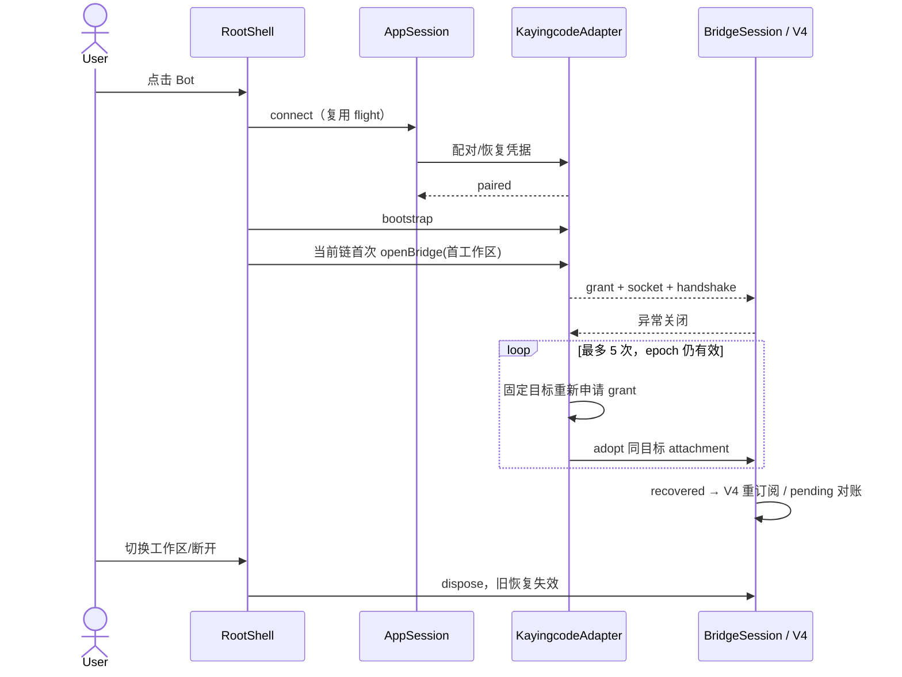

# 手机交互与断线恢复对齐

## 范围与所有者

对齐 Taro 的 `bot-direct-connect`、`session-workspace-list`、`chat-empty-state-layout`
和 `relay-attachment-reconnect`。保留 Flutter 原生工作区切换 sheet、归档和管理操作；
不迁移小程序 SocketTask、构建兼容代码，也不改变 ZCode 的连接协议。

- `AccountStore` 持久化 Bot 档案，`AppSession` 唯一持有设备连接和激活意图。
- `RootShell` 持有工作区目录、当前 bridge、链代数与目录请求代数。
- `SessionDrawerController` 持有当前 scope 的会话数据；搜索、折叠、展示数量属于视图。
- `KayingcodeAdapter` 持有 attachment 恢复 flight/epoch；`BridgeSession` 保持页面身份。
- `ConversationTransport` 重建 V4 client/subscription，并对账 pending command；不得盲重发未知 ACK 命令。

## 产品规则

1. Bot 页添加连接仅保存并回到 Bot 列表；点击 Bot 立即进入会话页并连接，自动请求配对，
   仍需电脑批准。重复点击复用 AppSession 的在途连接；失败仅显式重试。设备管理页原有
   添加并连接流程保留。旧连接在添加新档案时不被激活替换。
2. KayingCode 首次连接取当前目录第一个工作区自动打开，显示会话列表，不自动进入会话详情。
   空目录是有效状态，不删除凭据；已打开目标和重连目标不被目录刷新抢占。
   ZCode 保留原工作区选择流程。手动切换仍覆盖旧链，迟到目录/bridge 不可提交。
3. 顶栏提供刷新工作区图标，加载期间禁用并显示进度；刷新目录保留当前 bridge、会话与
   显式折叠选择，目录请求按设备和链代数隔离。Flutter 复用现有工作区选择器，不增加新的节点状态所有者。
4. 当前工作区默认展开，可显式折叠。空会话时在列表内容区显示突出「新会话 / 开始新的对话」
   行，并隐藏重复顶部创建图标。折叠时隐藏内容和创建行。搜索无结果使用独立提示，不能当成空工作区。
5. 会话行使用标题、活跃时间与单行纯文本摘要；保留管理菜单与状态信息，避免每行大卡片边框。
   搜索覆盖完整标题与原始摘要；页面默认最近 5 条，可展开全部，归档/置顶语义保留。
6. 点击新会话传递 null draft，首次发送才创建，不能复用前一会话。聊天空引导位于消息区域中心，
   AI 内容标签固定顶部，已有乐观输入时不显示空引导。
7. 已建立 attachment 异常关闭后立即重连，最多 5 次，重试间隔 1、2、4、8 秒，
   每次重新读取目录/generation、申请 grant、打开 socket、完成握手；不复用旧 connection/subscription。
   鉴权/授权永久错误立即停止，耗尽后显示真实失败原因和显式重试。正常恢复清除错误。
8. 恢复固定 relay/node/server/workspace，Node 重启允许 generation 变化；目录排序不能改变目标。
   切换工作区、移除 Bot、手动断开和 dispose 作废旧 epoch 并唤醒等待，不得保留迟到 socket。
   保留当前 BridgeSession、sessionId 与编辑草稿，恢复通过既有 V4 重订阅和命令对账路径。

## 顺序与边界

手机维持 `web-remote-replayable` 的 snapshot/gap repair；桌面 `desktop-continuous`
及 ZCode adapter 的恢复策略不在本次变更范围。

## 验收

- widget 全流程：添加只保存 → 点击 Bot → 自动开首工作区 → 空列表创建 draft；重复点不重复配对。
- 有会话显示两行摘要，Markdown/换行不泄漏；搜索能找到第六条，最近/全部可切换。
- 空列表创建行位于内容区，收起隐藏，再展开恢复；刷新禁用、保留当前 workspace。
- 切 Bot/工作区时旧 bootstrap 或打开结果迟到不抢占；空目录不清凭据。
- 真实本地 WebSocket：Node 重启恢复同一目标，generation 冲突重试；暂时失败耗尽恰好 5 次，
  永久授权失败一次即停止，手动断开/切换取消等待与迟到握手，恢复后可再次恢复。
- iOS/Android 真机的后台恢复、系统网络切换需真机验证；Windows widget 与本地 socket 测试不冒称真机 E2E。

## 验证记录（2026-10-17，Windows）

- `fvm flutter analyze --no-pub`：No issues found；使用 Flutter 3.35.5 / Dart 3.9.2。
- `fvm flutter test --no-pub`：86 个测试全部通过，包括 widget 全流程和真实本地 WebSocket。
- `fvm flutter build apk --debug --no-pub --target-platform android-arm64` 通过，产物为 `build/app/outputs/flutter-apk/app-debug.apk`（插件有 Java 8 兼容性 warnings）。
- 10 个本次修改的 Dart 文件通过 `fvm dart format --output=none --set-exit-if-changed`。
- 根 `bun run typecheck` 通过；`bun run lint` 为 0 errors / 129 条既有 warnings。
- `source:check` 通过；`architecture:check --changed` 为 baseline 0 / new 0。
  Flutter 不在该 TypeScript 检查器的覆盖范围内，Dart 边界由本应用 CONTRACT、analyze 和测试验证。
- 本次仅修改 Flutter UI/连接适配层，含规范与测试净增 918 行；Taro 工作树保留。依赖版本、锁文件和 FVM 版本配置未变更。
- 本机没有执行 iOS 构建、真机后台恢复及真实 Relay/桌面审批联调。
