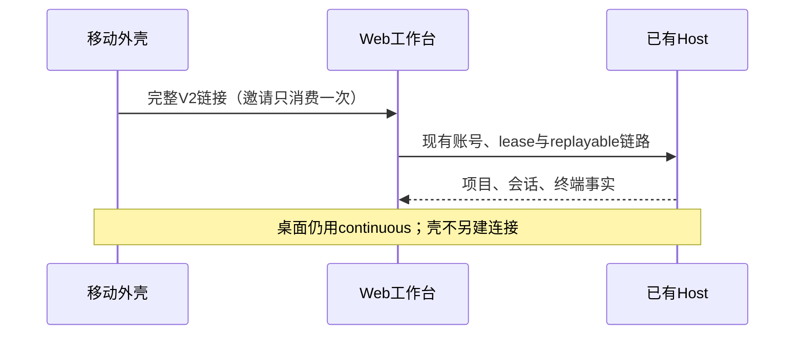
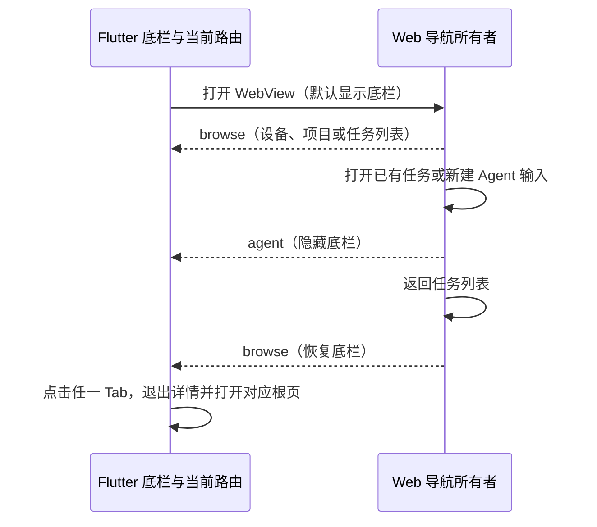

# 移动 WebView 工作台与导航

移动端仅接入 KayingCode V2 Web 授权链接；移除 ZCode 产品连接入口，扫码、粘贴、导入及旧档案打开均不得建立 ZCode 连接。旧数据保留供用户删除，不自动销毁凭据。此产品取舍只作用于移动壳，不移除共享上游协议能力。

启动不再展示图文视觉引导，也不提供「我的 → 重新观看引导」入口；首次启动直接进入无设备时的连接入口。原引导页包含已移除的 ZCode 连接与原生会话操作，与当前 WebView 工作台流程不一致，因此连同完成标记、入口和资源整体移除。

底栏顺序：会话列表、项目列表、我的。连接管理、终端管理、会话管理统一从会话列表进入 Web 工作台，网页唯一拥有连接和业务状态，壳不创建原生 attachment 或第二条 socket。会话列表副标题说明从 Web 工作台管理会话和终端，右上角进入连接管理；底栏会话 Tab 显示未读任务角标，超过 99 显示 `99+`。

最近项目必须是真实打开过的 workspace，按档案、实际 deviceSid 及 workspaceIdentity.trim() || workspacePath 隔离。不得用设备档案或邀请 URL 冒充项目。网页拥有项目选择事实；外壳仅保存供导航使用的元数据，邀请及凭据不进入项目记录。

项目列表按已保存连接分组，连接名在组标题显示一次。各组及组内项目按最近打开时间排序。项目行突出目录名，完整路径作为次级信息显示并可换行，整行打开工作台。列表显示项目数量，加载、空列表和读取失败有各自的提示。

仅在列表展示时，同一连接、同一设备、没有显式工作区身份的 Windows 盘符绝对路径，若只差分隔符，则展示最近打开的一条。持久化仍由最近项目存储拥有，点击传递所选记录的原始工作区键，由网页和 Host 核验。不同连接、设备、显式身份及 POSIX 路径保持独立。Flutter 直接调用现有 WebView 入口并原样传递工作区键与设备 SID，不经过页面路由参数。

验收覆盖旧数据、窄屏长路径、深浅主题、空列表和打开正确项目。

验收：首次安装仅显示 KayingCode；旧 ZCode 档案不能连接；三个 Tab 顺序正确；连接与终端从会话模块可达；最近项目重启保留且身份不混淆；WebView 加载失败可重试、返回不重建原生连接。Taro H5及小程序构建、Flutter静态检查与widget测试分别执行，真机不足如实记录。

## WebView 容器操作与包标识

Flutter 使用同一底栏承载会话、项目和我的的二级页面，包括连接管理、设置详情、Web 设备和任务列表、加载与失败状态。点击任一 Tab 回到该 Tab 的根页，同一 Tab 也可退出当前目录页。Agent 新建输入和已有对话是全屏页面，退出后恢复原 Tab。对话中的网页返回仍由 Web 导航处理。系统返回优先处理当前页面和 WebView 历史。

WebView 没有 Flutter 顶栏或浮动菜单。加载失败时提供刷新和在浏览器打开，离开页面走底栏。Flutter 通过 `kayingPlatform=flutter` 请求网页使用移动导航，Web 把当前 `browse` 或 `agent` 状态报告给打开它的 Flutter 路由。Flutter 仅接受当前可信来源的已知事件；开始加载、加载失败和旧 Web 缺少报告时显示底栏。页面路由释放后不再影响底栏。Taro 使用自己的容器工具栏。

本应用的私有 Dart 包名为 `kayingcode_mobile`，Windows 制品名为 `KayingCode.exe`。已有构建目录中指向旧目标的默认安装前缀随构建更新。Zflow 是迁入源码的来源，未通过包管理器安装或作为远端服务依赖。迁入代码仍随包交付，MIT 原文与版权归属继续放在开源许可及 NOTICE。应用安装身份、偏好键、凭据、WebView profile 和平台通道名称继续兼容存量安装。

验收检查窄屏无浮动菜单、原生详情及 Web 列表显示底栏、打开任务和新建隐藏底栏、返回恢复、从详情切换 Tab、旧网页及失败回退。使用固定 SDK 执行 analyze、测试与 Windows 调试构建，并构建配套 Web 制品。

## 本次验收范围

原生 ZCode 会话交互验收已由当前 WebView 场景替换，共享协议相关单测仍保留。Taro 覆盖 URL 无全局 URL 环境、来源校验、320/375px 深浅主题、加载重试与最近项目导航；Flutter 覆盖启动、三个 Tab、无原生连接、最近项目重启恢复与拒绝 ZCode。Web 覆盖元数据白名单与定点上游构建。真机微信/Android/iOS/HarmonyOS、Windows WebView2 运行和线上授权尚待设备联调；本次未部署 Web 或发布移动安装包。
