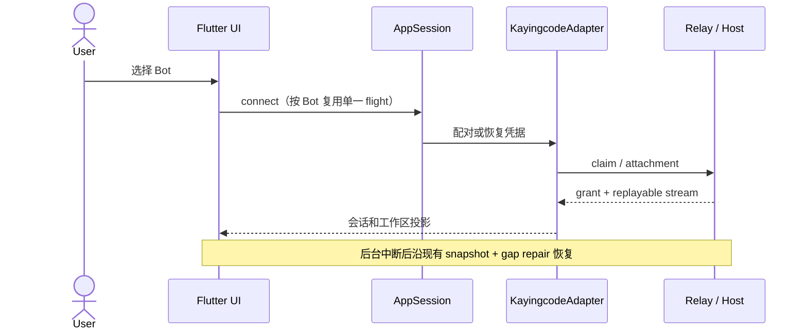

# 鸿蒙平台接入与多端构建环境

## 范围和产品规则

- 在现有 Flutter 手机客户端增加 OpenHarmony / HarmonyOS 原生 HAP。共用 `lib/` 的 UI、Bot 档案、配对、会话和 `web-remote-replayable` 恢复协议，不创建新的 Agent、Host 或远端任务状态。
- 首版支持前台配对、工作区、会话、聊天、扫码和选取文件。后台常驻连接、Android 前台服务、WakeLock 与 Android 通知渠道不属于鸿蒙首版承诺；鸿蒙端不能把 Android 原生实现当作可用能力。
- 设备身份中的 OS 为 `harmony`。Relay 的平台字段必须保持现有公开协议允许的值；不能为了鸿蒙自行扩展服务端枚举或把设备误报为 Android。
- 配对密钥与设备凭据仍由 `AccountStore` / 凭据存储端口唯一持有，鸿蒙实现使用系统安全存储。偏好和崩溃记录使用鸿蒙可用的本地存储，不在日志中暴露连接串。
- 相机、相册、文件选择或权限不可用时展示已有错误/手动输入路径，不能悄悄使核心配对和恢复逻辑改走另一套状态。

## 所有者与接口

- `AppSession` 仍是设备连接和最后激活意图的所有者；`KayingcodeAdapter`、`BridgeSession` 和 `ConversationTransport` 保持现有 attachment 与命令对账顺序。
- `AccountStore` 持有档案持久化；`CredentialStorage` 是安全存储边界。鸿蒙插件只实现平台 IO，不持有第二份凭据或连接队列。
- `ohos/` 只负责应用壳、权限、图标和原生插件装配。Android 的通知与保活调用仅在 Android 启用。
- 华为应用市场的应用图标使用未做圆角遮罩的 1024×1024 PNG 正方形底图，基于 `assets/brand/kayingcode.png` 生成；控制台上传图必须与 `ohos/AppScope/resources/base/media/app_icon.png` 一致。鸿蒙 AppScope 与 entry 图标保持一致，平台系统负责最终图标遮罩。
- 已上传过的 HarmonyOS 构建再次提交时，保持展示版本号不变并递增 pubspec build number，避免重复上传同一 versionCode。
- `scripts/build-ohos.mjs` 是鸿蒙构建入口，核对 SDK 来源和固定 tag，并在独立临时工程解析鸿蒙插件依赖、生成 HAP。`scripts/flutter-target.mjs` 是 Agent 的统一选平台入口：Android/iOS 直接调用本应用 `.fvm/flutter_sdk` 固定的上游 SDK，鸿蒙委托给唯一的鸿蒙构建入口；不修改全局 PATH 或 FVM 配置。

## SDK、依赖及迁移边界

- Android/iOS：上游 Flutter 3.35.5，以 `.fvmrc` / `.flutter-version` 为准。Agent 入口读取 `.fvm/flutter_sdk` 并核对实际版本，提供保留锁文件的 `pub-get`、分析、测试与构建动作，因而本机没有全局 `fvm` 命令时仍可构建；原有 `fvm flutter` 命令可继续用于人工开发。`pub-get` 从根锁文件读取唯一的 hosted 包源并只在该子进程覆盖机器级 `PUB_HOSTED_URL`，强制现有锁文件，避免镜像切换重写依赖来源。
- 鸿蒙：CPF-Flutter `flutter_flutter` 固定稳定 tag `3.35.8-ohos-1.0.4`。HAP 最低兼容设备版本为 API 21；编译工具链允许 API 21（原有基线）或 API 26（本机 `assembleHap` 已完成 ArkTS 编译与未签名打包），不把编译 API 等同于最低设备 API，真机兼容性另行验收。API 20 缺少 `AutoFillType` 等类型，API 23 已观察到 ArkTS 编译错误，入口拒绝两者。旧 tag `3.35.7+ohos-1.0.5` 在本机初始化时 Engine stamp 返回 404，不作为此工程的发布基线。
- 鸿蒙工具链绝对路径可通过环境变量显式指定，也可写入被忽略的 `.local/ohos-toolchain.json`，环境变量优先。构建入口从所选 SDK 定位同一套 `ohpm`、`hvigorw`、`hdc` 并只为子进程调整 PATH；不得使用系统 PATH 上的另一版鸿蒙工具。若 CPF Flutter 的全局 `ohos-sdk` 配置仍指向另一安装目录，预检必须先报错，避免它优先覆盖所选 SDK；只提示人工清除旧配置，不自动改动全局设置。切换目标后重新执行对应 `check`，不修改全局 PATH、`.fvmrc`、根锁文件或根 `.dart_tool`。
- 鸿蒙插件依赖必须固定适配仓库的 tag。构建脚本将应用代码和 `ohos/` 壳放入独立暂存目录，生成单独 pubspec；以 `ohos/flutter-pubspec.lock` 固定解析结果、以 `build/ohos-pub-cache/` 缓存。它不改写根 `pubspec.yaml`、`pubspec.lock`、`.dart_tool` 或 `.fvmrc`；每次构建创建忽略的 `build/ohos-stage-*/`，具体产物目录由命令输出。
- ZCode 网页容器新增 `webview_flutter 4.13.0` 与 `webview_windows 0.4.0`，同步刷新独立锁文件，不替换鸿蒙插件或 SDK。两包没有本工程的 OH 内嵌实现；无法创建浏览器时只显示通用错误和系统浏览器入口。不能把 Windows 验收等同于 OH 网页/授权/HAP 验收。
- Debug 与 Release HAP 的 Agent 构建都需要本机签名配置路径；缺少 `KAYING_OHOS_SIGNING_PROFILE` 时应在解析依赖前给出清晰错误。DevEco Studio 可以在暂存工程中单独配置调试签名。
- 首次由官方 SDK 模板生成 `ohos/`，其本机路径、签名材料、`oh_modules` 和构建缓存不入库。升级 SDK 或插件时先更改本 spec 与固定版本，再重建并验证三端。

## 事件顺序

鸿蒙首版不更改 Desktop 的 `desktop-continuous` 流语义；旧 attachment 的迟到结果继续由现有 epoch / lease 边界拒绝。

## 验收场景

1. 指定上游 SDK 构建 Android/iOS，不会读取鸿蒙插件锁文件；指定 CPF SDK 构建 HAP，不会重写 Android/iOS 的 `pubspec.lock`。
2. 用上游 Flutter 或错误 CPF tag 调用鸿蒙入口时，在解析依赖和写入产物前明确失败，并显示正确 SDK 配置方式。
   DevEco/HarmonyOS SDK 不是允许的编译 API 21/26 时也必须在构建前失败，并说明所需版本。选 API 26 时不能调用 PATH 上旧 API 20 工具；选上游平台时没有全局 `fvm` 仍能通过项目 `.fvm/flutter_sdk` 运行。
3. 鸿蒙真机前台完成粘贴/扫码配对、冷启动凭据恢复、工作区和会话切换、发送消息、附件选择；权限拒绝时仍能使用手动配对。
4. 鸿蒙 attachment 断开后沿现有 `web-remote-replayable` snapshot/gap repair 恢复；切换目标后旧结果不能覆盖新会话。
5. Android/iOS 原有构建和主要交互保持可用；鸿蒙后台连接、通知和签名发布须另行验证后才能声明支持。

- 上游 Flutter SDK 首次运行可能先输出初始化日志；`check` 读取其后版本 JSON，仍必须严格确认版本及拒绝 OHOS SDK。
