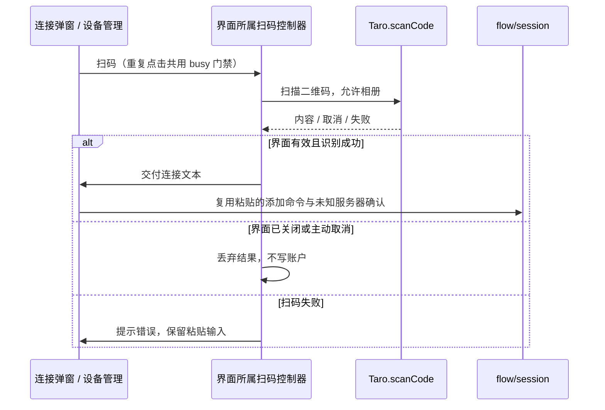

# 添加远端的扫码与粘贴输入

## 产品规则

- 首次连接和 Bot 列表的“连接 KayingCode / ZCode”弹窗直接提供“扫码添加”、粘贴输入、“取消”和“添加”，不要求先去设备管理寻找扫码入口。
- 扫码调用微信扫码能力，允许从相册选择二维码；识别结果走与粘贴相同的 `addAccountFromInput`，保留非法输入提示、未知服务器确认及账户去重。添加后仍显示 Bot 列表，点击 Bot 才开始连接和配对。
- 空输入时禁用“添加”，文字仍清晰可读；输入非空时恢复可用。深浅主题显式提供禁用主按钮的前景和背景，不能只依赖微信原生禁用样式或只降低透明度。
- H5 的操作按钮恢复可用时，不因组件保留 `disabled="false"` 属性而继续套用原生禁用配色；主按钮、次按钮在深浅主题下均保持文字对比度。
- 主动取消扫码保持当前弹窗及已输入草稿，不提示“不支持扫码”；扫码失败提示“扫码失败，请重试或粘贴连接信息”。H5 无扫码能力时仍可粘贴添加。
- 同一输入入口只允许一个在途扫码；关闭弹窗、离开设备管理页后，旧扫码结果不得添加账户或弹出错误。设备管理既有扫码入口复用相同处理。

## 所有者与边界

- 连接弹窗持有输入草稿；扫码控制器仅持有当前扫码的 busy 与有效标记，生命周期由对应界面 hook 管理，不持有账户、凭据或连接事实。
- Taro 平台调用在 hook 装配到扫码控制器；控制器通过注入端口便于测试成功、取消、失败、并发及迟到结果。
- 页面继续通过 `flow/session.ts` 现有添加命令写入账户，core 仍是账户和凭据的唯一所有者。未知服务器确认以及 desktop-continuous / web-remote-replayable 的链路不变。

## 验收与 E2E 场景

1. 在首次连接和已有 Bot 列表分别打开两种后端的弹窗，可看到“扫码添加”“取消”“添加”；320px、375px 深浅主题无横向溢出。空输入的“添加”文字可辨认，点击不添加；输入空白保持禁用，输入连接信息后可用。
2. 微信真机：点击扫码进入原生扫描界面，可使用相机或相册；扫描有效 KayingCode / ZCode 二维码，添加卡片后保留 Bot 列表，点击卡片沿用原配对/连接流程。
3. 扫描非法文本显示解析错误；未知服务器先确认，取消不添加，确认只添加一份。扫码与粘贴同一连接不产生重复卡片。
4. 取消原生扫码不报错、不清空草稿；模拟扫码失败时显示错误，仍能粘贴添加。重复点击不并发开启扫码，结束后可以重试。
5. 关闭弹窗后旧扫码成功或失败均不影响页面；重新打开的弹窗不受旧结果影响。设备管理页离开后相同。
6. H5 E2E：窄屏深浅主题检查禁用文字、扫码按钮与粘贴提交流程；无扫码能力时提示失败并保留草稿。原生相机、相册和微信默认禁用样式须由微信开发者工具或真机复核。
