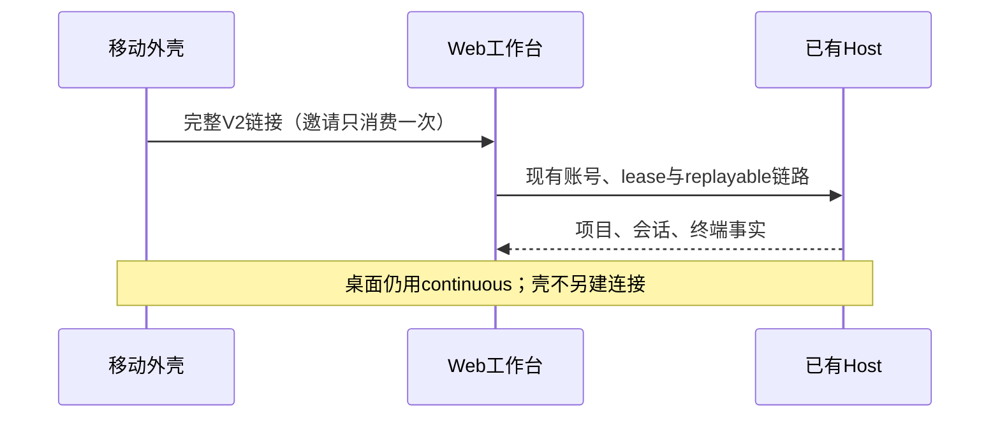
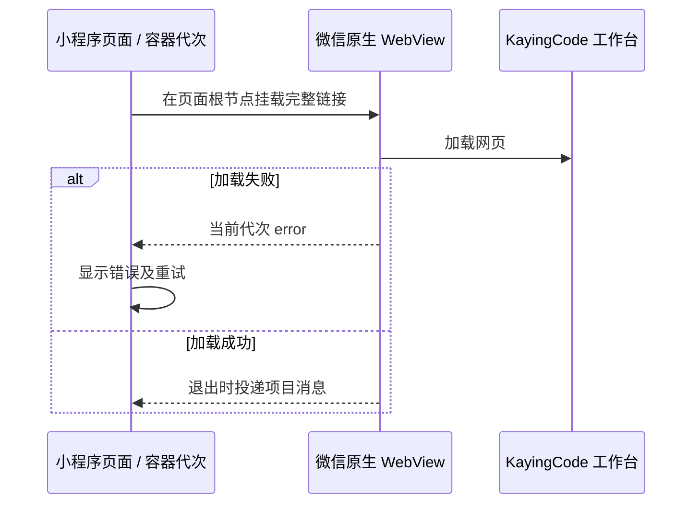

# 移动 WebView 工作台与导航

移动端仅接入 KayingCode V2 Web 授权链接；移除 ZCode 产品连接入口，扫码、粘贴、导入及旧档案打开均不得建立 ZCode 连接。旧数据保留供用户删除，不自动销毁凭据。此产品取舍只作用于移动壳，不移除共享上游协议能力。

启动不再展示图文视觉引导，也不提供「我的 → 重新观看引导」入口；首次启动直接进入无设备时的连接入口。原引导页包含已移除的 ZCode 连接与原生会话操作，与当前 WebView 工作台流程不一致，因此连同完成标记、入口和资源整体移除。

底栏顺序：会话列表、项目列表、我的。连接管理、终端管理、会话管理统一从会话列表进入 Web 工作台，网页唯一拥有连接和业务状态，壳不创建原生 attachment 或第二条 socket。

最近项目必须是真实打开过的 workspace，按档案、实际 deviceSid 及 workspaceIdentity.trim() || workspacePath 隔离。不得用设备档案或邀请 URL 冒充项目。网页拥有项目选择事实；外壳仅保存供导航使用的元数据，邀请及凭据不进入项目记录。

验收：首次安装仅显示 KayingCode；旧 ZCode 档案不能连接；三个 Tab 顺序正确；连接与终端从会话模块可达；最近项目重启保留且身份不混淆；WebView 加载失败可重试、返回不重建原生连接。Taro H5及小程序构建、Flutter静态检查与widget测试分别执行，真机不足如实记录。

## 本次验收范围

原生 ZCode 会话交互验收已由当前 WebView 场景替换，共享协议相关单测仍保留。Taro 覆盖 URL 无全局 URL 环境、来源校验、320/375px 深浅主题、加载重试与最近项目导航；Flutter 覆盖启动、三个 Tab、无原生连接、最近项目重启恢复与拒绝 ZCode。Web 覆盖元数据白名单与定点上游构建。真机微信/Android/iOS/HarmonyOS、Windows WebView2 运行和线上授权尚待设备联调；本次未部署 Web 或发布移动安装包。

## 微信全屏容器与标题

微信构建的默认 AppID 为 `wx7c84fe95e306bc3c`，由工程根的 `project.config.json` 提供，Taro 将有效配置写入微信产物。显式传入的 `TARO_APP_ID` 用于覆盖本次构建。

有效链接在微信端直接挂载页面根节点的原生 WebView，使用微信原生导航栏和网页加载进度。小程序页面标题为「KayingCode 工作台」。外壳的工具栏、内嵌布局和加载提示用于 H5；微信在链接无效或原生加载失败后显示外壳错误页，仍可返回、复制有效链接或重试。原生失败事件回到当前页面代次，旧容器的迟到事件不能覆盖重试结果。WebView 继续接收完整授权 fragment 和返回时的项目消息，网页仍拥有业务连接。

验收检查生成的微信页面标题、有效链接直接挂载、失败重试及 H5 回归。微信开发者工具和真机的业务域名权限以实际 AppID 为准。

本地验收通过微信产物校验、71 项单测和 H5 E2E。隔离的微信开发者工具项目使用同一模拟邀请并关闭本地业务域名校验。旧产物复现壳的加载提示持续显示；修复后线上网页从首屏进入授权提示，导航栏显示 KayingCode，模拟原生加载失败后可点击重试。正式 AppID 的域名校验和有效邀请配对仍需真机验收。

## 项目列表展示

项目列表按已保存连接分组，连接名在组标题显示一次。各组及组内项目按最近打开时间排序。项目行突出目录名，完整路径作为次级信息显示并可换行，整行打开工作台。列表显示项目数量，加载、空列表和读取失败有各自的提示。

仅在列表展示时，同一连接、同一设备、没有显式工作区身份的 Windows 盘符绝对路径，若只差分隔符，则展示最近打开的一条。持久化仍由最近项目存储拥有，点击传递所选记录的原始工作区键，由网页和 Host 核验。不同连接、设备、显式身份及 POSIX 路径保持独立。验收覆盖旧数据、窄屏长路径、深浅主题、空列表和打开正确项目。

Taro 页面路由的工作区键与设备 SID 由 WebView 页解码一次，再交给 URL 构造器编码。含冒号、反斜杠或字面百分号的键与原始记录一致；非法参数保留由工作台核验。

从项目列表打开时，由 Web 工作台在已验证的项目范围内展示任务会话。空项目展示新建任务入口，打开会话后返回仍显示该项目的任务。移动容器继续使用原项目导航链接，不读取任务库或生成会话。

本地通过 73 项单测、微信小程序构建与 H5 端到端测试。H5 验证了 320px 的分组与长路径、原始 Windows 路径导航，以及 390px 的深浅主题和空状态。微信开发者工具停在未登录页，模拟器交互待验证。
