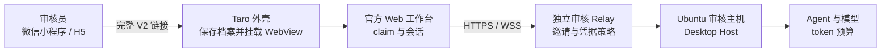
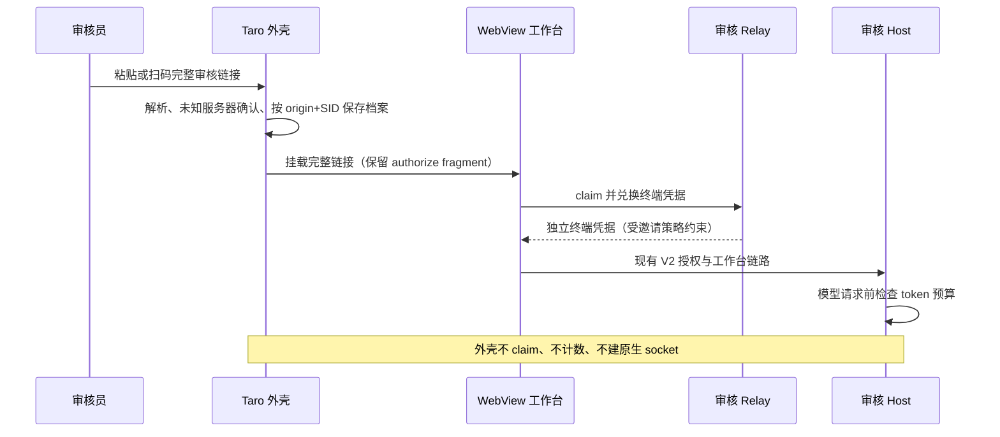

# 微信小程序（Taro）审核接入

面向应用商店与微信小程序审核等受控部署。邀请长有效期、多次领取、终端凭据有效期和 token 预算由 Relay、Desktop Host 与 Web 工作台拥有；Taro 壳只保存并原样打开完整 V2 授权链接，不新增 claim、预算或连接实现。部署步骤见[审核环境部署](../../../docs/deploy/kayingcode-review-environment.md)，WebView 导航见[移动 WebView 工作台与导航](mobile-webview-tabs.md)。

## 产品规则

- 审核链接仍是 `https://<review-origin>/remote/v4?sid=…#authorize=…`。微信与 H5 都原样打开；外壳可追加 `kayingShell`、`kayingPlatform` 和项目导航参数，但不得改写路径、查询串或丢弃授权 fragment。
- 微信提审备注限 200 字。审核主机设置 `KAYINGCODE_REVIEW_COMPACT_LINK=1` 后，链接只保留 `sid` 和 authorize fragment，省略 `name`、`mid`、`app_version`；外壳仍按完整链接解析，不依赖这三个字段。缺少 `mid` 时 Desktop 重启后的新 SID 不能自动接续，审核期间需保持 Desktop 在线并重新签发链接。
- 微信小程序的 WebView origin 必须在提交审核的小程序「业务域名」中。`urlCheck` 保持开启，不为审核关闭域名校验，也不能用浏览器打开代替 WebView。
- Relay 构建固定从 `domain-verification/` 复制 `69txzPKb7q.txt` 到制品根并只放行该精确路径，用于当前默认 AppID 的业务域名校验。换用其他 AppID 时微信生成的文件名不同，当前 Worker 不提供；必须先扩展 Relay 静态白名单与构建复制，校验失败时按本规范排查而不是直接判定域名不可用。
- 审核域名不在已知服务器列表时，添加设备会弹一次「未知服务器」确认。审核备注需写明可点击继续；建议审核 origin 使用 `kayingai.com`、`kaying.ai` 等已知域名的子域（如 `review.kayingai.com`），跳过该确认。
- 邀请有效期、领取次数与终端凭据有效期由 Relay 环境变量配置；外壳不读取、不展示、不缓存这些策略，也不根据剩余次数改变入口。
- 同一浏览器重开同一邀请不重复 claim 由 Web 工作台的本地存储摘要实现。微信 WebView 存储被清除或不可用时按一次正常 claim 处理，属于预期；外壳不为保存邀请另建存储或原生凭据。
- token 预算由 Desktop Host 环境变量控制，按 environment 或 session 累计。额度耗尽时 Web 显示固定文案，外壳原样呈现，不做本地计数、拦截或自动重试。
- 微信原生 WebView 加载失败时，外壳保留错误页、重试和复制完整链接；不得自动改走浏览器、关闭域名校验或建立第二条连接。
- H5 目标没有业务域名限制，但页面在跨域 iframe 中运行。第三方存储分区可能使摘要复用失效，从而多消耗一次领取次数；H5 不作为商店提审产物。

## 所有者与边界

- Desktop 生成带审核 origin 的完整链接并持有 owner 凭据；外壳只接收链接，不生成、不刷新邀请。
- Relay 是邀请、领取次数和终端凭据的唯一所有者；Web 工作台负责 claim、清除 fragment 和保存会话摘要。
- 外壳只拥有本地账户档案、WebView 生命周期和最近项目元数据。自托管档案按 origin 与 SID 去重，新邀请更新同一设备档案，不建立第二份连接事实。
- Desktop Host 是模型请求预算的唯一所有者；审核相关环境变量不进入客户端、日志或发布配置。
- 邀请密文只存在于账户 URL 与 WebView 地址中，不写入日志、截图、项目元数据或导出内容；审核链接按受控渠道发放。

## 验收

1. H5：粘贴或扫码审核形状的链接（非已知域名）先出现未知服务器确认；确认后只添加一份档案，WebView 打开工作台并完成 claim。
2. 微信开发者工具与真机：审核 origin 已加入业务域名，校验文件根路径返回 200 且无重定向；`urlCheck` 开启时 WebView 正常加载工作台。
3. 同一微信内重开同一链接：工作台直接进入现有会话，Relay 剩余领取次数不变；清除小程序/网页存储后重开会再 claim 一次。
4. 领取次数耗尽：claim 被 Relay 拒绝，外壳显示工作台错误，需从 Desktop 生成新链接；外壳不保存或展示剩余次数。
5. token 预算耗尽：模型请求被 Host 拒绝，工作台显示“审核用量已达上限”，外壳不拦截也不重试。
6. 业务域名未配置或校验失败：微信显示原生错误页；外壳错误页可重试、复制完整链接，不自动改用浏览器。
7. H5 跨域 iframe 存储不可用：重开链接可能多 claim 一次；该行为在审核备注中说明，不作为缺陷处理。
8. 边界回归：添加审核链接不产生原生 V2 请求；链接、凭据和剩余次数不进入日志、项目记录或导出。相关 URL 与主机判定由 `mobileConnectionParams`、`webviewEntryUrl` 单测覆盖。
9. 紧凑审核链接（仅 `sid` 和 authorize fragment）：仍能添加、claim 并打开工作台；Desktop 重启导致 SID 变化后旧链接失效，需要重新生成。首次打开可能因补写 Desktop 版本刷新一次。

## 部署与审核备注

- 部署、域名、变量和提审步骤见[审核环境部署](../../../docs/deploy/kayingcode-review-environment.md)的微信小程序章节；平台提交位置和备注模板见[应用审核方案](../../../docs/deploy/kayingcode-app-review.md)。
- 审核备注至少写明：审核链接与备用链接、有效期与可领取次数（不写具体凭据）、Desktop 需在线、未知服务器确认方式、H5 存储重置可能多消耗一次领取。
- 审核结束后从业务域名移除审核域名，并按部署文档下线审核 Worker、撤销模型 Key 和删除预算目录。
