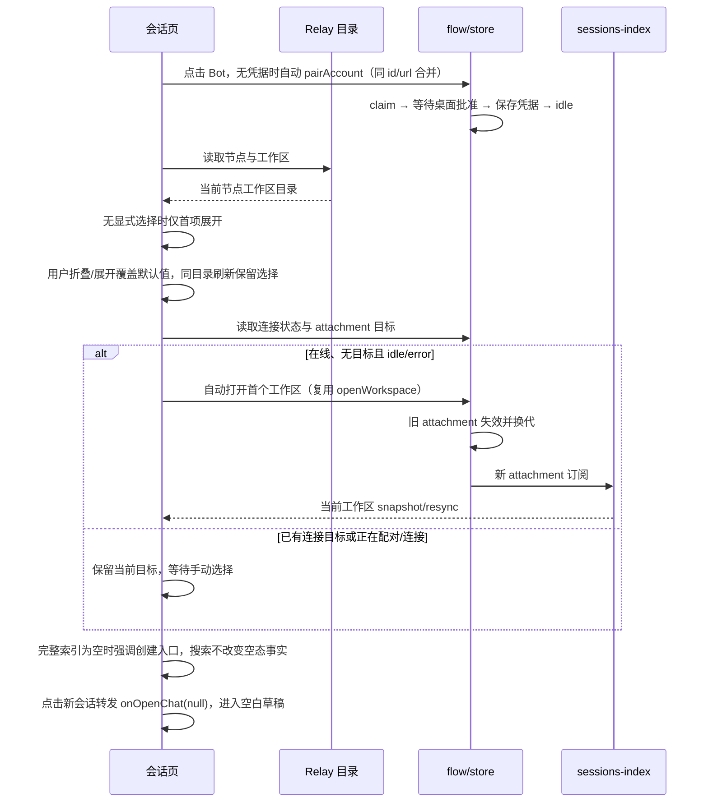

# 小程序会话页的工作区列表

## 产品规则

- KayingCode 会话页以工作区为主列表；节点选择放在顶部栏，显示当前节点名称与在线状态，点击后展开紧凑的节点选择菜单。节点选择右侧提供“刷新工作区”图标，设备管理入口排在刷新右侧；不在列表底部放整行刷新按钮。加载时刷新按钮禁用并显示加载状态，刷新沿用现有目录读取入口，保留节点、手动展开选择与已有 attachment。
- 首次加载及切换节点/Bot 后仅默认展开目录中的第一个工作区，其余收起；点击工作区标题可独立收起或展开。刷新同一目录保留用户的显式展开选择，打开工作区成功后展开该工作区。目录加载完成后，若所选节点在线、当前无 attachment 目标且连接状态为 idle/error，则自动调用现有打开工作区入口连接首项并加载会话，无需再点击“打开”。点击折叠箭头仍仅改变界面状态，不触发连接。当前工作区可新建会话，并展示按最近活动排序的前 5 条；“查看全部”在该工作区内展示全部会话，可再收起。搜索针对当前工作区的全部会话，搜索时展示所有匹配项。
- 移动端当前只有一个活动 attachment。会话索引只属于该 attachment 的工作区；未连接的工作区展开时显示“打开工作区后查看会话”，不能把当前工作区的会话或旧快照显示到其他工作区。打开其他工作区后由新连接的 snapshot/resync 填充列表。连接失败保留工作区列表与错误提示。
- 切换节点只切换工作区目录，不主动关闭已有 attachment。当前工作区如果不属于所选节点则不显示其会话。返回其节点后仍以当前 attachment 为准。刷新目录时保留有效的节点选择，过期请求结果不得覆盖新选择。
- 自动打开与目录读取属于同一次受代数保护的界面操作，使用同一 `openWorkspace` 写入路径；只有当前目录结果能发起自动连接。paired/connecting/pairing、保留目标的重连、离线节点、空目录及 ZCode 均不触发自动打开。每次有效目录读取最多尝试一次；连接失败不因状态变化循环重试，保留错误与“打开”按钮，用户可点击打开或刷新重试。异步打开结束后须确认目录代数仍有效，再更新本地提示、展开状态和 busy。
- ZCode 桥接路径维持其独立目录与连接语义；节点折叠和新会话入口仍只属于截图中的 KayingCode Relay 路径，但会话卡片的单行摘要展示规则由 KayingCode 与 ZCode 共用。
- “创建新会话”必须进入空白会话草稿，首次发送时再由现有发送链路创建服务端会话。入口通过聊天页 URL 的显式新会话标记表达，不能回退到上一次打开的会话。无参数旧链接或进程恢复仍允许回退当前会话，以保持兼容。
- 会话卡片的标题和摘要都必须保持单行且高度紧凑。摘要展示时去掉常见 Markdown 标记、列表前缀和换行并折叠空白；原始 `lastAssistantPreview` 不修改，仍用于搜索。空摘要回退为“工作中”或“空闲”。KayingCode 与 ZCode 列表使用同一展示规则。
- 工作区标题为弱背景分组栏，会话使用扁平两行列表：上方标题与最近活动时间，下方摘要；仅行间显示细分隔线，不使用嵌套卡片或额外左缩进。待处理状态保持可见，长标题、摘要和工作区名称单行省略，整行可点击进入会话。
- 当前工作区索引为空时，在分组下的会话列表内容区显示一条“新会话”操作行，包含突出的创建图标、标题及简短说明；整行可点击，分组标题栏不再重复创建入口，折叠后该行隐藏。已有会话时标题栏保留普通创建图标按钮，提供无障碍名称。搜索无结果不算空工作区，仍显示搜索提示；未连接工作区不提供创建入口。新建动作仍只调用 `onOpenChat(null)`。
- 从 Bot 列表点击 KayingCode Bot 直接进入会话页并发起连接；无凭据时自动发起首次配对，在会话页内展示等待电脑批准及失败重试状态，不要求先点击“开始配对”或“发送配对请求”。已有凭据直接加载目录并打开首个工作区。新增 Bot 后保留在 Bot 列表，由点击卡片发起连接；设备管理中的既有配对页入口兼容保留，但进入后自动发起，只有失败才显示重试。

## 状态与接口

- `flow/store.ts` 仍是当前 attachment 目标与代数的唯一所有者；`flow/sessionsIndex.ts` 仍是当前连接会话索引的唯一订阅者。`SessionTab` 仅保存节点菜单、目录、折叠、查看全部和搜索等界面状态。
- `loadCatalog`、`loadWorkspacesForNode` 读取现有目录；`openWorkspace` 是唯一切换工作区入口。不新增跨工作区的会话缓存或第二条写入路径。
- `SessionTab` 在有效目录提交后根据 `flow.getSnapshot()` 与 `flow.getAttachTarget()` 的即时值决定是否自动打开首项，不另存连接标记，不用定时器或监听 error 状态的 effect 重试。手动与自动打开共用同一回调，保留 flow 的 attachment 代数、owner/lease 和 stale-result 防护；协议及 desktop-continuous / web-remote-replayable 语义不变。
- `useWorkspaceOpening` 只封装打开回调与代数检查，不保存连接或 busy 的副本；展开、搜索、busy 和消息仍由 `SessionTab` 唯一持有。
- `useAccountPairing` 仅把稳定的 account id/url 和重试意图转发到现有 `pairAccount`，不保存配对事实。`pairAccount` 对同一 id/url 的并发调用合并为一个在途 Promise，凭据由 core 保存，连接状态仍由 flow 持有。当前 Bot 成功后刷新账户并恢复 idle，触发现有目录与工作区连接链路；失败不自动循环重试。切换 Bot 后，已批准的结果仍可保存到原账号，不能改写新选择的连接状态；原账号已删除或连接串已变更时丢弃旧结果，已有新凭据也不能被旧结果覆盖。
- 聊天页 URL 的构造与首次会话解析集中在一个纯函数模块。`chatPageUrl(null)` 生成带 `new=1` 的新草稿入口；聊天页优先识别该标记并得到 `sessionId = null`，有 `sessionId` 时解码后打开对应会话，两者都没有时才读取 `flow.getCurrentSessionId()`。
- Markdown 摘要是由 `SessionSummary` 派生的只读展示文本；归一化失败或结果为空时回退到会话阶段文案，不写回索引，也不建立独立缓存。
- `SessionTab` 持有工作区展开选择覆盖值；未操作的工作区按目录首项派生默认值，不用 effect 在刷新后强制重置用户选择。空态强调从当前 attachment 的完整索引派生，不从搜索结果派生。共享 `SessionListItem` 只展示摘要并转发点击，不持有会话状态。

## 事件顺序

## 验收场景

1. 微信小程序有多个节点时，顶部栏可选择节点；节点切换后工作区目录更新，旧请求晚到不覆盖当前选择，设备管理入口可用。
2. 首次进入会话页及切换节点/Bot 后仅首个工作区展开；目录晚到时仍正确默认展开。手动收起首项、展开其他项后刷新保持选择；打开工作区成功后该项展开。未连接项明确提示打开后查看，不展示其他工作区的会话。
3. 打开工作区后显示最近 5 条；点击“查看全部”显示全部，搜索能找到第 6 条及之后的会话，收起工作区后内容隐藏。
4. 切换工作区、重连或连接失败时，会话内容只属于当前 attachment；新快照到达前不显示旧工作区的列表。
5. 在已有会话之后点击“创建新会话”，聊天页标题为“新会话”且消息流为空；首次发送沿用现有链路创建会话。从会话列表进入已有会话仍加载目标会话。
6. 含 `**粗体**`、反引号、项目符号和多段换行的摘要显示为一行纯文本；标题与摘要不换行，会话卡片保持紧凑高度；空摘要仍显示“工作中”或“空闲”。
7. 新建会话、已有会话进入聊天页、刷新、配对与 ZCode 路径继续可用；深浅主题和窄屏下顶部选择与工作区操作不互相遮挡。
8. 当前工作区没有会话时，“新会话”操作行位于会话内容区，点击进入空白草稿；标题栏无重复入口。索引出现会话后恢复标题栏普通图标；搜索无结果保持普通图标。折叠空工作区会隐藏该操作行。
9. E2E：在窄屏深浅主题下加载多工作区，依次验证默认展开、手动切换、刷新保留、搜索无结果、空索引突出创建、创建草稿及点击已有会话；标题/摘要无换行、无水平溢出，列表行不被固定高度裁切。
10. E2E：以 idle、无 attachment 进入页面，目录晚到后自动打开在线节点首项且只调用一次；paired 后加载其会话或突出空态创建入口。刷新不重建已有连接；已有其他工作区目标或正在重连时不抢占；离线/空目录不连接。自动打开失败后显示错误及打开按钮，重渲染不会重复尝试，手动打开或刷新可重试。切换节点/Bot 或卸载后，旧目录不发起连接，旧打开结果不覆盖新目录的本地提示与 busy。
11. E2E：新增 Bot 后显示卡片，点击未配对 Bot 自动发起一次配对；无需额外发送按钮，桌面批准后自动显示首个工作区。等待期间重复渲染或重复调用不重复 claim；失败保留错误且仅点击重试才再次请求；已有凭据不再 claim；切换 Bot/更新连接串后旧请求不覆盖新状态。
12. E2E：320px 与 375px、深浅主题下，节点选择、刷新与设备管理不挤压遮挡；点击刷新图标只刷新当前目录一次且加载期间禁用，列表底部无刷新大按钮。空工作区创建行的整行与图标均可进入空白草稿，有会话与搜索无结果时入口位置正确。
