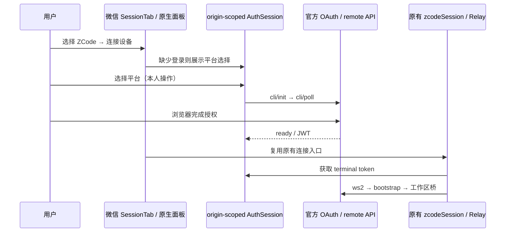

# ZCode V2 登录与连接

> 微信小程序恢复本规范的原生入口，H5 继续使用 [zcode-webview.md](zcode-webview.md) 的官方网页容器。小程序不以 WebView 失败作为自动切换依据，而是在构建目标上确定唯一入口。

## 平台入口与本次实测范围

- 微信 Bot 卡片选择 ZCode 后进入 SessionTab 的既有 ZcodeWorkspacePanel；连接按钮复用原有登录选择、OAuth 轮询、Relay V2 与工作区桥，不加载官方网页。
- 设备管理的微信 ZCode 按钮显示「连接」，按本地 accountId 路由到首页会话 Tab；不在路由携带设备 URL/JWT。首页校验档案存在且为 ZCode，失效档案不连接。
- 微信 ZCode 卡片展示真实原生 flow 连接阶段，H5 仍显示「官方网页」。切换原生 Bot 先释放旧连接再选择账户；H5 网页入口不触碰原生 attachment。
- 原生 flow 仍唯一拥有 socket/bridge 生命周期，AuthSession 按 origin 唯一拥有登录状态。登录页只展示授权状态；关闭、切换 Bot 后迟到结果不得自动连接其他账户。
- 真实验证先到登录平台选择页；用户选择与电脑相同的平台并在浏览器完成授权。未经本人授权结果不得写成登录成功；如被 request/socket 合法域名或真实 API 拦截，记录实际失败阶段，不改域名校验开关、不代理凭据、不恢复已退役账户服务。
- 回归：平台选择测试、小程序构建与 ES2019 检查、H5 网页 E2E、根 typecheck/lint/source/architecture；微信开发者工具实际查看原生面板、连接按钮和授权入口。真实账号登录、token、socket、bootstrap/工作区各阶段单独记录。

- 协议、状态所有者与事件顺序遵循 `packages/mobile-client-core/spec/zcode-relay-v2.md`。
- 保存新版 Bot 后仍显示列表。点击连接时如缺少该 origin 的登录，展示独立 ZCode 登录入口，用户选择与电脑相同的 Z.ai / BigModel。
- 小程序复制服务端登录链接，提示在浏览器中完成后返回；H5 同样提供可复制链接。不要求手工输入 JWT。界面按服务端间隔检查登录，并提供手动检查与重试。取消关闭只取消本次登录，不添加账户或连接。
- JWT 仅保留内存，不进入 Taro storage、账户 URL、导出、日志；冷启动重新登录。token 失效时重新展示登录；已有其他 origin 登录不复用。
- 登录成功回到同一个 Bot 的现有连接入口；切换 Bot/关闭页面使旧登录结果与自动连接失效。KayingCode.localrun 仍无账户系统，不恢复已退役 OAuth 服务。
- E2E：320/375px、深浅主题下检查平台选择、复制、pending/失败/取消/成功；成功后由原入口发起一次连接。授权浏览器与微信相机等外部环节如未实测须注明。

## 本次运行记录（2026-10-25）

- 微信构建成功并保留开发者工具现有本地项目配置。实际点击已有 ZCode Bot → 原生面板 →「连接 ZCode 设备」，已显示 Z.ai / BigModel 平台选择，未再进入 WebView。
- 独立 Node HTTP 探测官方 cli/init 返回 HTTP 200 / code 0，得到有效授权流程；按相同凭据轮询返回 pending。只记录状态与字段形状，未输出 flow id、poll secret、授权链接或 token。此探测不等于微信 request/socket 域名已经通过。
- Taro 83 项、mobile-client-core 187 项单元测试通过；H5 四组受控网页 E2E 通过。H5/weapp 构建、根 typecheck/source/architecture 通过，lint 为 0 错误、129 条警告。
- 用户完成本人账号授权后确认可以正常连接；开发者工具已观察到原生 ZCode Bot 显示「已连接」。这是开发者工具环境的真实授权/连接结果，真实手机网络、前后台恢复与完整会话操作仍需各自验收。
