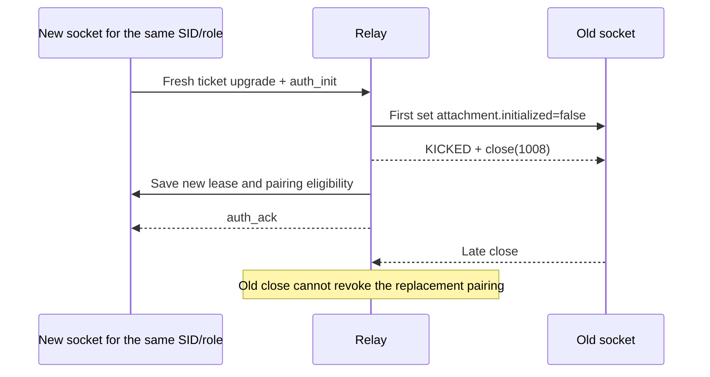
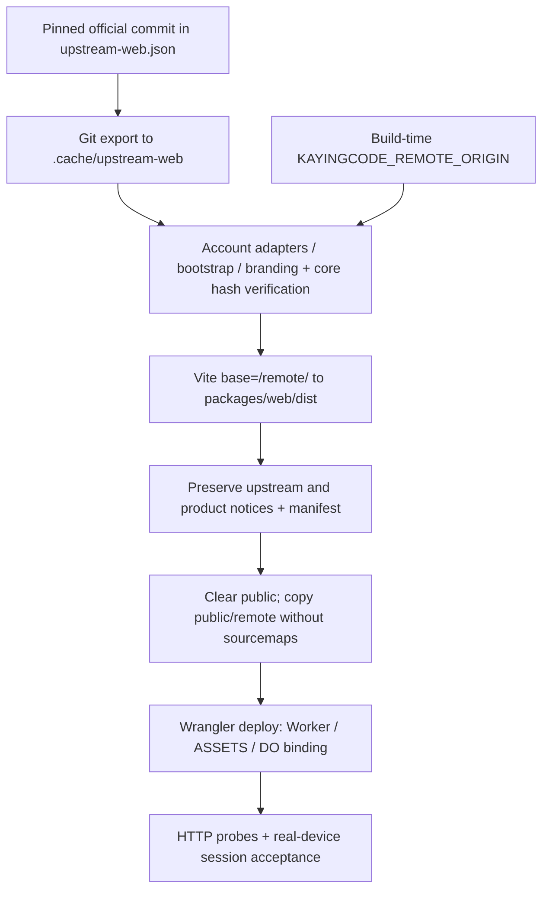

# Relay technical flows

[中文（默认）](FLOWS.md) | **English** · [Overview](README.en.md) · [Implementation](IMPLEMENTATION.en.md) · [Deployment](DEPLOYMENT.en.md)

Reviewed: 2026-11-07. Relay means the same WebRemoteRelayObject; Host means the existing Desktop window Host.

## User actions and automatic work

Users enable remote control, scan a QR code and use the workbench. Clients perform identity registration, invitation claim, credential storage, ticket acquisition and reconnect automatically. The technical messages below are not manual setup steps.

## 1. Initial authorization

```mermaid
sequenceDiagram
  participant D as Desktop credentials / remote manager
  participant R as Relay account and device owner
  participant W as Mobile Web adapter
  D->>D: Create and save owner secret first
  D->>R: Register; retry with the same secret
  R-->>D: Stable userId
  D->>R: Owner Bearer registers device_mid
  R-->>D: New device_sid
  D->>R: Owner Bearer creates invitation
  R-->>D: One-use invitation, five minutes
  D-->>W: Complete /remote/v4?sid=…#authorize=… link
  W->>W: Remove fragment first; retain sid
  W->>R: POST account/claim(invitation)
  R->>R: Consume invitation; store terminal digest
  R-->>W: Independent terminal credential, 30 days
  W->>W: Save browser session; load workbench
```

Owner registration is idempotent for a secret; device registration creates a new SID each time. The invitation is not a long-term credential. Its fragment is removed from page history. Reopening a used link does not deliberately discard an existing valid browser session. Failed claims prompt a fresh scan.

## 2. Tickets and handshake

```mermaid
sequenceDiagram
  participant D as Desktop device
  participant R as Relay
  participant W as Web terminal
  D->>R: Owner Bearer requests role=device ticket
  W->>R: Terminal Bearer requests role=terminal ticket
  R-->>D: One-use ticket, 60 seconds
  R-->>W: One-use ticket, 60 seconds
  D->>R: ws2?token=…&mid=… upgrade
  W->>R: ws2?token=… upgrade
  R->>R: Consume tickets before upgrade; assign leases
  D->>R: auth_init(device_sid, meta)
  R-->>D: auth_ack(waiting or matched)
  W->>R: auth_init(same device_sid)
  R->>R: Check account/SID; generate terminal_sid
  R-->>W: auth_ack(matched)
  R-->>D: pair_status_ack(matched)
```

Either role may connect first. The first waits; the second completes the pair. Failed upgrades also consume tickets. Waiting for a peer is not a task failure: check both roles, account, SID and Desktop availability.

## 3. Forwarding and business recovery

```mermaid
sequenceDiagram
  participant W as Mobile workbench
  participant R as Relay
  participant H as Existing Desktop Host
  participant C as CLI/runtime
  W->>R: data(JSON RPC payload)
  R->>H: Forward data; do not persist
  H->>C: Existing session and owner/lease routing
  C->>C: CommandInbox admission / run / snapshot
  C-->>H: Session events
  H-->>R: web-remote-replayable output
  R-->>W: data
  W->>R: pair_status_query
  R-->>W: pair_status_ack
  Note over W,H: After disconnect, obtain fresh tickets and handshake; request snapshot/resync from the same Host
```

Relay retains no disconnected-period business data. A missing peer produces DEVICE_OFFLINE without queuing or replay. It does not promise business exactly-once delivery. Host/runtime owns snapshots, ordering and stale-run protection. Desktop's original desktop-continuous path remains separate.

## 4. Replacement and revocation



Multiple terminals cannot occupy the same SID concurrently. Terminal logout removes that credential digest and closes its sockets; other independent terminal credentials remain separate. Owner device deletion removes the device and closes both roles for the SID. Reconnect requires a fresh ticket and authorization.

## 5. Build and deployment



Changing the external origin requires rebuilding Web. Deployment does not recreate accounts: use the same service configuration and object identity. Restore matching Worker and assets together. Code rollback is not DO data restoration.
