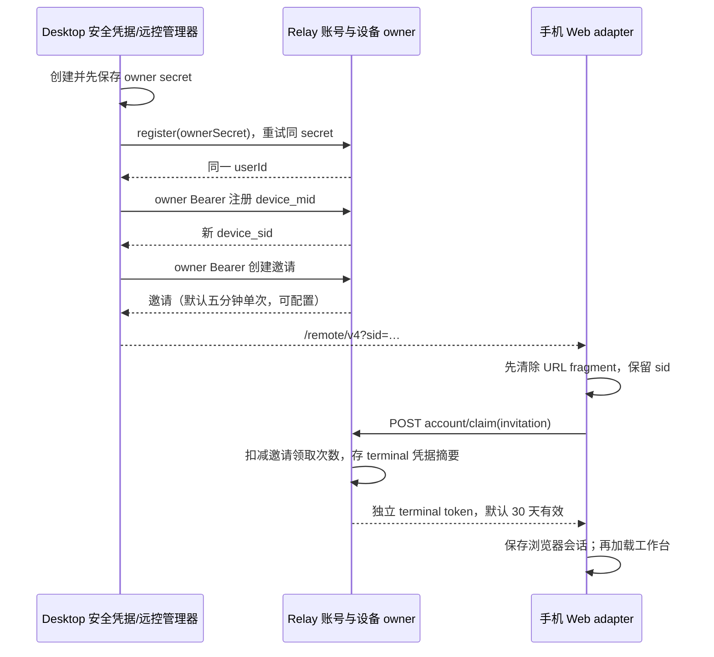
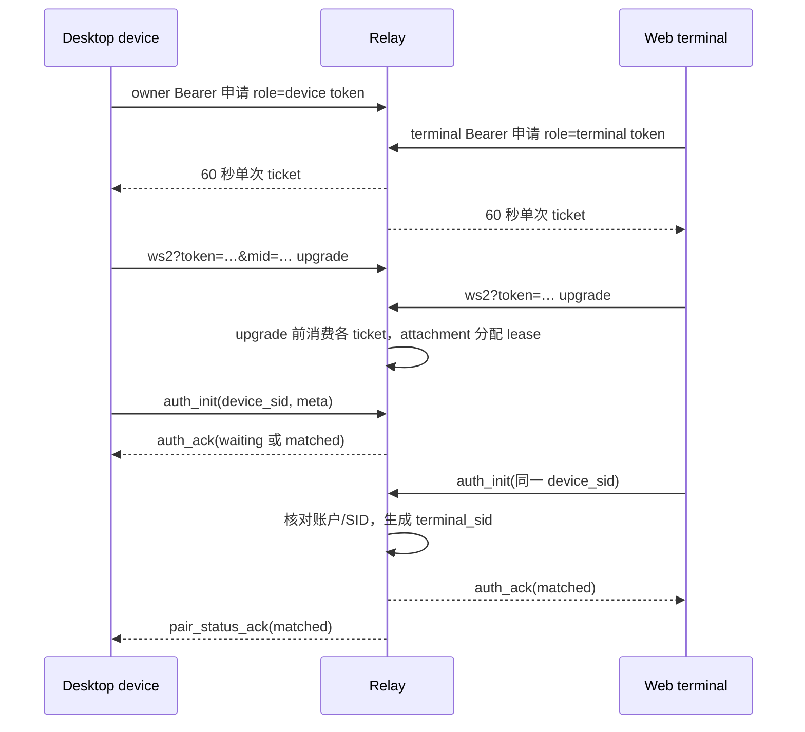
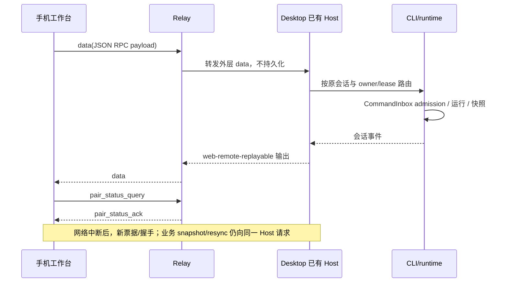
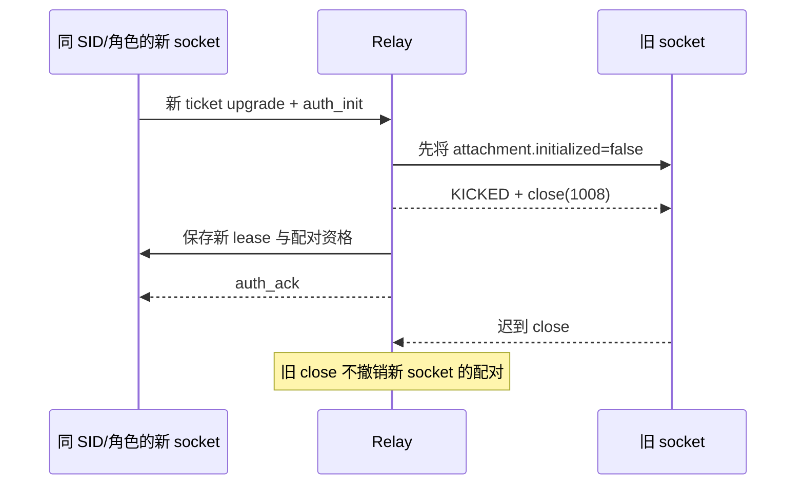
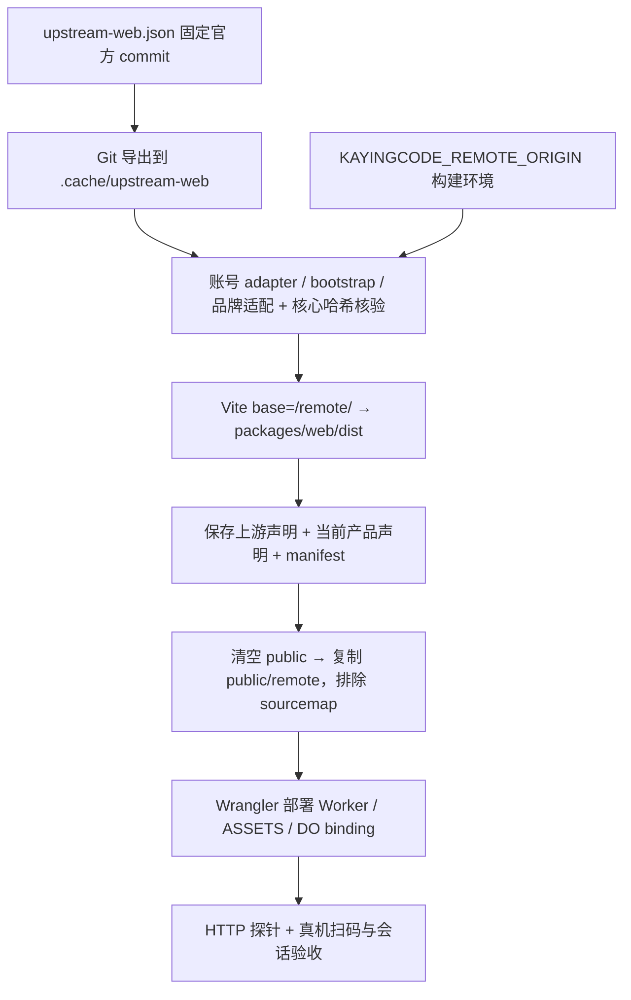

# Relay 技术流程

**中文（默认）** | [English](FLOWS.en.md) · [总览](README.md) · [实现](IMPLEMENTATION.md) · [部署](DEPLOYMENT.md)

核对日期：2026-11-07。图中 Relay 指同一 WebRemoteRelayObject；Host 指桌面已有窗口 Host。

## 用户操作与自动处理

用户只需开启远控、扫码并使用工作台。身份注册、邀请领取、凭据保存、连接票据获取及重连均由客户端自动处理。下文技术消息不是要求用户手工执行的部署步骤。

## 1. 首次授权

owner 注册按同一 secret 幂等，设备注册每次创建新 SID。邀请不是长期登录凭据；一次性 fragment 不再保留在页面历史中。浏览器已有有效会话时，重新打开已使用链接不会主动清掉旧会话。claim 失败会提供重新扫码提示。

## 2. 独立票据与握手

连接顺序可以反过来，第一端 waiting，第二端完成后 matched。ticket 在 upgrade 失败后也不能重用。鉴权成功但等待另一端，不等于设备或任务运行失败；先检查两端 role、SID、账户和 Desktop 是否仍在线。

## 3. 消息与业务恢复

Relay 不保存断线期间的数据。没有目标连接时返回 DEVICE_OFFLINE；不承诺重放或业务 exactly-once。手机恢复由 Host/runtime 的快照、顺序和 stale-run 防护完成。Desktop 原实时通道保持 desktop-continuous，不改成手机的恢复链路。

## 4. 换连接与撤销

同 SID 不支持多 terminal 同时占用。terminal logout 删除当前凭据摘要并关闭同摘要连接；其他独立 terminal 凭据不因此全部注销。owner 删除设备时删除记录并关闭同 SID 两种角色连接。重连必须重新取票据并重新鉴权。

## 5. 构建到部署

改变外部 origin 需要重新构建 Web。部署不重建账号；使用同一服务配置与对象身份。页面、Worker 与静态资源应作为对应版本一起恢复，代码回退不等于 DO 数据恢复。
