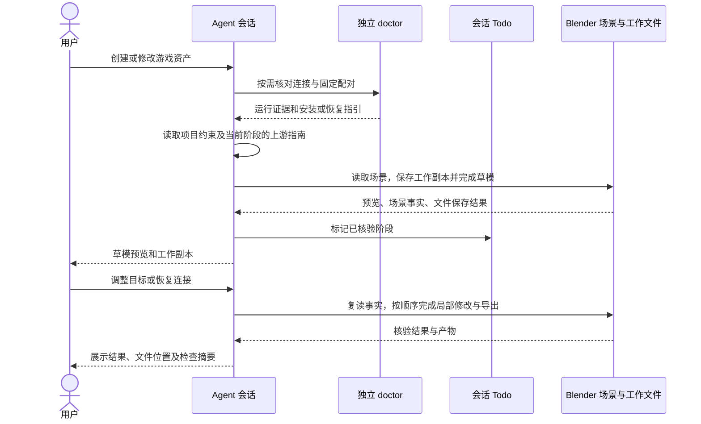

# KayingForBlender 优化评估与开发方案

| 项目     | 内容                                                                            |
| -------- | ------------------------------------------------------------------------------- |
| 状态     | 源码实现与本地回归已完成，制品和跨端实测见 [验证记录](verification.md)          |
| 评估基线 | 2026-11-18，KayingCode `main`（`cd604813`），内置上游 2.2.2 / protocol 14       |
| 同步目标 | mcp-for-blender 2.3.0 / protocol 16，`b6a2ce30c14636a562b5549684d9db6fc01f29ab` |
| 交付顺序 | 同一版本先同步上游，再在候选快照上完成效果与体验增量，一起验收                  |

## 交付目标

用户启用 KayingForBlender 后，能按诊断提示连上 Blender，从现有工作区或场景开始创建和修改资产，尽早看到真实预览并拿到可编辑的 `.blend`。Agent 根据项目用途检查尺度、枢轴、材质和动画等关键条件，按需导出 GLB，并用实际内容证明产物可用。用户中途调整目标或遇到断线时，可以接着修改同一份工作成果。

首版以通用游戏资产流程验收。复用现有插件 ID、默认关闭策略、官方目录、两个 stdio MCP、会话待办和 Host 链路。引擎导入验证仅在项目已有可用入口时执行。自动安装、专用 viewport、新编排器和引擎专属导出规则留作独立范围。

## 1. 先同步上游

- 用固定 SHA 导入服务端、add-on、`uv.lock` 与完整资源。继续由 [`upstream-lock.json`](../upstream-lock.json) 记录上游版本、commit、协议与文件哈希。官方发行登记沿用统一目录，插件发行版随本次交付升级。对照 [候选差异](https://github.com/ahujasid/mcp-for-blender/compare/5a3618fccb2d982d0dd61e7a1879912c3100073b...b6a2ce30c14636a562b5549684d9db6fc01f29ab) 审阅工具与资源、监听地址、生成能力和渲染默认值。
- 修正 [`sync-upstream.mjs`](../scripts/sync-upstream.mjs) 与 [目录测试](../test/mcp.test.mjs) 的仓库根定位。同步在干净的开发 worktree 内执行。修改前验证候选快照、第三方来源登记和生成依赖。失败用例应验证此次涉及的 vendor、lock、版本清单、来源登记和生成文件可恢复至同步前状态。许可证声明继续走已有生成与校验入口。
- 用平台路径构造测试期望，通过 Git 属性保留 vendor 原始字节。在现有 Windows Source checks 加入包内单测与快照校验，真实同步 CLI 覆盖成功、前置失败和生成阶段失败。
- 以候选版本验收配对握手、场景读取、`look`、保存和导出。用上游回归或隔离夹具验证[生成图片输入修复](https://github.com/ahujasid/mcp-for-blender/commit/38e47dcc28a6)、默认 loopback 和服务端遥测关闭。远程检查复用受保护的连接或隧道。生成服务的可用性继续以工具报告、凭据与费用授权为准。

## 2. 提升成品效果

### 按任务加载上游指南

2.3.0 有七篇[指南](https://github.com/ahujasid/mcp-for-blender/tree/b6a2ce30c14636a562b5549684d9db6fc01f29ab/src/blender_mcp/guides)，当前内置快照已完整保留这些文件。上游为评估暂停了 [`get_guide` 与 `guide://` 的注册](https://github.com/ahujasid/mcp-for-blender/blob/b6a2ce30c14636a562b5549684d9db6fc01f29ab/src/blender_mcp/server.py#L2124-L2126)。本轮在现有 [`blender` Skill](../skills/blender/SKILL.md) 增加主题索引，由 Agent 从实际加载的插件根 `vendor/mcp-for-blender/src/blender_mcp/guides/` 按需读取。vendor 与上游注册行为随快照同步。

| 任务信号                               | 优先读取          |
| -------------------------------------- | ----------------- |
| 草模、构图、对象与集合组织             | `scene.md`        |
| 材质、纹理、UV 贴图检查                | `materials.md`    |
| 面数预算、网格清理、重拓扑及烘焙       | `retopology.md`   |
| 骨架、蒙皮、权重与变形                 | `rigging.md`      |
| Action、关键帧、循环与动作交付         | `animation.md`    |
| 玩家尺度、模块拼接、关卡草模与碰撞需求 | `level-design.md` |
| `bpy` 脚本编写或 API 兼容性判断        | `bpy.md`          |

连接诊断仅使用 doctor。创作阶段先读最相关的一篇，跨阶段确有需要时再补读。通过执行主机上的文件读取工具访问实际加载副本。使用含空格的 staged 路径验收定位；远程 Blender 场景继续通过 MCP 操作。指南读取失败时，保留已有工具能力并明确缺失的参考内容。

### 从项目约束出发，用预览纠偏

- 修改前读取工作区约定、当前场景和目标对象。优先采用用户明确要求，其次沿用项目单位、比例、风格、命名、导出路径及格式。只在缺少会影响交付的约束时询问；其余假设在本轮任务中简短说明。
- 已有场景先保存工作副本。在同一目标对象或集合内分阶段编辑，保留无关资产、材质和动画。以尺寸、轮廓、材质或代表性姿势等可观察目标组织每轮细化。
- 2.3.0 的 `look` 默认走真实渲染。草模显式指定 `solid`，材质核对按需使用 `material`，最终再用实际渲染。纠偏前后尽量复用视角与取景范围；动画用关键帧拼图核对姿势，支持图像输入的模型可据此修正具体缺陷。尺寸、面数和帧范围由场景查询给出。

### 把资产验收固化为只读检查

优先复用上游场景查询，缺少确定性检查时在插件适配层提供小型、可测试的只读检查逻辑，通过现有 Blender MCP 获取场景事实。输入包括目标对象或集合、资产类型、项目明确的约束与导出范围。每项输出对象或资源标识、检查项、实测值和状态（通过、需修正、未验证）。面数预算、尺寸容差和引擎导入条件随项目或用户要求确定。

| 资产类型   | 代表性检查                                                |
| ---------- | --------------------------------------------------------- |
| 静态道具   | 尺寸、枢轴、三角面数、材质和纹理引用                      |
| 模块化场景 | 单位、模块尺寸和拼接位置，项目要求的碰撞数据              |
| 动画资产   | Action 名称与帧范围、代表性姿势，必要时检查绑定或动画导出 |

交付回传真实预览、工作副本路径、请求的导出和检查摘要。以可复读为准，发布验收在隔离上下文打开 `.blend` 核对目标对象、材质和 Action，并将 GLB 导入空场景验证预期内容。项目存在可用的引擎验证入口时补做导入检查，结果按实际覆盖记录。

## 3. 提升使用体验

### 启用后给出下一步

复用独立 [`blender_doctor`](../commands/blender-doctor.md)。诊断优先给当前阻塞项、证据与一个可执行的下一步，并提供对应执行主机上已校验的随包 `addon.py` 绝对路径。区分随包期望版本、磁盘发现的副本和运行实例握手报告的版本、协议。磁盘和运行结果不一致时引导核对正在运行的 Blender 并重启复查。握手超时时保留未验证状态。KayingCode 工作流统一向用户展示固定随包副本的安装步骤，主 MCP 的能力信息继续用于选择工具。

首次安装继续使用 Blender 的 Install from Disk。远程场景标明随包文件所在主机及 Blender 安装目标。主 MCP 因 uv 或 Python 启动失败时，正式安装包里的 `/blender-doctor` 仍应可用。独立 doctor 的配对证据用于首次使用和断线恢复后的继续判断；握手匹配代表协议吻合。

### 用户尽早看到可继续编辑的结果

复用会话 `TodoWrite` 表达草模、细化、动画和交付等阶段。第一条更新说明本轮具体目标和首个可见成果。用户在精细化之前收到真实草模图与可打开的工作副本。每个阶段按实际工具结果和核验更新；聊天直接呈现预览、已保存文件和下一步。用户提出调整时，Agent 在核实当前步骤结果后更新后续目标，保留已验收的部分。

### 中断后续做

写操作超时或断线后先核对 Blender 当前文件、目标对象、已落盘成果及当前任务约束，再确定剩余步骤。执行结果仍未确认时暂停依赖该结果的写入。模型退避、Blender 执行与待核验分别使用各自的真实状态。手机复用桌面已有 Host 和恢复链路；产物位置明确标注所在主机。

Blender 持有场景和实际加载的 add-on，上游 MCP 管理进程内连接与 socket 锁，doctor 每次读取诊断证据。会话 Todo 负责进度投影，文件以实际保存结果为准。Desktop continuous 与手机 replayable 沿用既有交付链路，远程按既有 workspace identity 路由。当前会话按完成顺序修改同一场景，重连后重新确认场景与目标。

## 4. 验收与开发入口

主验收走一次真实 KayingCode Agent 会话，从实际 staged 制品完成手动安装。起始场景提供一扇带开门 Action 的模块门和一个无关对象。收到工作副本与首张预览后，用户要求加宽门体并保留开门动画。修改期间断线一次，再恢复并交付。预先约定门体尺寸、枢轴与关键帧，用输入、实际预览、场景检查及复读证据判断结果。

| 场景               | 完成条件                                                                                                                 | 证据                                             |
| ------------------ | ------------------------------------------------------------------------------------------------------------------------ | ------------------------------------------------ |
| 固定快照同步       | 2.3.0 的两端、锁文件与来源登记一致；CLI 成功和失败路径通过；Windows checkout 后字节校验通过                              | CLI 回归、快照校验、Windows Source checks        |
| 首次安装与配对恢复 | 从实际路径安装，默认地址可握手；缺 uv、缺 Python、单边升级、磁盘与加载状态不同可得到对应指引；重启或恢复随包版本后可复查 | staged 安装记录、Desktop 安装包冒烟、doctor 输出 |
| 指南按需可用       | 七篇均随包交付；动画或拓扑任务实际读取相关主题；单纯连接诊断无需加载指南                                                 | 制品清单、真实会话工具记录                       |
| 预览、纠偏与导出   | 草模图和可打开的工作副本先交付。加宽后核对尺度、枢轴、已有 Action 与无关对象。复读 `.blend`、导入 GLB 并核对结果         | 同视角预览、检查输出、文件和导入记录             |
| 恢复与跨端         | 中断后正确辨认已提交修改和已有产物；继续剩余阶段，无重复门体或覆盖。以手机接续时记录已有 Host 上的恢复与可见状态         | 真实会话、场景与文件检查、手机接续记录           |

效果记录包括资产检查通过项、人工返工项与原因。体验记录包括从启用到首次连通的操作数、从发出创作请求到首张有效预览的耗时，以及中断后是否需要用户重述目标。以完成上游同步、应用本轮 Agent 优化前的工作流为对照，使用同一模型、设备、起始场景和提示词，记录实际数值与样本数。固定脚本 GUI 测试用于回归场景工具链，真实 Agent 会话用于验收指南选择、目标调整与恢复。

### 已有证据与待验收项

- 在当前 2.2.2 基线和 Node 24.14.0 上，快照校验通过，真实 Python MCP 连接模拟 add-on 的测试通过。包内单测 9 通过、1 失败，目录定位失败已复现。另在临时 checkout 复现 CRLF 导致的校验失败，在隔离夹具复现同步 CLI 退出失败后版本已改变。
- 既有 [验证记录](verification.md) 包含真实 Blender GUI 工具链验收。正式安装路径、候选 2.3.0 运行结果、真实 Agent 主验收、Windows/Linux Blender 实机与手机接续待验证。验收记录需标明系统、Blender 版本、插件 SHA、模型和制品类型。

开发先更新 [集成规范](integration.md) 的配对、安装、指南和检查接口，再更新 [创作规范](creation-progress.md) 的阶段证据和恢复规则。通过现有包命令运行 `verify`、`test`、`test:upstream`、`test:blender`，并执行仓库要求的目录、架构、类型和 Lint 检查。快照或发行元数据有变化时复用官方目录、源码图与第三方声明生成入口，将运行结果记入 [验证记录](verification.md)。
