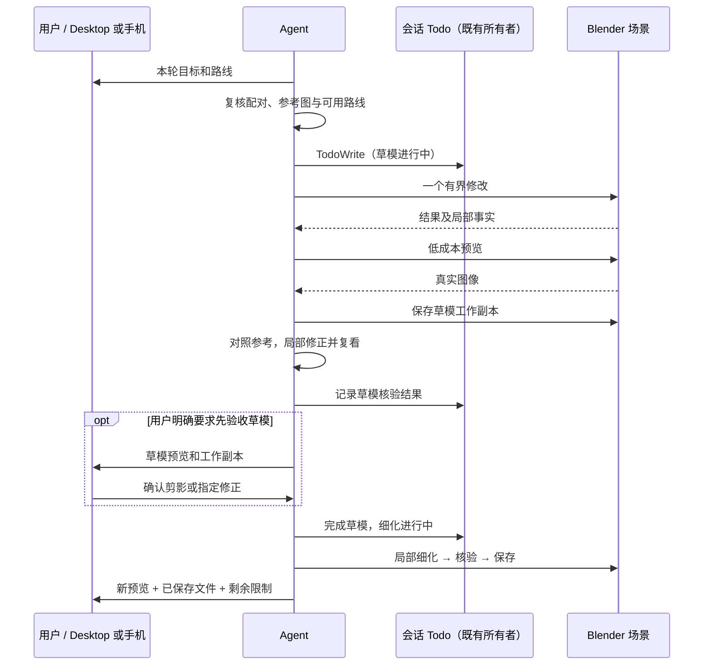

# 分阶段创作与进度反馈

## 产品规则

- `/blender-from-reference [目标]` 通过现有自定义命令传递用户参数，要求加载同插件 `blender` Skill。配对和生成能力在第一笔写入前检查。默认由 Agent 在同一轮完成可安全执行的创作、核验与交付。Blender 场景、工作副本和会话进度沿用现有所有者。
- 草模是内部验收。先完成参考取景、姿势、比例和剪影，渲染同向预览并保存工作副本。人物先核对肩胯方向、手脚、重心及有辨识度的发型和服装轮廓；其他资产先核对尺度、主要体块和缺口。Agent 对照参考、局部修正并复看，随后直接进入可继续的细化。仅在用户明确要求分阶段验收时，按约定提交草模并等待反馈。
- 参考图工作流通过已配对 Blender MCP 写入。到达参考选择或只读核验阶段时可以使用已有本地工具；通过后台 Blender 从头重建不属于该入口的创作路线。现有资产和经用户授权的图生 3D 候选也先过剪影与姿势核验。
- 开始参考图或指定角色任务时，先给出目标、容许的风格偏差和 3–5 项可对照的特征。用一次有界的素材检索取得主参考，并确认当前模型实际收到图片。较长的资料研究与 Blender 准备可使用现有独立只读能力，首张可用参考到手便推进，只有缺少关键视角或证据时补搜。
- 在第一笔写入前运行 doctor，通过配对后读取 `get_addon_status` 的实际生成/素材能力。结合已有可编辑资产、可行的本地建模方法及用户已授权的生成服务选择路线。生成服务关闭或未授权时，直接采用可行的本地方案。局部可逆写入能推进任务时，先完成有用成果并在交付时披露质量限制。只有缺少无法替代的关键输入、现有工具要求的授权或必须由用户处理的阻塞时才询问。
- Agent 自行核对轮廓、比例、识别特征和姿势，再在最终预览复核色彩和材质。主要特征存在差距时，只修对应对象或集合并复看；仍不足时完成可独立验证的后续工作，按实际结果交付并标明差距。最终交付带实际参考、同向预览、文件及检查结果。只读资产检查和文件复读单独核验可编辑性、材质、动画和导入。
- 多阶段创作复用会话 `TodoWrite`：能力检查、草模预览、局部细化、动画验证、保存交付；按任务删减为 3–5 项，只有一项进行中。不以脚本行数、等待时长推算完成百分比。
- 第一段长脚本前简短说明本轮目标和路线。先做轮廓与比例并用真实预览核验。普通创作可用简单材质交代体块，参考图入口先检查剪影再细化材质。精细建模、动画和最终渲染分阶段执行。
- 阶段只有在工具返回并核验后完成，默认接着运行下一阶段。长任务可发简短进度；用户主动给出新要求时调整未完成项，保留已验证成果。
- 精细化请求先依据当前场景/一张当前预览选出 2–3 个可观察目标，说明默认优先级并继续。默认一轮实现、一轮纠偏后交付当前成果；仍有明显缺陷则标注未完成并说明下一步，不继续开放式微调。用户要求更深入时继续追加明确阶段。
- 一个脚本只处理一个阶段或局部，优先使用数据 API；工具回传必要事实，避免整场景 dump。每阶段最多一张组合预览，只有新视角/错误证据需要时追加，不重复 Read 已看过的图片。动画预览用关键帧拼图。
- 可选进度写明“已完成什么、接下来做什么”。在最终交付或用户明确要求的阶段展示工作副本路径和预览。进度来自实际工具结果，Skill 无法在模型没有输出时自行定时发送。
- 网络重试由宿主已有模型重试投影展示，Blender 超时由 doctor/场景重读确认；不把二者混为一谈，也不因 UI 等待重放 Blender 写操作。
- 优先采用用户明确给定的资产要求，沿用项目或现有场景中的单位、命名、材质风格和导出约定。已有场景先保存工作副本，并保护无关对象与已有 Action。草模 `look` 显式使用 `solid`，材质检查按需使用 `material`，前后复用视角。关键帧图和只读资产检查共同作为阶段证据。
- 写入超时或连接恢复后，先核对当前文件、目标资产、保存和导出结果，再提交依赖前一步的修改。按用户请求的对象或集合导出。导出需临时改变选择时，操作结束后恢复选择与活动对象。交付优先给真实预览、工作副本、请求的导出与检查摘要，并标明远程文件归属主机。

## 所有者与事件顺序

Blender 保持场景事实的唯一所有者，Todo 仅表达步骤；不新增调度器、队列或持久化状态。Todo 与反馈沿既有 Desktop continuous / 手机 replayable 链路传递。丢失连接后先重读事实；用户改目标不会使已完成写入自动回滚。

## 验收与限制

1. 新建模型的草模在细化前可预览，且存在有效 `.blend` 工作副本。无阻塞时，预览、修正、细化和交付在同一轮完成。
2. 继续细化：保留场景和动画，对具体目标局部修改，一轮实现及最多一轮纠偏后返回当前结果，不能把所有待办标为完成掩盖缺陷。
3. 动画：预览关键帧而非只看静帧，完成状态来自实际 Action/帧范围及保存结果。
4. 请求恢复不重复建模，新增文字与状态不能伪称 Blender 正在计算。
5. 真实 Blender GUI 测试验证草模预览/检查点 → 局部细化 → 动画关键帧预览 → 保存导出顺序及产物。该测试不调用模型，不能证明模型必然遵循 skill，也不构成耗时承诺；需要后续真实会话观察。
6. 实际 Agent 会话从 staged 制品启用，修改已有开门动画的模块门。中断连接后重新核对场景并继续，保留 Action、枢轴和无关对象，复读 `.blend` 与 GLB。记录首次连通操作数、首张有效预览耗时、人工返工和恢复是否需要用户重述目标。
7. 指定角色复测覆盖旧协议、所有生成器关闭、可用且已获授权的生成器三种起点。记录草模与终稿的视觉核验结果、局部写入范围、资产检查及复读。生成服务关闭时验证本地路线可以直接推进，未达到目标时交付当前成果和具体差距。
8. `/blender-from-reference` 通过插件命令目录发现并在展开提示中要求使用 `blender` Skill，保留用户目标。实际模型复测覆盖默认同一轮交付、用户明确要求草模确认以及存在真实阻塞三种情况。常规草模进度无需用户回复；用户只要求草模时以草模为交付目标。
