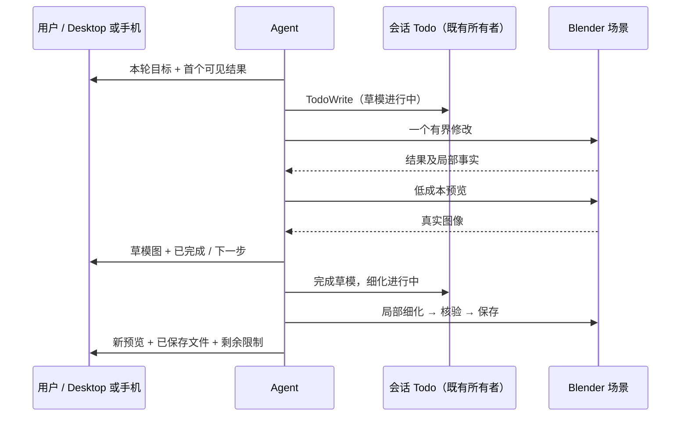

# 分阶段创作与进度反馈

## 产品规则

- 多阶段创作复用会话 `TodoWrite`：能力检查、草模预览、局部细化、动画验证、保存交付；按任务删减为 3–5 项，只有一项进行中。不以脚本行数、等待时长推算完成百分比。
- 第一段长脚本前先说明本轮目标、阶段和首个可见结果；草模先做轮廓/比例及简单材质，立即给真实预览，不将精细建模、动画、最终渲染塞进同一次调用。
- 阶段只有在工具返回并核验后完成。先展示结果，再开始下一阶段；不每步要求用户确认。用户的新要求调整未完成项，保留已验证成果。
- 精细化请求先依据当前场景/一张当前预览选出 2–3 个可观察目标，说明默认优先级并继续。默认一轮实现、一轮纠偏后交付当前成果；仍有明显缺陷则标注未完成并说明下一步，不继续开放式微调。用户要求更深入时继续追加明确阶段。
- 一个脚本只处理一个阶段或局部，优先使用数据 API；工具回传必要事实，避免整场景 dump。每阶段最多一张组合预览，只有新视角/错误证据需要时追加，不重复 Read 已看过的图片。动画预览用关键帧拼图。
- 阶段反馈写明“已完成什么、接下来做什么”；保存有效工作副本后尽早给路径。不能承诺固定耗时、伪造预览，不能在模型无输出时声称可由 skill 定时发送进度。
- 网络重试由宿主已有模型重试投影展示，Blender 超时由 doctor/场景重读确认；不把二者混为一谈，也不因 UI 等待重放 Blender 写操作。

## 所有者与事件顺序

Blender 保持场景事实的唯一所有者，Todo 仅表达步骤；不新增调度器、队列或持久化状态。Todo 与反馈沿既有 Desktop continuous / 手机 replayable 链路传递。丢失连接后先重读事实；用户改目标不会使已完成写入自动回滚。

## 验收与限制

1. 新建模型：精细化前已能看草模，且存在有效 `.blend` 工作副本；修改/预览/交付按顺序完成。
2. 继续细化：保留场景和动画，对具体目标局部修改，一轮实现及最多一轮纠偏后返回当前结果，不能把所有待办标为完成掩盖缺陷。
3. 动画：预览关键帧而非只看静帧，完成状态来自实际 Action/帧范围及保存结果。
4. 请求恢复不重复建模，新增文字与状态不能伪称 Blender 正在计算。
5. 真实 Blender GUI 测试验证草模预览/检查点 → 局部细化 → 动画关键帧预览 → 保存导出顺序及产物。该测试不调用模型，不能证明模型必然遵循 skill，也不构成耗时承诺；需要后续真实会话观察。
