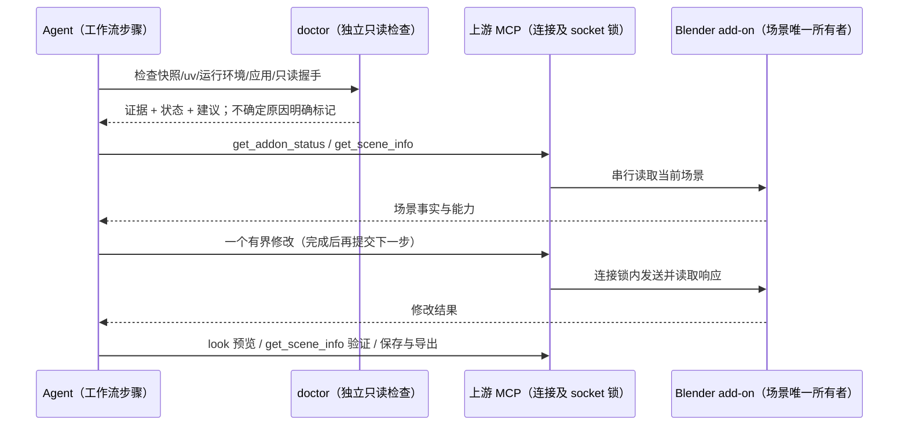

# KayingForBlender 内置插件

## 规则与边界

- 插件名 `blender`，通过 `config/official-plugins.json` 随应用播种；默认关闭，由用户按需启用。无需添加远程市场或重复登记 MCP。
- 插件展示名称在中英文界面统一为 `KayingForBlender`；保留 `blender@kayingcode-plugins-official`、包名和 MCP 名称，复用已有安装、启用状态及数据目录。
- `vendor/mcp-for-blender` 是 ahujasid/mcp-for-blender 的原样快照；commit、包版本、add-on protocol 和每个文件 SHA-256 由 `upstream-lock.json` 记录。服务端及 add-on 必须来自同一快照。保留原始 MIT 许可。
- 适配层不修改上游工具、资源或 MCP Apps 协议。MCP `blender` 用 Node 启动固定项目，uv 使用随快照分发的 `uv.lock`，在缓存中的源码副本构建，并使用独立缓存虚拟环境；首次准备 Python/依赖可能需要网络。启动不得执行上游 setup/update、修改其他客户端配置或自动安装 add-on。
- 独立 MCP `blender_doctor` 使用 Node 内建模块，在 uv/Python/Blender 缺失时仍能诊断。CLI 与 MCP 使用同一个诊断实现。doctor 只读，不安装、不清缓存、不执行 Blender Python、不触发付费服务。
- 本地进程、uv 解析、缓存、连接诊断属于插件适配层；工作流通过 skill/command 指导 Agent 调用既有上游工具，不在 Renderer/Main/Host 创建另一条任务队列。
- Python 入口 `scripts/server.py` 在导入上游前提供仅含 `enabled=False` 的 `blender_mcp.config.telemetry_config`，并强制 `DISABLE_TELEMETRY=true`。固定上游的 Git 源码忽略了私有 config.py，但状态工具仍直接读取它；此适配消除源码发行缺口，不写 vendor/已安装 Python 包，不提供采集地址、凭据或启用遥测的路径。更新上游后用真实 MCP 回归验证兼容性。

## 所有者及事件顺序

- 上游持有每个服务进程的连接与 socket 串行锁；Agent 不并发修改同一场景。Blender 场景为唯一事实来源，聊天中的计划只是步骤描述。
- KayingCode 维护固定配对边界。插件 Python 入口复用已固定上游连接的发送锁，在当前实际 socket 上校验 add-on 协议后才派发可写命令。成功握手只对该 socket 有效，重连重新核对。旧版、新版或无法验证的连接可做已知只读诊断，写入返回错误并指向 `/blender-doctor`。上游快照、注册工具、资源和授权协议继续原样同步。
- 写入超时/断线不等于未执行：停止后续修改，重新读取场景确认结果，不自动重放非幂等操作。doctor 的独立短连接只发送 `get_addon_info`，不参与业务写入。
- 本地与远程 Agent 的依赖和 Blender 在 MCP 执行主机上检查；手机复用已连接桌面 Host，不创建新的 Blender runtime。Desktop 连续流/手机可恢复流复用现有 Agent 路径，不新增 stream/snapshot/queue。
- 不缓存诊断为服务端事实，每次重新检查。忙碌/超时只表示未能验证，不能推断 Blender 没安装或 add-on 没启用。

## 上游指南与资产检查

- 发行目标为 mcp-for-blender 2.3.0 / protocol 16 的固定快照。复用上游已注册的工具与 MCP Apps 资源，按上游状态保留指南的 MCP 注册行为。Agent 按 [Blender Skill](../skills/blender/SKILL.md) 的主题索引，通过插件实际副本读取七篇原样指南；诊断任务只走 doctor。阶段内先读最相关的一篇，后续按需读取。找不到相关指南时继续使用已有工具，并注明缺失资料。
- 通过会话现有文件读取能力取得插件适配层的只读检查脚本，在 Blender 所在主机经现有 `execute_blender_code` 运行。输入为明确命名的对象或集合及可选项目约束，输出 JSON 检查事实与 `pass`、`needs-fix` 或 `unverified`。检查范围仅包含选定资产，读取物体尺度、世界空间枢轴、评估网格三角面数、材质与文件纹理、活跃 Action 与帧范围。不推断未给定的预算或动画要求。模块化资产以项目明确的尺寸、摆放要求和碰撞对象为准。代表性姿势通过 `look` 关键帧核对。
- Blender 保存场景事实。检查只读取有效场景与必要文件状态，不修改帧、选择、模型或文件，不另建 MCP、队列或持久化状态。工具输出中的文件路径归属 Blender 主机。发布验收在隔离进程复读 `.blend`，在空场景导入 GLB 并核对对象、材质和动画。
- `inspect_asset(..., require_camera=True)` 用于带渲染交付的工作副本，在检查输出中报告当前场景的 `active_camera`。缺失活动相机或相机不属于当前场景时返回 `needs-fix`，默认调用维持原有报告。保存前分配交付机位，复读后确认活动相机与该机位一致。外部纹理是否需要随包或打包按用户交付目标检查。
- `requirements` 在读取场景前校验：向量字段固定为 3/3/2 个有限数值，`max_triangles` 为非负整数，材质为非空名称列表，`action` 为非空字符串；`unit_scale` 为正有限数，`tolerance` 为非负有限数。非法输入返回带字段名的 `ValueError`，不触碰场景、选择或帧。

## doctor 接口及失败语义

- CLI：`node scripts/doctor.mjs`；输出 JSON，`ready` 为 false 时退出 1。
- MCP：`blender_doctor`，无参数，返回相同结构，包括 `ready`、`checks[]`、每项 `id/status/evidence/suggestion` 和固定上游信息。
- `installation` 在快照验证通过时提供已校验的 `addonPath`、`pluginRoot`、预期 `addonVersion`、`protocol`、`executionHost`，以及只读发现的 `blenderExecutable`、`blenderVersion` 和当前版本目标 `addonsDir`（未发现时为 `null`）；否则为 `null`。`target` 提供实际握手目标 `host`、`port` 及远程标记；地址配置无效时为 `null`。`addon-files` 的 `installed` 为本地扫描到的磁盘副本及声明版本，`addon` 的 `running` 为有效 `get_addon_info` 响应报告的运行版本和协议。较旧和较新的协议均指向对应执行主机上的随包副本。通过握手可确认协议吻合，文件身份以单独的快照校验和磁盘证据解释。
- `nextAction` 按检查结果给出一个下一步：`ready`、`restore-snapshot`、`install-uv`、`prepare-python-runtime`、`fix-connection-config`、`install-addon`、`restart-blender`、`open-blender` 或 `fix-connection`。它只描述只读诊断后的建议，不执行安装、下载或配置写入。
- 检查快照完整性、uv（包括 GUI PATH 缺失时的标准安装位置及显式路径）、缓存 Python 和锁定依赖、Blender 可执行文件、端口配置、add-on 握手及协议一致性。
- `KAYINGCODE_BLENDER_UV`、`KAYINGCODE_BLENDER_CACHE`、`BLENDER_EXECUTABLE` 支持显式主机配置；`BLENDER_HOST/BLENDER_PORT` 与上游保持一致。非法端口在连接前失败，不静默回落。远端地址提示依赖所属主机及隧道边界，不因本地未找到 Blender 误判远端未安装。
- 检测拒绝连接、DNS/网络错误、握手超时/断开、非 JSON 或其他服务响应、旧/新协议、缺少 Python 依赖、文件丢失/篡改；建议必须对应证据。默认禁用服务端 telemetry。
- 生成效果诊断沿用 `/blender-doctor` 的只读流程。按本次会话获取路径、真实工具结果、参考和预览图片、已有脚本、产物及时间点。区分不可用与未验证，分别归因连接与配对、输入与能力、建模及材质、渲染与交付验收。只读取相关数据，保留用户产物和应用运行状态。

## 显式安装入口

- `/blender-install` 与独立 MCP `blender_setup` 的 `blender_install_addon` 把随包 add-on 安装并启用。只有用户显式调用命令并确认后才写入；插件启用、会话启动、doctor 和任何后台流程都不自动安装。默认 `dryRun`，`confirm=true` 才允许写入。
- 安装器只读取并写入当前执行主机的 Blender 用户配置：校验随包快照后复制固定字节到目标 addons 目录，覆盖前保留 `.bak`，复制后核对 hash；再以 headless Blender 调用 `addon_utils.enable`，仅在 `savePreferences=true` 时保存用户偏好。启用进程读取用户偏好但禁用 `.blend` 自动执行脚本（`--disable-autoexec`），不使用会覆盖偏好的工厂启动。不联网、不执行上游 setup/update、不修改项目文件或其他 MCP 客户端配置。
- Blender 正在运行、目标为远端 `BLENDER_HOST`、找不到可执行文件、Blender 版本目录尚未初始化或发现 extensions 目录中的既有副本时拒绝写入，并返回具体阻塞项和手动步骤。新 Blender 版本尚未首次启动时只报告需要先打开一次，不写入偏好，避免吞掉设置迁移选择。
- 多版本共存时以 `BLENDER_EXECUTABLE` 或可发现的 Blender 版本为准，只处理该版本目录；切换版本后重新安装。安装成功返回 `blender`、`target`、`enabled`、`savedPreferences`、`needsRestart`、`blockers` 和 `nextAction`，不把“文件已复制”表述为“服务已连接”。
- add-on 默认 `auto_start_server=True`；安装并启用后，用户打开或重启 Blender 即会自动监听。只有用户曾停止服务、端口冲突或旧场景保存了关闭状态时，才需要在 3D 视图 N 面板重新点击连接，随后由 doctor 验证握手。
- 远程 Blender 主机不通过本地安装器写入；把随包 add-on 交到执行主机，或在目标主机运行同一安装脚本后再由 doctor 验证。

## 上游更新

- 维护者运行 `scripts/sync-upstream.mjs --source <干净本地 checkout> --ref <commit/tag> --plugin-version <version>`，固定读取 Git commit 的白名单内容，不联网、不执行上游安装脚本。
- 提交前校验项目结构、add-on 副本一致、uv.lock 对应包版本、协议字段、许可证登记和生成入口。验证成功才替换 vendor 并刷新 hash、版本、来源登记及生成目录。普通读写或生成失败时恢复本次涉及的文件，保留原快照；同步在专用开发 worktree 串行执行。适配代码、doctor、skills、commands 保持独立。Git checkout 保留 vendor 原始字节。
- `verify` 发现快照不一致时列出路径并区分缺失、额外、真实改动和仅 CRLF 的检出漂移。CRLF 漂移通常来自 Windows 旧分支检出：提示删除对应文件后重新 checkout，不修改 lock、不放宽字节校验。其他不一致要求恢复内置快照或重新同步。
- 不在用户启动时拉取 HEAD/更新 add-on。用户手动在 Blender 内升级导致协议偏离时，doctor 提示使用随包 add-on 或升级整套内置插件。

## 验收

1. 内置目录、清单生成、脚本与 vendor 进入打包白名单；禁用时不会启动 Blender/下载依赖。
2. 缺少 uv/Python/add-on 时 doctor MCP 仍能初始化与调用，返回可操作建议；不会自动修复。
3. doctor 正确处理分片 UTF-8 JSON、错误服务、旧协议、错误端口、未监听与忙碌超时；所有短连接及时关闭。
4. 启动器只运行固定项目与锁文件，缓存可写且位于插件安装目录之外，透传 stdio 和退出状态，终止时清理子进程。
5. 端到端 MCP 场景覆盖 initialize → tools/list → doctor；真实上游服务覆盖 initialize → tools/list → 读取模拟 add-on，错误可定位且 stdout 无安装日志。
6. 从本地上游快照更新后，hash 检查通过，适配层不变；非法快照拒绝且保留原 vendor。
7. 建模交互：诊断 → 场景读取 → 小步修改 → 多视角检查 → 显式路径保存/导出；失败不盲重试。真实 Blender 设备验收与模拟服务测试分开报告。
8. Python 入口先装配禁用配置再导入上游；即使继承环境尝试启用遥测，服务端仍禁用。get_addon_status 正常返回版本与能力，不再出现缺少 blender_mcp.config 的错误。
9. 使用含空格的 staged 插件路径进行安装与诊断。从正式制品启用后，缺 uv 或 Python 时 doctor 仍可用。覆盖磁盘新版本与运行旧版本并存、不同协议恢复、远程目标与本地安装路径分别显示。
10. 导入候选 commit 后七篇指南可从实际插件副本读取。真实 Agent 会话按任务调用相关主题；纯连接诊断保持 doctor 单一路径。
11. `/blender-install` 先返回 dry-run 计划；未确认时不写任何文件、不启动 Blender。确认后只写目标版本的 addons 目录和用户偏好，覆盖前生成 `.bak`，复制后 hash 与随包快照一致。
12. Blender 运行中、远端目标、版本目录未初始化、extensions 既有副本和启用失败分别返回明确阻塞项；不自动关闭 Blender、不写其他版本目录、不改其他 MCP 客户端配置。
13. 安装并重启 Blender 后 add-on 自动监听；doctor 的 `nextAction` 从 `install-addon` 转为 `ready`。用户曾停止服务时返回 `fix-connection` 并指向 N 面板重新连接。
