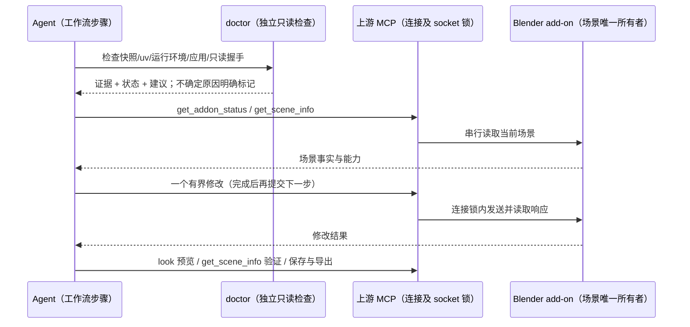

# KayingForBlender 内置插件

## 规则与边界

- 插件名 `blender`，通过 `config/official-plugins.json` 随应用播种；默认关闭，由用户按需启用。无需添加远程市场或重复登记 MCP。
- 插件展示名称在中英文界面统一为 `KayingForBlender`；保留 `blender@kayingcode-plugins-official`、包名和 MCP 名称，复用已有安装、启用状态及数据目录。
- `vendor/mcp-for-blender` 是 ahujasid/mcp-for-blender 的原样快照；commit、包版本、add-on protocol 和每个文件 SHA-256 由 `upstream-lock.json` 记录。服务端及 add-on 必须来自同一快照。保留原始 MIT 许可。
- 适配层不修改上游工具、资源或 MCP Apps 协议。MCP `blender` 用 Node 启动固定项目，uv 使用随快照分发的 `uv.lock`，在缓存中的源码副本构建，并使用独立缓存虚拟环境；首次准备 Python/依赖可能需要网络。启动不得执行上游 setup/update、修改其他客户端配置或自动安装 add-on。
- 独立 MCP `blender_doctor` 使用 Node 内建模块，在 uv/Python/Blender 缺失时仍能诊断。CLI 与 MCP 使用同一个诊断实现。doctor 只读，不安装、不清缓存、不执行 Blender Python、不触发付费服务。
- 本地进程、uv 解析、缓存、连接诊断属于插件适配层；工作流通过 skill/command 指导 Agent 调用既有上游工具，不在 Renderer/Main/Host 创建另一条任务队列。
- Python 入口 `scripts/server.py` 在导入上游前提供仅含 `enabled=False` 的 `blender_mcp.config.telemetry_config`，并强制 `DISABLE_TELEMETRY=true`。固定上游的 Git 源码忽略了私有 config.py，但状态工具仍直接读取它；此适配消除源码发行缺口，不写 vendor/已安装 Python 包，不提供采集地址、凭据或启用遥测的路径。更新上游后用真实 MCP 回归验证兼容性。

## 所有者及事件顺序

- 上游持有每个服务进程的连接与 socket 串行锁；Agent 不并发修改同一场景。Blender 场景为唯一事实来源，聊天中的计划只是步骤描述。
- 写入超时/断线不等于未执行：停止后续修改，重新读取场景确认结果，不自动重放非幂等操作。doctor 的独立短连接只发送 `get_addon_info`，不参与业务写入。
- 本地与远程 Agent 的依赖和 Blender 在 MCP 执行主机上检查；手机复用已连接桌面 Host，不创建新的 Blender runtime。Desktop 连续流/手机可恢复流复用现有 Agent 路径，不新增 stream/snapshot/queue。
- 不缓存诊断为服务端事实，每次重新检查。忙碌/超时只表示未能验证，不能推断 Blender 没安装或 add-on 没启用。

## doctor 接口及失败语义

- CLI：`node scripts/doctor.mjs`；输出 JSON，`ready` 为 false 时退出 1。
- MCP：`blender_doctor`，无参数，返回相同结构，包括 `ready`、`checks[]`、每项 `id/status/evidence/suggestion` 和固定上游信息。
- 检查快照完整性、uv（包括 GUI PATH 缺失时的标准安装位置及显式路径）、缓存 Python 和锁定依赖、Blender 可执行文件、端口配置、add-on 握手及协议一致性。
- `KAYINGCODE_BLENDER_UV`、`KAYINGCODE_BLENDER_CACHE`、`BLENDER_EXECUTABLE` 支持显式主机配置；`BLENDER_HOST/BLENDER_PORT` 与上游保持一致。非法端口在连接前失败，不静默回落。远端地址提示依赖所属主机及隧道边界，不因本地未找到 Blender 误判远端未安装。
- 检测拒绝连接、DNS/网络错误、握手超时/断开、非 JSON 或其他服务响应、旧/新协议、缺少 Python 依赖、文件丢失/篡改；建议必须对应证据。默认禁用服务端 telemetry。

## 上游更新

- 维护者运行 `scripts/sync-upstream.mjs --source <干净本地 checkout> --ref <commit/tag> --plugin-version <version>`，固定读取 Git commit 的白名单内容，不联网、不执行上游安装脚本。
- 提交前校验项目结构、add-on 副本一致、uv.lock 对应包版本、协议字段与许可证，验证成功才替换 vendor 并刷新 hash/版本及生成目录。适配代码、doctor、skills、commands 不被覆盖。
- 不在用户启动时拉取 HEAD/更新 add-on。用户手动在 Blender 内升级导致协议偏离时，doctor 提示使用随包 add-on 或升级整套内置插件。

## 验收

1. 内置目录、清单生成、脚本与 vendor 进入打包白名单；禁用时不会启动 Blender/下载依赖。
2. 缺少 uv/Python/add-on 时 doctor MCP 仍能初始化与调用，返回可操作建议；不会自动修复。
3. doctor 正确处理分片 UTF-8 JSON、错误服务、旧协议、错误端口、未监听与忙碌超时；所有短连接及时关闭。
4. 启动器只运行固定项目与锁文件，缓存可写且位于插件安装目录之外，透传 stdio 和退出状态，终止时清理子进程。
5. 端到端 MCP 场景覆盖 initialize → tools/list → doctor；真实上游服务覆盖 initialize → tools/list → 读取模拟 add-on，错误可定位且 stdout 无安装日志。
6. 从本地上游快照更新后，hash 检查通过，适配层不变；非法快照拒绝且保留原 vendor。
7. 建模交互：诊断 → 场景读取 → 小步修改 → 多视角检查 → 显式路径保存/导出；失败不盲重试。真实 Blender 设备验收与模拟服务测试分开报告。
8. Python 入口先装配禁用配置再导入上游；即使继承环境尝试启用遥测，服务端仍禁用。get_addon_status 正常返回版本与能力，不再出现缺少 blender_mcp.config 的错误。
