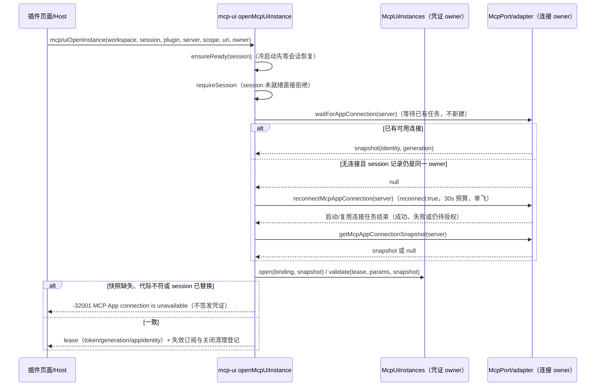

# MCP App open 主动重连

对齐上游 ZCode 4.0.0（`zcode-protocol/mcp-ui` open 语义）：首次 open 在已有连接不可用时主动重连一次，重连仍失败才报 `-32001`。本文件是 `src/kayingcode-protocol/mcp-ui/` 该行为的规格；模块契约见同目录 `CONTRACT.md`。

## 规则

- 冷打开前置：`openMcpUiInstance` 先 `getSessionLifecycle(context).ensureReady(sessionId)`，再 `requireSession`。冷启动时历史订阅已建立但 session 可能仍在恢复，直接 `requireSession` 会让面板停在 `sessionUnavailable` 错误页。该前置在 3.18.2 基线即存在，产品此前遗漏，本轮补齐以与上游一致。
- 连接可用性 owner 是 `McpPort`：`waitForAppConnection` 只等待已有连接任务、不新建；`waitForServer({ reconnect: true, timeoutMs })` 复用 adapter 的 `connectionTask`（`record.connecting` 单飞）走与 `callTool` 相同的重连路径。
- 凭证 owner 仍是 `McpUiInstances`：open 只负责"等待 → 重连一次 → 重新读快照 → 签发"，不缓存连接、不降级、不做重试循环。
- 首次 open 先 `waitForMcpAppConnection(serverName)`。返回 `null` 且 session 记录仍是同一 owner 时，调用一次 `reconnectMcpAppConnection(serverName)`，预算 `MCP_APP_OPEN_RECONNECT_BUDGET_MS = 30_000`（与 MCP 默认请求超时一致），随后重新读 `getMcpAppConnectionSnapshot`。
- 单次重试与幂等：每个 open 请求最多发起一次重连，不退避、不循环。并发 open 的重连在 adapter 内共享同一个连接任务（单飞），不产生第二条连接；同一逻辑页面 + 同连接的同 key 并发 open 由 `McpUiInstances.open` 归并为同一 lease。
- 失败报告：重连后仍无快照，或 current 快照的 `identity`/`generation` 与校验来源不一致，返回 JSON-RPC `-32001 "MCP App connection is unavailable"`。不签发部分凭证，不吞错误。
- stale 结果：open 接纳条件只有"当前快照身份与代际等于校验来源"；重连产生的新 generation 必须重新签发。重连等待期间 session 记录被替换（`context.sessions.get(id) !== record`）立即 `-32001`，不复活已释放 owner，也不把重连结果投给旧实例。
- 不发起 OAuth 交互授权：`reauthorize` 只属于工具执行准入；App open 的 reconnect 遇到仍需授权的 server 以 `-32001` 结束，由宿主/设置页显式连接或完成授权。
- 只作用于 open：`callTool`、资源读取/订阅、ToolSearch 仍固定已验证代际，不因本规则触发重连或重放。

## 事件顺序

## 预算

- 30 秒是单次 open 内等待重连结束的上限，不是连接生命周期。超时按"连接仍不可用"处理并报 `-32001`。
- open 请求没有 operationId/取消通道，等待只受该预算约束；不引入客户端超时或第二次尝试。

## 投递差异（Desktop / 手机）

- 语义只在 Agent/Host 侧实现一次：桌面 `desktop-continuous` 与手机 `web-remote-replayable` 都通过同一 Host attachment 调用 `mcp/uiOpenInstance`，因此两者都获得"一次重连"能力，不存在手机单独的重连实现，也不新增第二条恢复链路。
- 通道差异只影响投影与重放：手机恢复连接后重新 open 由 `McpUiInstances` 的 key 幂等归并，不因 replay/重连重复发起底层连接。
- 客户端不自行重试连接；UI 的"重试"按钮复用同一 open 请求。

## 验收

1. 连接不可用 → 恰好一次重连 → 重连成功时签发绑定新代际的实例。
2. 重连后仍不可用 → `-32001`，且只尝试一次（无循环）。
3. 连接已健康 → 不发起重连。
4. 并发 open → 底层只发生一次连接尝试（adapter 单飞），各请求得到同代实例或同一 lease。
5. 重连产生新 generation → 旧代际凭证不被复用；session 被替换 → `-32001`。

验证：`pnpm --filter @zcode/bootstrap exec vitest run tests/mcp-ui-open-reconnect.test.ts`。

## 非目标

- 不新增协议方法或字段，不持久化重连状态。
- 不改 Host/Relay owner/lease、continuous 与 replayable 通道语义。
- 不在 open 路径自动发起 OAuth 授权，不把重连扩散到 callTool、资源读取或 ToolSearch。
- 不引入 open 级别的连接缓存或"预热所有 MCP"。
