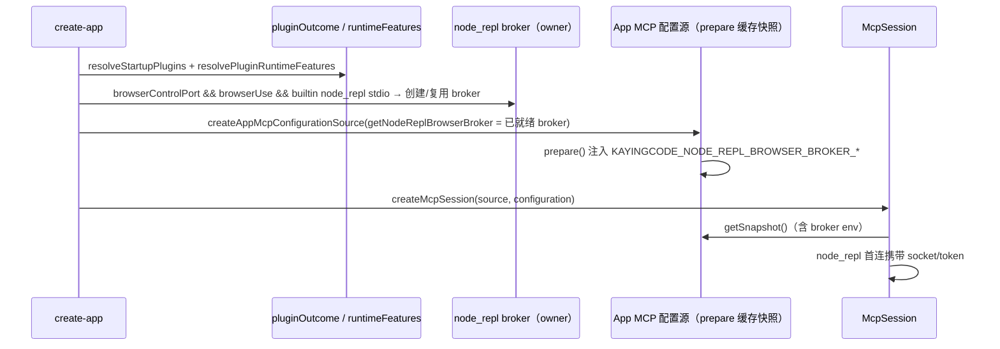

# node_repl browser broker 启动时序

`create-app` 装配 node_repl 的浏览器 broker（`KAYINGCODE_NODE_REPL_BROWSER_BROKER_SOCKET/TOKEN`）
与 App MCP 配置源。两者顺序决定 `agent.browsers.*` 能否使用。

## 根因

- `createAppMcpConfigurationSource` 在**创建时**执行一次 `prepare`（合并内建 server、注入 broker
  env）并把结果缓存为该 view 的 `getSnapshot()`；只有后续配置文件事件才会重新 `prepare`。
- core 的 `createMcpSession` 优先使用 `source.getSnapshot()`，其次才是传入的
  `runtimeConfig.mcp`（`mcp/runtime/session.ts`）。
- 旧顺序先创建配置源、后创建 broker：首份快照的 `node_repl` 没有 broker env，MCP session 又忽略
  之后的显式注入，node_repl 子进程因此拿不到 socket/token。表现是 `agent.browsers.list()` 抛
  `Browser control is unavailable for this node_repl session`，且要等到下一次 MCP 配置事件触发
  `prepare` 才自愈（重启后必然复发）。

## 规则

- broker 的创建必须**先于** App MCP 配置源创建；同一 App 生命周期内只有一个 broker owner。
- 创建条件同时满足才建：宿主注入 `browserControlPort`、`runtimeFeatures.browserUse === true`、
  内建 `node_repl` 为 stdio（或调用方显式配置了 stdio `node_repl`）。
- 协议宿主注入的进程级 broker（`options.nodeReplBrowserBroker`）优先复用；缺省时 App 自建并拥有，
  关闭时由 App 释放。
- 审核 workspace（`KAYINGCODE_REVIEW_WORKSPACE_ROOT`）不创建 broker：该模式的 MCP 已整体禁用。
- 注入只依赖"broker 已就绪 + 配置源首次 prepare"，不得依赖文件事件或二次 reconcile 作为必要路径。
- `runtimeConfig.mcp` 与配置源快照必须携带同一份 broker env，禁止在启动后期再修补首份快照。

## 事件顺序

## 验收

1. 新建 App（browser-use 启用）后，MCP 首连使用的 `node_repl.env` 同时包含 broker socket 与 token。
2. 宿主注入进程级 broker 时不新建第二个 broker；未注入时 App 自建并在 close 时释放。
3. 只有配置源首次 `prepare` 参与，不需要人为制造配置文件变更。
4. 审核 workspace 不创建 broker，且不注册 node_repl MCP。

验证：`pnpm --filter @zcode/bootstrap exec vitest run tests/node-repl-browser-broker-startup.test.ts`。

## 非目标

- 不改 `McpSession` "配置源优先" 的上游语义，也不改 MCP 配置源的共享/引用计数。
- 不新增协议方法或持久化状态；broker 仍是进程内、按 App 生命周期。
- 不在运行期热切换 broker：插件启停或配置变化仍走既有 MCP reconcile。
