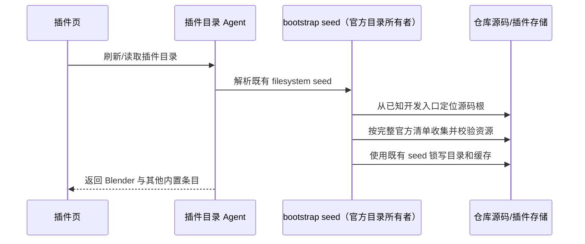

# 开发态内置插件源码发现

## 原因与规则

Desktop Dev 的插件目录 Agent 从仓库外的工作区运行，入口通常是 `apps/zcode-cli/packages/cli/dist/kayingcode.cjs`。现有 filesystem seed 仅从入口目录、bundle 的 \_\_dirname 和 cwd 拼接 rootCandidates；CLI 迁入 apps 后，这些候选不能到达仓库 plugins/。Blender 虽已登记进生成清单，仍未被播种，市场继续显示缓存中的旧 14 项。

由 bootstrap 的 filesystem seed 统一定位源码根，不在 UI 中安装插件或直接改写市场缓存。仅对两个已知开发入口增加仓库根候选：

- `apps/zcode-cli/packages/cli/dist`
- `packages/desktop/bundled-agents/<platform>/glm`

候选根须同时包含 `config/official-plugins.json` 和 `apps/zcode-cli/packages/cli/package.json`。不向任意工作区或用户目录递归查找；生产包仍优先使用入口同级 `packages/*-plugin`，既有 rootCandidates、SEA、抑制态、版本与 hash 校验保持原语义。新增根适用于整份官方清单，不能只播种 Blender 而把旧内置目录覆盖成单条目。

## 所有者与顺序

不新增队列或缓存所有者，不改变 Desktop/手机的会话流语义。正式版与 Dev 若使用同一个 storageRoot，旧正式版仍可能按自身资源写回旧清单；本修复不迁移用户存储或停止其他进程。

## 验收

1. 从仓库外 cwd 启动 CLI，仍能发现全部 15 项官方源，包括默认关闭的 Blender。
2. 两种 Dev 入口都能解析到同一仓库根；不存在标记文件、任意嵌套目录和生产包路径不得误判为开发仓库。
3. 原有打包态同级资源优先级保持不变，已有 14 项不会因新增 Blender 消失。
4. 新编译 CLI 使用隔离存储执行 `plugins list --available --json`，实际返回 Blender；再用同一合法入口更新当前插件目录，不手写 registry。

验证命令：`bun test apps/zcode-cli/packages/bootstrap/test/official-plugin-source-paths.test.ts apps/zcode-cli/packages/bootstrap/test/official-plugin-seed-paths.test.ts`；构建 Dev Agent 后，`node --test apps/zcode-cli/packages/bootstrap/test/official-plugin-source-discovery.e2e.mjs` 从仓库外的临时 cwd 和隔离存储验证两个真实 bundle。
