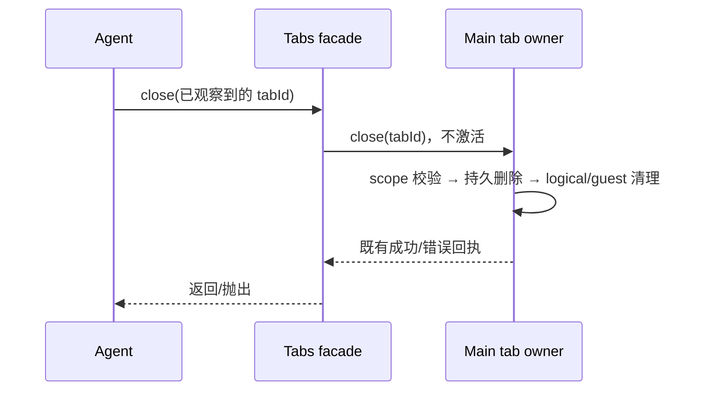

# 无需激活的页签关闭

- Main 继续持有 logical tab、scope、guest generation 和持久恢复记录；客户端不维护第二份关闭事实。
- 新增 `await browser.tabs.close(tabId)`，直接走已有 `close` 命令，不先 list/get/activate，不为关闭恢复 guest。`tabs.get` 仍保持激活语义。
- tabId 必须为非空字符串；无效显式 ID 在发送前拒绝，不能退化为关闭当前活动 tab。
- Main 必须继续校验 window/workspaceIdentity/remoteSession/session 归属，先持久删除恢复记录，再完成既有 tab/guest/waiter 清理与通知。未知或跨 scope 的 tab 不能被此入口关闭；持久删除失败继续向上传播。
- 已有 `tab.close()` 保持兼容。能力清单、插件文档和生成 bundle 同步；旧页签恢复失败后使用 collection close 清理。

验收：guest 缺失或恢复失败的 tab 可直接关闭；不调用 activateTab，也不触发 guest 重建；失败不伪装成功；Main 拒绝跨 scope 关闭，持久失败可重试。此入口解决失效页签清理，不声称消除 Chromium 原生崩溃。
