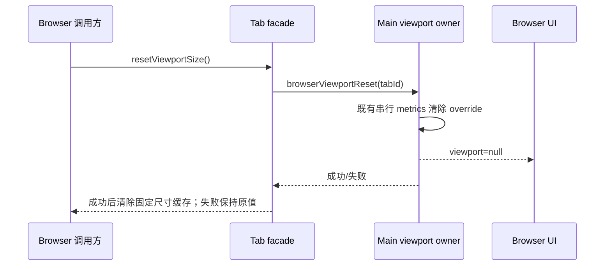

# Browser Tab 自然尺寸

- Main 是浏览器实际 viewport 的唯一所有者。Tab facade 通过已有 `browserViewportReset` 命令退出固定尺寸模拟，不新增状态同步或 IPC。
- 公开 `await tab.resetViewportSize()`，能力清单与生成的插件文档同时暴露；按原 tabId 路由，不更换 tab、导航或覆盖用户场景。
- 成功回执后 `tab.viewportSize()` 返回 null，表示不再固定尺寸；失败抛出既有 BrowserCommandError，保留最后确认的固定尺寸。真实尺寸仍从 `tabs.list()` 观察。
- 编辑工作台打开或复用 tab 后，在观察页面前恢复自然尺寸；临时固定截图尺寸后在 finally 中恢复。

验收：set→reset 命令顺序与 tabId 正确；重复 reset 幂等；失败保留缓存并向上传播；公开能力裁剪正确；宿主从 720×1280 切回自然尺寸时保持网页 DOM、人工编辑和历史。Desktop 连续链路沿用既有实现，不改变手机 replay 协议。
