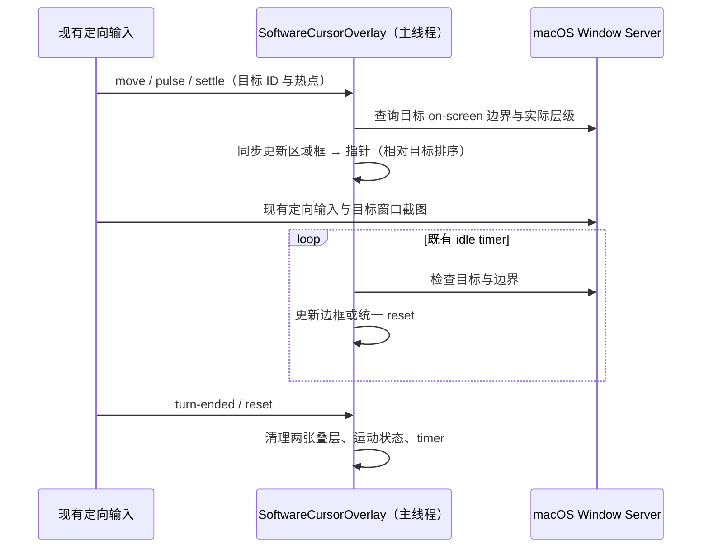
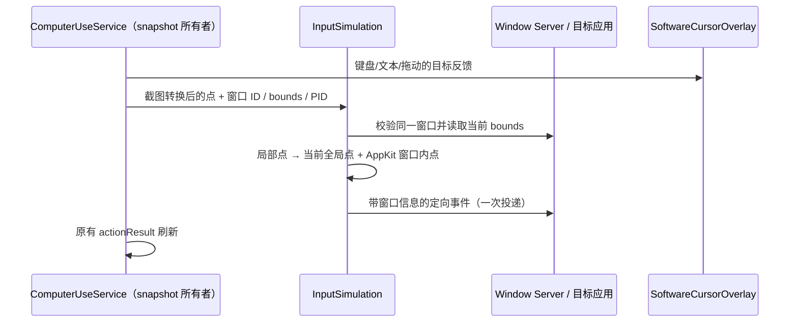

# macOS Computer Use 工作过程反馈

## 产品规则与平台边界

- 在现有软件指针上增加柔和蓝色光晕和清晰的点击脉冲；沿用现有箭头资产与运动模型。旋转及点击压缩围绕箭头热点进行，屏幕边缘只约束热点，不要求整张透明指针窗口留在屏幕内。
- 为当前目标窗口增加透明中心、蓝紫细边和柔光；随实际窗口边界更新，支持 Retina、负坐标及跨显示器窗口。边框与指针都不可成为 key/main window，不拦截输入，也不把目标应用带到前台。
- macOS 继续支持后台定向输入。叠层按目标窗口的实际层级相对排序；目标被其他应用遮挡时，不把边框提升为全局置顶。用户在其他应用移动真实鼠标，不取消后台目标。
- 目标窗口不在当前屏幕列表中（关闭、最小化、隐藏或切换 Space）时，清理两张叠层；不能把失效目标退化为悬浮在最前面的匿名指针。有效目标切换时，两张叠层由同一所有者同步换目标。
- 复用既有 30 秒空闲期限和 turn-ended/reset 路径，统一清理指针、边框、运动状态与计时器。空闲隐藏使用同步清理，避免旧淡出回调清除后来操作的新状态。
- 遵从系统“减少动态效果”：保留静态指针和边框，跳过指针旅行、点击缩放及空闲摆动；生命周期与边界跟踪继续工作。现有 `KAYING_COMPUTER_USE_VISUAL_CURSOR=0` 同时禁用两种叠层。
- 截图继续使用现有 `SCContentFilter(desktopIndependentWindow:)` 指向目标窗口，独立叠层不进入截图；不另建截图、输入或 Host 链路。
- Windows 沿用 [`visual-feedback.md`](visual-feedback.md)，Linux 不新增显示后端。

## 所有者与事件顺序

`SoftwareCursorOverlay` 继续是唯一展示状态所有者，持有目标 ID、指针运动状态、两张 panel 与既有空闲/隐藏 timer。`TargetWorkAreaOutline` 仅绘制和排序窗口边框，不保留另一份目标或创建计时器。几何转换及热点约束为纯函数，跨模块接口和公开 MCP 协议不变。

每次新操作和 reset 都递增展示代次；动画帧、idle timer 和 hide timer 在写入前校验代次。旧目标或旧生命周期的回调必须丢弃，不影响当前展示。

展示不持久化、不回放、不广播；不改 Desktop continuous 或手机 replayable 业务语义。视觉刷新不重试输入、不激活应用，空闲期限只控制展示寿命。

## 验收

1. 纯函数测试覆盖多屏上下排列、负坐标、跨屏边界、非法/离屏窗口，以及屏幕角落的热点不偏移。
2. 绘制测试覆盖 1x/2x 边框中心透明、边缘可见、圆角透明；点击与旋转变换保持热点固定。
3. macOS 专用交互测试用自建窗口验证不可抢焦点/拦截输入、相对排序、目标切换、移动缩放、最小化/关闭清理、turn-ended 与旧隐藏周期不清除新目标；截图只捕获目标。
4. 真实 macOS 执行 `swift test`（vendor 根目录）和 `bun run --filter @kayingcode/kayingcode-cua-plugin build:native`。Windows 不能完成 AppKit 编译、Retina、Space 与实际截图验收，必须在报告中明确。
5. 根 typecheck、lint、source 与架构检查仍需执行；不以它们代替 macOS 原生编译。

参考：[减少动态效果](https://developer.apple.com/documentation/appkit/nsworkspace/accessibilitydisplayshouldreducemotion)、[相对窗口排序](<https://developer.apple.com/documentation/appkit/nswindow/order(_:relativeto:)>)、[单窗口截图过滤](<https://developer.apple.com/documentation/screencapturekit/sccontentfilter/init(desktopindependentwindow:)>)。本地 upstream 快照维护时须同时保留此实现及验收，不改写基础快照 commit。

## 定向输入与键盘反馈回归（2026-10-28）

- 定向鼠标事件必须同时携带目标 CGWindowID、窗口内 AppKit 坐标和全局 Quartz 坐标。不能仅 `CGEvent.postToPid` 后让目标把全局坐标当作 `locationInWindow`。点击、拖动、滚轮共用同一窗口绑定入口；不移动真实鼠标、不激活目标。
- 输入前按窗口 ID 和 PID 校验当前窗口；窗口移动后用最新原点映射截图局部位置，窗口失效时报错，不向其他窗口投递。截图像素缩放仍由现有 snapshot 转换负责。
- 键盘与文本操作也通过 `SoftwareCursorOverlay` 展示目标区域，使用窗口中心作为无指针操作的反馈锚点，沿用同一 30 秒生命周期和 reset；拖动补齐相同反馈路径。
- 截图选择缩放屏幕时用 Quartz 边界与 Quartz 屏幕求交，禁止与 AppKit 屏幕边界混用。

验收补充：在负原点、上下排列与混合 Retina 屏幕参数下，将生成事件转回 NSEvent，断言 windowNumber、locationInWindow 和 CGEvent.location；真实自建窗口接收后台点击/拖动/滚轮并核验位置；键盘反馈与窗口切换沿用交互验收。测试窗口需等待 Window Server 发布后再检查，截图对比使用稳定正文，避免焦点装饰变化造成误报。
