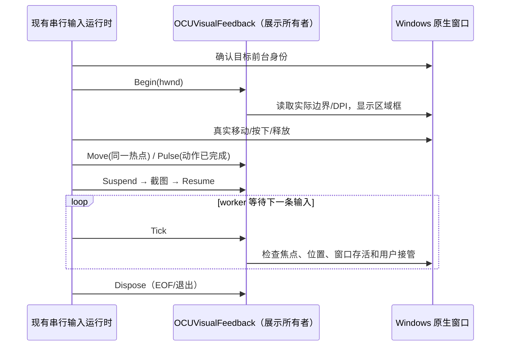
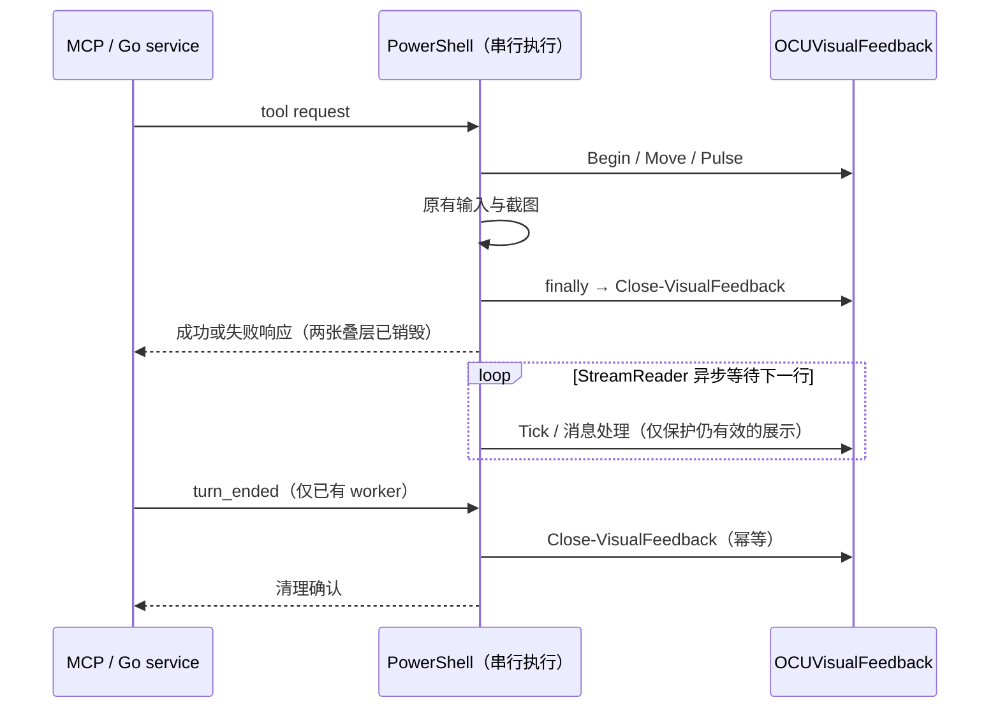

# Windows Computer Use 工作过程反馈

## 产品规则

- 参考当前 Codex Computer Use 在空白记事本上的实测：深色箭头、浅色描边、柔和蓝色光晕。[官方说明](https://learn.chatgpt.com/docs/computer-use)只说明前台操作语义，不公开视觉参数；本实现使用插件自己的原生绘制与语义调色板。
- Windows `foreground` 输入期间显示软件指针；移动与拖动沿用真实输入的坐标及顺序，箭头尖端必须与真实热点重合。点击/滚动完成后播放一次短扩散反馈，结束后回到静止指针。
- 当前目标窗口用透明中心、蓝紫细边与轻柔外光标识。高亮只描述工作区域，不覆盖正文、不抢焦点、不拦截鼠标、不出现在任务栏或应用列表。
- 目标切换时同步替换高亮并清除旧指针；窗口移动、缩放与 DPI 变化时重新读取原生边界。窗口失焦、最小化、关闭，或用户移动真实鼠标接管时立即清理（下一个展示帧）。每次工具调用返回前同步释放；30 秒有效期仅保护尚在执行的展示，worker 退出时仍统一释放。
- Windows 背景输入不创建叠层。现有 `KAYING_COMPUTER_USE_WINDOWS_DISABLE_VISUAL_CURSOR=1` 同时关闭指针与区域标识；动画关闭时仍提供静态反馈。
- 截图期间临时隐藏派生叠层，完成后只恢复仍有效的展示，避免反馈被截进下一次模型观察。
- macOS 展示增强见 [`macos-visual-feedback.md`](macos-visual-feedback.md)；Linux 不新增显示后端。公开工具协议、坐标映射、窗口路由和输入策略保持现有语义。

## 所有者与接口

`runtime.ps1` 内原生 `OCUVisualFeedback` 是展示状态的唯一所有者：目标 HWND、指针热点、展示有效期、暂停标志与两张透明窗口。PowerShell 仅调用 Begin / Move / Pulse / Suspend / Resume / Tick / Dispose，不持有第二份目标状态。展示不持久化、不广播，不参与 Desktop 或手机恢复链路；远端观看不建立另一套 Host 或叠层。

展示失败只移除展示，不重试或重放真实输入。窗口验证失败仍按现有输入路径报错；不得为保留高亮重新抢焦点。超时仅为展示生命周期，不用于输入同步。

## 验收场景

1. 原生绘制测试：静止箭头可见、热点固定、背景透明；点击扩散消失后保留静止指针；区域框中心透明、边缘可见；100%/150%/200% DPI 不裁切。
2. Windows 交互测试：以测试专用窗口完成单击、双击、拖动、滚动及键入；高亮不抢焦点，底层控件收到事件。
3. 移动/缩放目标后区域框同步更新；切到另一目标不留下旧框；失焦、关闭、用户移动指针、有效期到期与 EOF 均清理。
4. 截图不包含软件指针或区域框，截图后有效展示可恢复；禁用开关与背景模式不显示反馈。
5. 执行插件测试、原生运行时构建/验证及根 typecheck、lint、架构检查。跨平台验收只报告实际执行的结果。

从仓库根执行 `bun run --filter @kayingcode/kayingcode-cua-plugin test` 包含 Windows 离屏原生绘制测试。交互 E2E 需解锁的 Windows 桌面，并显式设置 `KAYING_COMPUTER_USE_TEST_INTERACTIVE=1` 后执行同一命令；测试只操作自己创建的窗口，并在结束时恢复原窗口与指针位置。

原生 PowerShell 源码和测试夹具保留 UTF-8 BOM，供 Windows PowerShell 5.1 正确解码中文注释。不要只移除 BOM 而不验证 Windows 5.1 的实际执行结果。

## 快照维护

本文件与 Windows 运行时增强属于内置插件的本地修改；`upstream-lock.json` 继续记录基础快照来源。维护者再次同步 upstream 时须保留或移植此 spec 对应实现及测试，不能把基础 commit 误写成包含本地修改的新上游版本。

## Windows 调用结束清理（2026-10-29）

- 指针与目标边框只覆盖正在执行的 CUA 调用。`Invoke-Operation` 的成功、失败返回均在 `finally` 同步销毁两张叠层，再序列化响应；下一次操作通过既有 Begin 路径重建。工具间隔不保留“仍在控制”的视觉标记。
- `notifications/turn-ended` 不再忽略：Go service 仅向已经存在的 worker 发送内部 `turn_ended` 清理请求，不启动新 worker，不清空 snapshot，不断开 MCP。重复通知与无 worker 通知均幂等；清理失败时关闭该 worker，下一次操作按既有路径重建。
- `OCUVisualFeedback` 仍为唯一展示状态所有者；PowerShell 的 `Close-VisualFeedback` 仍为唯一销毁入口。保留失焦、窗口失效、用户接管和 30 秒有效期作为执行期间保护。
- 常驻 worker 使用独立 UTF-8 `StreamReader` 读取 Go 的 JSON 行，禁止使用会同步阻塞的 `Console.In.ReadLineAsync()`。等待期间继续 Tick/处理窗口消息；EOF、空闲 watchdog 与异常退出统一释放读流和叠层。队列中每条输入依然串行处理，不重试真实动作。

验收：Go 用管道模拟 resident worker 验证结束通知投递、无 worker 不启动、重复通知不破坏 snapshot、失败时释放 worker；Windows 5.1 worker 保持 stdin 打开且不发送数据时，短 idle watchdog 必须自行退出。交互夹具验证成功/失败响应前两张窗口已 Dispose、重复结束幂等、下一次调用可重建且不抢焦点。macOS 上执行 Go 逻辑测试和 Windows x64 交叉编译、回填受版本控制 exe；Windows 原生测试若未执行必须明确报告。
