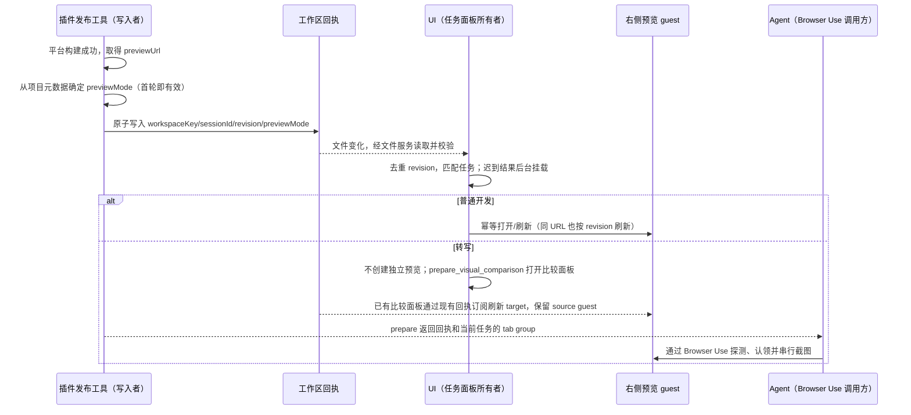

# 平台提交与预览

## 产品规则与所有者

- 普通 Maker 开发每轮平台提交成功后，优先自动打开或刷新当前任务右侧的「TapTap 游戏预览」，沿用同一 guest；不能要求 Agent 另开普通网页。网页游戏转写始终留在「转写对比」，首轮及后续提交都不得自动创建独立游戏预览。
- 发布工具沿项目目录向工作区根目录查找现有 `project-info.json`；只有含非空 `t3m_version`、`source_url` 且 `paths.dest` 解析为当前发布项目的记录才确认转写归属。回执新增可选 `previewMode: standalone | transcription-compare`，由插件推导，不接受 Agent 指定。缺省兼容旧回执的独立预览行为。
- 不扫描工作区外的祖先或其他项目。元数据缺失、JSON 损坏或字段不符时不认定为转写；其他文件 IO 错误向调用方报告且不写新回执。发布模式不新增持久化状态，继续复用 t3m 元数据与原子发布回执。
- 发布工具是提交与 publication revision 的唯一写入者。回执位于工作区根目录的 `.maker/kaying-for-taptap/preview-publication.v1.json`，子目录项目仍写入工作区根目录。
- 回执携带 Host 注入的可选 `sessionId`，禁止 Agent 指定归属。缺少 sessionId 的旧回执仍可手动预览，但不自动绑定到当前任务。
- UI 只投影回执；按 workspace identity 和发布任务隔离。后台任务的提交可以后台挂载预览，不能激活另一任务或展开其面板。重复/过期 revision 不重复展开，关闭后等下轮新提交才自动重开。
- 普通开发/QA/截图验证先认领 `taptap-preview:*`；转写对拍保留现有「转写对比」流程。普通网页不替代专用预览。
- 转写的 `prepare_visual_comparison` 成功结果给出本次回执对应的 tab group，并提示用当前桌面会话的 Browser Use 实测。恢复任务后需要对拍时同样重新探测，应用更新前的工具错误和历史项目记忆不能决定当前可用性。面板可见只证明 UI 已挂载，Browser Use 必须列出本会话的双 guest 才能继续取证。
- 对拍沿用 Main 的 guest 注册表和既有 Browser Use 工具。UI 与 MCP 共用 tab group 构造函数。未认领的预览按 `tabGroup` 匹配，已认领的预览按回执组名加 `:source:` 或 `:target:` 的 ID 前缀匹配。核对两边 URL，按回执 viewport 串行截图，使用工具落盘的原始 PNG 运行 `t3m compare`。当前探测失败时保留具体错误和回执 revision。MCP 文本给出下一步，既有结构化回执字段与持久化格式保持兼容。
- Browser Use 的原图由应用制品目录持有，转写 MCP 的输入和输出受工作区路径约束。Agent 把当前回执两侧的原始 PNG 按字节复制到工作区的本次证据目录，使用目录内的副本调用 `compare`。同目录保存差异图和指标。
- 右侧预览不可用或明确失败，且平台错误/远端日志不足以定位时，才考虑官方本地模拟器兜底；记录原因。用户显式要求本地运行时可直接走本地路径。不能因提交成功、网页加载等待或一次截图失败就默认启动本地模拟器。

## 时序与接口

不引入任务队列、owner/lease 或 stream 改动。Desktop continuous 与手机 replayable 消息语义维持现有契约；Web/手机不支持 embedded browser 时不创建 guest，不启动本地模拟器。

## 验收

1. 首次发布前无 `.maker` 目录；成功写入首份回执后，当前任务自动展开专用预览，无普通 browser tab。
2. 同 URL 的下一 revision 刷新同一 guest；重复文件事件不抢焦点；关闭面板后同 revision 不重开，新 revision 重开。
3. A 任务发布期间切到 B：完成后 A 后台挂载，B 焦点不变。其他 workspace、无 sessionId、无效/失败/延迟发布不触发错误归属的自动打开。
4. 工作区切换或卸载后，旧异步读取结果失效；订阅建立期间写入回执不漏读。
5. 插件停用或壳层无 embedded browser 能力时不自动打开；平台预览正常时不启动本地模拟器。
6. 转写首轮提交早于 compare receipt 时不闪开独立预览；比较面板建立后连续发布仍保留原版 guest 与面板焦点，只有 target 按 revision 刷新。其他任务、项目及工作区的转写元数据不影响普通开发；同工作区后续普通项目仍正常自动预览。
7. 已有任务记录过 Browser Use 失败，更新客户端后恢复对拍时重新探测。prepare 的 MCP 成功响应给出与回执一致的 tab group；失败响应只返回错误。两张原始 PNG 复制到工作区后可从转写 MCP 得到差异图和指标。
