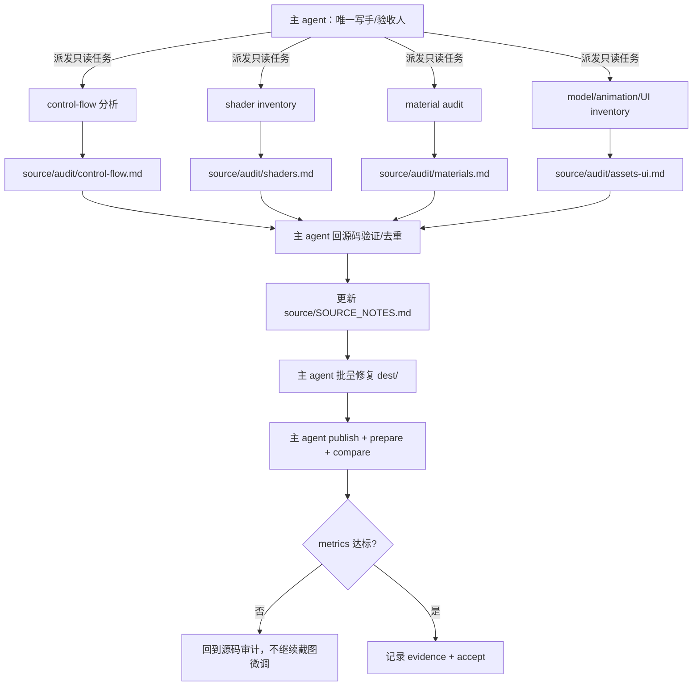
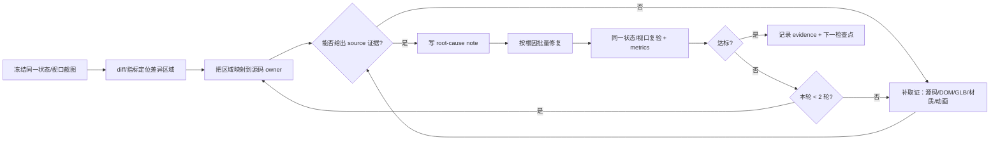

# 转写插件优化评估方案（草案）

- 状态：**Phase 1、Phase 2（warning 级）、Phase 3（audit + compare hard gate）已实施；Phase 0/4 待回放**
- 范围：`apps/zcode-cli/packages/kaying-for-taptap-plugin` 的 `threejs-to-taptapmaker` 技能、命令、参考文档、测试与工具门禁
- 复盘案例：Turbo Tails 转写会话 `session_56a5e1cd5acc1baede1e73f20e2975a2`
- 目标：回答三个问题，并给出可分批落地的方案
  1. 转写类项目是否应启用 subagent，怎样启用才更快/更好；
  2. 如何把“源码优先、截图只做验证”的铁律变成可执行约束；
  3. 基于本次复盘，插件还需要补哪些约束和指导。

---

## 1. 结论摘要

### 1.1 子 agent：建议启用，但只作为“只读分析员/独立复核员”

- **推荐拓扑：1 个主写手 + N 个只读子 agent。**
- 主 agent 继续独占 `dest/` 写入、`publish`、`prepare_visual_comparison`、双 guest 截图、`t3m compare` 和最终验收。
- 子 agent 负责**并行的源码审计、资产/材质/动画/UI 盘点、独立复核**，产出证据文件，不直接改工程。
- 不建议让多个子 agent 并发写同一批 `dest/scripts`、同一个 UI 根面板或同一个场景；这类任务共享状态强，合并冲突和“各写一套”会抵消并行收益。
- 只有在**文件所有权完全不重叠**时，才允许“模块写手”子 agent（例如一个写 `TracksData.lua`、一个写 `Audio.lua`），主 agent 负责合并、跑 lint、统一验收。
- 不同宿主暴露的子 agent 类型不同：有只读类型（如 Explore）优先用只读类型；没有时用 `general-purpose` + prompt 禁止写入，并由主 agent 复核所有结论。插件不硬依赖某一种子 agent 类型，只约束“谁可以写、谁只能读”。

### 1.2 铁律：必须从“提示词建议”升级为“可执行门禁”

当前插件已有“先找根因，再改东西”“禁止直接调样式”，但它是**建议级**的，Turbo Tails 复盘中仍出现了按截图调相机/logo/布局的循环。建议新增一条可检查的铁律：

> **截图/对比图只回答“哪里不一样”，不回答“应该改成什么”。**
> 任何视觉修改前，必须在 `source/` 中找到并记录证据：`文件:行号 + 具体值/分支/资源 + 期望行为`。
> 找不到源码证据时禁止编辑，先补取证；修复按根因批量进行，禁止按截图逐像素/逐区域微调。

配套要求：

- 每个检查点的视觉修复最多 **2 轮**；超过则停止截图重试，回到源码审计。
- `mark accept` 前必须有 `SOURCE_NOTES.md`、`visual_fixes` 台账、同 revision 的 `compare_*` 证据。
- 子 agent 的输出默认是**假设**，主 agent 必须回源码验证后才能改代码。

### 1.3 本次复盘暴露的插件缺口

| 缺口                 | 本次案例表现                               | 插件现状                         | 建议                                           |
| -------------------- | ------------------------------------------ | -------------------------------- | ---------------------------------------------- |
| 无子 agent 策略      | 单 agent 反复读 33 MB 单文件，4 次压缩     | 插件未提 subagent                | 新增 `references/subagents.md` + SKILL.md 策略 |
| 铁律不可执行         | 按截图调 4.45/6.6/10.2 m 相机              | 只有“先找根因”建议               | 增加源码证据门槛 + 批量修复规则                |
| 无源码控制流审计     | 误读 `rb()`/`ab()`/`?char=old`             | `t3m analyze` 只给通用风险       | 新增 control-flow 清单/审计                    |
| 无自定义 shader 盘点 | 漏掉 face/neck/ex shader                   | 通用报告不识别 `onBeforeCompile` | 新增 shader inventory                          |
| 无材质 parity 审计   | clearcoat/emissive/doubleSided/Accent 丢失 | 靠人肉发现                       | 新增 GLB↔XML 材质 diff                         |
| 无动画盘点           | 车轮每帧归零、无尾巴/眨眼/头部朝向         | 验收清单未覆盖                   | 新增 animation inventory                       |
| 无确定性对比         | 两端截图不同 9 秒相位                      | 有建议，无强制                   | 冻结时间/状态 + `t3m compare`                  |
| 无证据台账           | 压缩后错误结论被固化                       | 无 `SOURCE_NOTES.md`             | 新增证据落盘与压缩前更新                       |
| 验收门禁偏松         | 回执 rev42、代码 rev43；无 metrics         | `mark accept` 只查部分字段       | 增加最新 revision/metrics/known gaps 检查      |

---

## 2. 现状评估

### 2.1 已有能力

插件已经具备较好的转写骨架：

- `threejs-to-taptapmaker/SKILL.md`：九步流程、first-publish gate、双预览、方向判定、阶段性验证。
- `references/pipeline.md`：数据→规则→棋盘→角色→装饰→界面→音频→验收。
- `references/visual-compare.md`：双 guest 认领、同 viewport、原始 PNG、`t3m compare`。
- `references/acceptance.md`：像素阈值、17 项走查、known gaps、`mark accept`。
- `references/pitfalls.md` / `engine-gap-map.md`：引擎坑位与 API 映射。
- `commands/transcribe-web-game.md`：命令级流程与约束。
- `test/transcription-skill-policy.test.ts`：技能策略的文本回归测试。

### 2.2 关键不足

1. **规则分散**：SKILL.md、command、references 各自有一部分“源码优先/根因定位”，但没有单一、可引用的铁律段落。
2. **缺少源码审计产物**：没有要求输出 control-flow/custom shader/material/animation/UI 的审计文件。
3. **缺少证据台账**：关键结论只存在对话/压缩摘要里，压缩后容易失真。
4. **子 agent 无契约**：没有说明谁能写、谁不能写、输出什么、如何合并。
5. **对比方法不强制**：没有要求冻结动画/状态，允许不同相位截图被当作验收依据。
6. **验收门禁不看“修复是否有源码依据”**：只要证据文件存在，截图驱动的修改也可能通过。

---

## 3. 子 agent 评估方案

### 3.1 结论

**建议启用，但按“只读分析 + 独立复核”使用；不建议并发写共享工程。**

理由：

- 转写项目的瓶颈往往不是写代码速度，而是**源码理解覆盖率**和**上下文压力**。子 agent 最适合并行读大文件、做交叉审计。
- 写 `dest/` 的并发风险高：共享 `Visuals.lua`、`Game.lua`、`Menu.lua`、`HUD.lua`、场景根节点、材质缓存，容易出现覆盖、重复实现、状态不一致。
- 发布/预览/compare 是**有副作用的串行操作**，必须由主 agent 独占，子 agent 不得调用。

### 3.2 适用 / 不适用

| 任务                                                            | 是否适合子 agent | 建议角色                         |
| --------------------------------------------------------------- | ---------------- | -------------------------------- |
| 读 1.44 MB minified bundle，梳理入口/分支/特征开关              | **适合**         | `source-control-flow` 只读分析员 |
| 盘点 `onBeforeCompile`/`ShaderMaterial`/`customProgramCacheKey` | **适合**         | `shader-inventory` 只读分析员    |
| GLB 材质 vs 目标 Material XML 对比                              | **适合**         | `material-audit` 只读分析员      |
| 角色 id/显示名/模型/图集语义映射                                | **适合**         | `model-semantics` 只读分析员     |
| 动画/程序化动画清单与目标实现状态                               | **适合**         | `animation-inventory` 只读分析员 |
| DOM/CSS UI 清单 vs 目标控件                                     | **适合**         | `ui-inventory` 只读分析员        |
| 独立复核主 agent 的修复方案                                     | **适合**         | `verifier` 只读复核员            |
| 同时改 `dest/scripts` 多个共享文件                              | **不适合**       | 主 agent 单写                    |
| 发布 / prepare / 双 guest 截图 / `t3m compare`                  | **不适合**       | 主 agent 独占                    |
| 最终验收 / known gaps 判定                                      | **不适合**       | 主 agent 独占                    |

### 3.3 推荐拓扑



### 3.4 子 agent 契约（必须写进 prompt）

每个子 agent 的 prompt 至少包含：

1. **角色**：只读分析员/复核员，不是实现者。
2. **铁律**：截图只用于发现差异；每个结论必须引用 `source/...:行号` + 具体值/分支/资源。
3. **禁止项**：不得编辑文件、不得 `publish`、不得 `prepare_visual_comparison`、不得删除/重置、不得读取凭据、不得从截图直接给修改值。
4. **范围**：只读哪些文件/目录；输出到哪个 `source/audit/*.md`。
5. **输出 schema**：
   ```json
   {
     "findings": [
       {
         "topic": "kart model branch",
         "evidence": ["game.pretty.js:39186", "game.pretty.js:39514"],
         "fact": "default path uses r13a; generic only when char=old",
         "confidence": "high",
         "proposed_fix": "switch race to r13a; keep generic fallback",
         "open_questions": []
       }
     ],
     "files_read": ["..."],
     "not_covered": ["..."]
   }
   ```
6. **验证要求**：关键结论至少给出两处交叉证据（调用点 + 定义点 + 资源/运行时证据）。
7. **停止条件**：发现结论无法从源码确认时，标记 `unverified`，不要猜。

主 agent 集成规则：

- 子 agent 的结论是**假设**，主 agent 必须回源码验证后才能改代码。
- 子 agent 之间冲突时，以源码为准，记录冲突和取舍。
- 每个子 agent 的输出合并进 `source/SOURCE_NOTES.md` 的“已确认事实”区。
- 子 agent 不得直接修改 `project-info.json` 的验收字段。

### 3.5 实验设计

用同一案例（Turbo Tails）做回放，比较两种模式：

| 组  | 模式                             | 观察                                        |
| --- | -------------------------------- | ------------------------------------------- |
| A   | 单 agent 顺序审计                | 源码审计耗时、关键事实覆盖、压缩次数、token |
| B   | 1 主写 + 3 只读子 agent 并行审计 | 同上 + 合并耗时、冲突数                     |

建议拆成两个实验：

1. **分析阶段**：只做 control-flow/shader/material/animation 审计，不写代码。
2. **实现阶段**：在小模块（如 `TracksData.lua`/`Audio.lua`）上比较“单写手”与“两个互斥文件写手”。

### 3.6 指标与决策标准

| 指标                | 目标                                                                                                     |
| ------------------- | -------------------------------------------------------------------------------------------------------- |
| 关键源码事实召回率  | B 组 ≥ A 组，且能覆盖 `rb/ab/char=old`、face/neck/ex、clearcoat/emissive/doubleSided、wheel/wobble/blink |
| 分析阶段 wall-clock | B 组比 A 组快 ≥ 20%                                                                                      |
| 视觉修复轮次/检查点 | 不高于 A 组                                                                                              |
| 合并冲突/返工       | 不高于 A 组 5%                                                                                           |
| 上下文压缩次数      | B 组更少或关键事实不丢                                                                                   |
| token 成本          | 记录，作为采纳门槛之一                                                                                   |

决策：

- 分析阶段收益达标 → 默认启用“1 主 + N 只读”；
- 实现阶段冲突/返工升高 → 不启用并发写手，只保留只读分析；
- 小项目（源码 < 5k 行、资产 < 30）默认不启用子 agent，避免协调成本。

---

## 4. “源码优先”铁律落地方案

### 4.1 建议写入的规则文本

放在 `skills/threejs-to-taptapmaker/SKILL.md` 的“0. 铁律”最前面，并在 `commands/transcribe-web-game.md` 重复一次：

```text
铁律：截图/对比图只用于发现差异和验证结果，不是修改规格。
任何视觉修改前，必须在 source/ 中找到并记录证据：
文件:行号 + 具体值/分支/资源 + 期望行为。
找不到源码证据时禁止编辑；先补取证（源码、运行时 DOM、GLB 材质、资源）。
修复按根因批量进行，禁止按截图逐像素/逐区域微调。
同一检查点视觉修复最多 2 轮；超过则停止截图重试，回到源码审计。
```

### 4.2 工作流



### 4.3 证据载体

1. `source/SOURCE_NOTES.md`
   - 只记录**已确认**的源码事实：入口、URL 参数、主/备分支、资源选择、custom shader、材质、动画、UI 结构。
   - 每条带 `file:line` 和“如何验证”。
   - 在每次上下文压缩前/检查点更新；压缩后先读它，不凭摘要记忆。

2. `source/audit/*.md`
   - `control-flow.md`、`shaders.md`、`materials.md`、`models.md`、`animations.md`、`ui.md`。
   - 由子 agent 或主 agent 生成；主 agent 复核后合入 `SOURCE_NOTES.md`。

3. `project-info.json` 的 `visual_fixes` 台账

   ```json
   {
     "visual_fixes": [
       {
         "symptom": "car eye black / forehead streak",
         "region": "title kart head",
         "source_evidence": "game.pretty.js:45463, 46582; Build.lua:759",
         "root_cause": "title sun/shadow not ported; normal map green",
         "fix": "source title sun + shadow bias; invert N green",
         "confidence": "high",
         "verified_by": "compare metrics + same-phase screenshot"
       }
     ]
   }
   ```

   `mark accept` 时检查每条是否有 `source_evidence`。

4. `verify/visual-compare/<operation>/`
   - `source.png`、`target.png`、`diff.png`、`metrics.json`。
   - 必须与最新 publication revision 对齐。

### 4.4 门禁

分三阶段，避免一次性把流程卡死：

| 阶段            | 门禁                                                                                                                                  | 强度   |
| --------------- | ------------------------------------------------------------------------------------------------------------------------------------- | ------ |
| Phase 1（文档） | SKILL/command 明确铁律；policy test 断言关键词                                                                                        | 软约束 |
| Phase 2（台账） | `mark accept` 对缺失 `SOURCE_NOTES.md`/`visual_fixes`/`compare_metrics` 给 warning；对 `visual_fixes` 缺 `source_evidence` 给 warning | 半硬   |
| Phase 3（工具） | `t3m audit` 生成/校验 `source/audit/*`；`mark accept` 对缺失关键审计项 fail；compare revision 过期 fail                               | 硬门禁 |

### 4.5 反例（写进 pitfalls）

把 Turbo Tails 的三个反例写进 `references/pitfalls.md`：

1. **按截图调相机**：4.45 → 6.6 → 10.2 m，最后回到源码 6.3 m；根因是没先读 `rC()`，不是相机参数难调。
2. **误读模型分支**：把 `ab()` 的 fallback 当成主路径，导致比赛用 generic + driver；根因是没有做 control-flow 审计。
3. **只看大色块**：图集 V 翻转后车身颜色“看起来对”，但法线 green/双面/face shader 没处理，眼睛和局部阴影仍然错；根因是缺少 material/animation 审计。

每条反例写：症状 → 错误做法 → 源码证据 → 正确做法。

---

## 5. 基于本次复盘的补充约束

### 5.1 源码控制流认证（step 0 必做）

新增清单，写入 `source/report.md` 或 `source/audit/control-flow.md`：

- URL/query 参数、feature flag、`localStorage`/配置开关；
- 主路径 vs fallback（例如 `rb()` vs `ab()`、`?char=old`）；
- 模型/资源选择（`kart_<id>_r13a` vs `kart` + `driver_<id>`）；
- 每角色/每关卡覆盖（paint/accent/scale/材质）；
- 自定义 shader 注入（`onBeforeCompile`、`ShaderMaterial`、`customProgramCacheKey`、`onBeforeRender`）；
- 程序化动画（车轮/尾巴/眨眼/头部朝向/UI tween）；
- 角色 id、显示名、模型名、图集名的语义映射。

完成标志：每条分支都有 `file:line` + 触发条件 + 目标实现位置。

### 5.2 自定义 shader 盘点

在 `t3m analyze` 或人工审计中搜索：

```text
onBeforeCompile
ShaderMaterial
customProgramCacheKey
onBeforeRender
material.clone(
envMapIntensity
emissiveIntensity
```

输出：shader 名称、注入点、uniform、依赖的几何/UV/法线、目标实现状态（已转/近似/未转）。

### 5.3 材质 parity 审计

对每个源 GLB 材质与目标 XML 对比：

| 字段                                             | 源 GLB | 目标 XML | 状态 |
| ------------------------------------------------ | ------ | -------- | ---- |
| baseColorFactor / baseColorTexture               |        |          |      |
| metallic / roughness                             |        |          |      |
| KHR_materials_clearcoat                          |        |          |      |
| emissiveFactor / KHR_materials_emissive_strength |        |          |      |
| doubleSided                                      |        |          |      |
| alphaMode                                        |        |          |      |
| COLOR_0 / vertex colors                          |        |          |      |
| texture units / UV set                           |        |          |      |
| normal map / tangents / color space              |        |          |      |

输出 `source/audit/materials.md`，标出“已回填/丢失/近似”。

### 5.4 模型语义映射

- 不要假设 `id` 等于显示名/模型名。
- 建立 `id → 显示名 → 模型 → 图集 → 颜色` 表；用运行时资源或 GLB 节点验证。
- 目标 UI 的显示名必须与模型语义一致；源自身的 stale bug 不要盲目复制，也不要制造新的不一致。

### 5.5 动画盘点

列出源的所有动画与目标状态：

- 骨骼/GLTF animation；
- 程序化：车轮 spin/steer、Wob\_ 弹簧、眨眼、头部 look、UI tween、相机 intro；
- 目标实现位置（`Kart.lua`/`VisualsLib.lua`/`Game.lua`）；
- 未实现项列入 known gaps，不要用“模型自带”糊过去。

### 5.6 确定性对比

在 `references/visual-compare.md` 增加：

- 冻结时间/动画（例如 `self.st = 0.0` 或暂停）；
- 同 viewport、同状态、同 UI；
- 对随机/计时元素做最小 mask，并写明理由；
- 必须跑 `t3m compare`，记录 `compare_metrics`；
- 不同相位的截图只能做“线索”，不能做验收。

### 5.7 上下文压缩保护

- 检查点/压缩前更新 `source/SOURCE_NOTES.md`。
- 压缩后第一件事：读 `SOURCE_NOTES.md`，再继续。
- 禁止把压缩摘要里的“结论”当作源码事实；摘要只作为索引。
- 关键结论必须带 `file:line`，否则重新验证。

### 5.8 验收门禁

`t3m mark accept` 增加：

- 最新 publication revision 与 compare receipt 一致；
- 有最终 gameplay 截图（不只标题屏）；
- 有 `compare_metrics` 和 `pixel_stats`；
- `visual_fixes` 每条有 `source_evidence`；
- `SOURCE_NOTES.md` 不比代码旧；
- known gaps 与“已完成”分开列出。

### 5.9 子 agent 策略

- 只读子 agent 不得写 `dest/`、不得 publish/prepare；
- 写手子 agent 只能写分配的文件，不得碰 `main.lua`/共享场景/共享 UI 根；
- 主 agent 必须复核子 agent 的 `file:line` 证据；
- 子 agent 输出进入 `source/audit/*.md`，不直接进入交付说明。

---

## 6. 实施路线

### Phase 0：基线测量（0.5–1 天）

- 用 Turbo Tails 回放一次“只读审计”阶段，记录：
  - 源码审计耗时；
  - 关键事实（rb/ab/char=old、face/neck/ex、clearcoat/emissive/doubleSided、wheel/wobble/blink）是否被覆盖；
  - 压缩次数/token；
  - 视觉修复轮次。
- 不改代码，只记录基线。

### Phase 1：文档/命令/测试（1–2 天）

| 文件                                                         | 改动                                                                           |
| ------------------------------------------------------------ | ------------------------------------------------------------------------------ |
| `skills/threejs-to-taptapmaker/SKILL.md`                     | 加“铁律”段、subagent 策略段、`SOURCE_NOTES.md` 要求                            |
| `skills/threejs-to-taptapmaker/references/pipeline.md`       | step 0 加 control-flow/material/shader/animation 审计；step 8 加确定性 compare |
| `skills/threejs-to-taptapmaker/references/visual-compare.md` | 加“diff 是线索不是规格”、冻结状态、metrics 必跑                                |
| `skills/threejs-to-taptapmaker/references/acceptance.md`     | 加 source evidence/final gameplay/stale receipt/known gaps 检查                |
| `skills/threejs-to-taptapmaker/references/pitfalls.md`       | 加 3 个 Turbo Tails 反例                                                       |
| `skills/threejs-to-taptapmaker/references/engine-gap-map.md` | 加 custom shader/material/doubleSided/vertex color 行                          |
| `skills/threejs-to-taptapmaker/references/subagents.md`      | 新增：拓扑/契约/prompt 模板/输出 schema                                        |
| `commands/transcribe-web-game.md`                            | 重复铁律 + subagent 策略 + 审计产物                                            |
| `commands/maker-transcription-lint.md`                       | 加“修复是否有源码证据”的检查提示                                               |
| `skills/visual-repair-loop/SKILL.md`                         | 加一句：转写项目的视觉修复走 source-first，不使用本 skill 的单目标预览替代     |
| `test/transcription-skill-policy.test.ts`                    | 断言铁律、subagent、source evidence、deterministic compare 关键词              |

Phase 1 只改文档和测试，风险最低，先让规则可发现、可引用。

### Phase 2：证据台账与半硬门禁（2–3 天）

- 新增 `source/SOURCE_NOTES.md` 模板（`t3m init` 或文档生成）。
- `project-info.json` 增加 `visual_fixes` 结构；`t3m note` 支持写入。
- `mark accept`：
  - 缺 `SOURCE_NOTES.md`/`visual_fixes`/`compare_metrics` → warning；
  - `visual_fixes` 缺 `source_evidence` → warning；
  - compare revision 过期 → warning。
- 测试：accept gate 的 warning/fail 分支。

### Phase 3：工具化（1–2 周）

- 新增 `t3m audit`（或 `t3m report --audit`）：
  - 扫描源 bundle：URL 参数/feature flag/主备分支/custom shader/材质/animation 关键词；
  - 输出 `source/audit/control-flow.md`、`shaders.md`、`materials.md`、`animations.md`；
  - 与 `dest/` 对比，标出“未转写/近似”。
- `t3m compare` 输出结构化 metrics；`mark accept` 可读取。
- 子 agent prompt 模板放进 `references/subagents.md`，可选提供 `t3m subagent` 提示生成器（不强制）。
- 测试：audit 输出快照、metrics gate、accept fail 分支。

### Phase 4：A/B 评估与上线（约 1 周）

- 按第 3.5 节做 A/B；
- 若分析阶段收益达标，默认启用“1 主 + N 只读”；
- 若实现阶段冲突高，只保留只读分析；
- 更新 `SKILL.md` 的“何时用 subagent”阈值；
- 回归 `pnpm test`、`pnpm typecheck`、插件构建。

---

## 7. 验收标准

### 7.1 插件层

- `pnpm --filter @kayingcode/kaying-for-taptap-plugin test` 全绿；
- `pnpm --filter @kayingcode/kaying-for-taptap-plugin typecheck` 全绿；
- 新增 policy tests 覆盖铁律/subagent/source evidence/deterministic compare；
- 现有 preview/publish/transcription 测试不回归。

### 7.2 转写回放层

用 Turbo Tails 回放，必须能自动/半自动发现：

- `rb()`/`ab()`/`?char=old` 分支；
- `onBeforeCompile` face/neck/ex shader；
- clearcoat/emissiveStrength/doubleSided/Accent 材质差异；
- 车轮/尾巴/眨眼/头部朝向动画缺失；
- 标题太阳/阴影/后处理差异；
- 两端截图相位不一致。

并且：

- 每个视觉修复都有 `source_evidence`；
- 同一检查点视觉修复 ≤ 2 轮；
- `compare_metrics` 存在且与最新 revision 对齐；
- 不再出现“按截图调相机/logo/布局”的记录。

### 7.3 子 agent 实验层

- 分析阶段 wall-clock 比单 agent 快 ≥ 20%；
- 关键事实召回率不低于单 agent；
- 合并冲突/返工不高于 5%；
- 子 agent 没有 publish/prepare/写 `dest/` 的记录。

---

## 8. 风险与取舍

| 风险                    | 影响                 | 缓解                                                                        |
| ----------------------- | -------------------- | --------------------------------------------------------------------------- |
| 规则过多，小项目变慢    | 开发体验下降         | 只在源码 > 5k 行/资产 > 30 时启用重审计；小项目走轻量清单                   |
| 子 agent token/协调成本 | 成本上升             | 只读 + 任务分片 + 输出 schema；小项目不用                                   |
| 子 agent 幻觉/误读      | 错误结论进入实现     | 主 agent 必须回源码验证；关键结论要求两处交叉证据                           |
| 并发写冲突              | 代码覆盖/返工        | 默认单写手；写手子 agent 仅限互斥文件                                       |
| 门禁过严                | 卡住正常流程         | Phase 1 软约束 → Phase 2 warning → Phase 3 hard fail，按回放校准            |
| 过度拟合 Turbo Tails    | 规则只对一个游戏有效 | 规则写成通用清单（control-flow/shader/material/animation/UI），案例只做反例 |
| 工具化范围膨胀          | 交付周期变长         | Phase 1 文档先落地；工具化按收益分批                                        |

---

## 9. 建议的下一步

1. 先评审本方案，确认：
   - 子 agent 是否按“1 主 + N 只读”落地；
   - 铁律是否采用第 4.1 节文本；
   - 门禁是否按 Phase 1→2→3 渐进。
2. 评审通过后先做 Phase 1（文档 + policy tests），不改运行时代码。
3. 用 Turbo Tails 做一次 Phase 0/Phase 1 回放，确认规则能拦住本次复盘中出现的错误。
4. 再决定是否投入 Phase 2/3 的工具化。

---

## 10. Phase 1 实施记录（已完成）

### 10.1 改动文件

| 文件                                                         | 改动                                                                                                                                                |
| ------------------------------------------------------------ | --------------------------------------------------------------------------------------------------------------------------------------------------- |
| `skills/threejs-to-taptapmaker/SKILL.md`                     | 新增“转写铁律：源码是规格，截图是线索”；新增 0.0.2 子 agent 只读策略；新增 0.0.3 确定性对比；要求 `SOURCE_NOTES.md`/`source/audit/*`/`visual_fixes` |
| `commands/transcribe-web-game.md`                            | 重复铁律；step 3 增加 control-flow/shaders/materials/animations/models 审计；step 6 要求 root-cause note + 最多 2 轮；约束改为 source-first         |
| `commands/maker-transcription-lint.md`                       | 视觉类 finding 走 source-first；accept 前检查 source notes/visual_fixes/最终 gameplay 截图                                                          |
| `skills/threejs-to-taptapmaker/references/pipeline.md`       | step 0 增加源码控制流/自定义 shader/材质 parity/模型语义/动画盘点；step 4 动画逐条接；step 8 确定性对比与证据检查                                   |
| `skills/threejs-to-taptapmaker/references/visual-compare.md` | 新增“diff 是线索，不是规格”；冻结时间/状态；必须跑 `t3m compare`                                                                                    |
| `skills/threejs-to-taptapmaker/references/acceptance.md`     | 新增同状态截图、最终 gameplay 截图、源码证据、compare 对齐、视觉修改准入                                                                            |
| `skills/threejs-to-taptapmaker/references/pitfalls.md`       | 新增 H 节：Turbo Tails 三个反例（按截图调相机、误读模型分支、只看大色块）                                                                           |
| `skills/threejs-to-taptapmaker/references/engine-gap-map.md` | 新增 custom shader/clearcoat/emissiveStrength/doubleSided/COLOR_0/model branch 风险行                                                               |
| `skills/threejs-to-taptapmaker/references/subagents.md`      | 新增子 agent 拓扑、契约、prompt 模板、输出 schema、度量、反模式                                                                                     |
| `skills/threejs-to-taptapmaker/references/workspace.md`      | 新增 `source/SOURCE_NOTES.md`、`source/audit/*`、`visual_fixes` 台账模板                                                                            |
| `skills/visual-repair-loop/SKILL.md`                         | 明确转写场景不用该 skill 的 repair loop，走 source-first + 转写对比                                                                                 |
| `test/transcription-skill-policy.test.ts`                    | 新增 5 个 policy tests：铁律、只读子 agent、源码审计/确定性对比、Turbo Tails 反例、visual-repair 让位                                               |

### 10.2 验证

- `pnpm test`：40 tests pass / 0 fail
- `pnpm typecheck`：通过
- `pnpm lint`：0 warnings / 0 errors
- `cargo test`（native）：12 tests pass / 0 fail
- `cargo build --release`（native）：通过
- `t3m init` 冒烟：生成 `source/SOURCE_NOTES.md` + `source/audit/README.md`
- `t3m audit` 冒烟：生成 `SUMMARY.md` + 7 个 topic 文件 + GLB 材质表
- 真实 Turbo Tails 回放：3 个文件、640 处证据、281 个 GLB 材质、97 个带 COLOR_0 的网格；
  命中 `39175` / `39186` / `39253` / `40101` / `39543` 等关键行
- `t3m mark accept` 冒烟：缺证据时输出 `SOURCE_NOTES` / `visual_fixes` / `gameplay_screenshot` warning；side-pane + verdict 未通过时退出码 2

### 10.3 Phase 2 已实施（warning 级）

- `t3m init` 自动生成 `source/SOURCE_NOTES.md` 模板 + `source/audit/README.md`；
- `mark accept` 对缺失/空模板/无 `file:line` 的 `SOURCE_NOTES.md` 给出 warning；
- `mark accept` 对缺失 `visual_fixes`、文件不存在、无 `source_evidence` 给出 warning；
- `mark accept` 对缺失 `gameplay_screenshot`、文件不存在给出 warning；
- `--force` 与 `runtime_log`/`maker_url` 硬门禁保持不变；
- 新增 Rust 单元测试与命令帮助文案；
- 没有重建/提交发布用二进制（发布前走 `build:native` 或 CI）。

### 10.4 Phase 3 已实施（audit + compare hard gate）

- 新增 `native/threejs-to-taptapmaker/src/audit.rs`：
  - `t3m audit <source-dir> [--out <audit-dir>] [--json]`
  - 输出 `SUMMARY.md` + control-flow/shaders/materials/models/animations/lighting/ui 七个 Markdown
  - 每条命中带 `file:line` + 片段 + 命中词 + “需要回答”清单
  - `materials.md` 额外输出 GLB 材质表（baseColor/metallic/roughness/clearcoat/emissiveStrength/doubleSided/alphaMode/COLOR_0）
  - 当 `*.pretty.js` 存在时跳过对应 `*.bundle.js`，避免重复命中
  - 按文件显示命中计数与行范围；每文件最多 400 条（首 200 + 尾 200），避免晚行游戏代码被截断
  - 自动把 `audit` 记进 `project-info.json` artifacts
- `main.rs` 注册 `audit` 命令与帮助文案；
- `src/tools/transcription-cli.ts` 白名单加入 `audit`，TS 测试覆盖；
- `workspace.rs` 新增 `comparison_evidence_errors`：
  - side-pane 无 `compare_metrics`、文件缺失/非法 JSON/缺 `verdict.passed`、verdict 未通过、比代码或 publication 旧 → **拒绝 accept**
  - `--force` 例外
  - 非 side-pane 缺 compare 仍只 warning，避免破坏 remote/local fallback
- 文档更新：`pipeline.md` step 0 加 `t3m audit`、`transcribe-web-game.md` step 3 加 `t3m audit`、`acceptance.md`/`maker-transcription-lint.md` 加 compare 硬门禁说明

### 10.5 剩余（Phase 0/4 与发布）

真实项目回放已完成，报告见 [transcription-plugin-replay-evaluation.md](transcription-plugin-replay-evaluation.md)。
回放中发现并修复了缺 lighting topic、全局采样截断、`tsun` 模式过宽、pretty/bundle 重复四个问题。

- 把 Turbo Tails audit 回放固化成自动化 golden test（当前是人工冒烟）；
- `t3m audit` 噪声调优（bundle 内联的 three.js 库代码仍有通用命中；摘要已提示优先看游戏自有脚本和 GLB 表）；
- 目标侧一致性审计（`t3m audit --target dest`）；
- `visual_fixes` 结构化逐行校验（当前只检查 `source_evidence` 字样）；
- `gameplay_screenshot` freshness/内容检查；
- `visual_review_mode` 缺失时的硬门禁策略；
- 把 source evidence warning 升级为 hard fail（按回放校准）；
- Turbo Tails 回放 A/B（Phase 0/4）；
- 三平台 native 二进制构建与发布。
