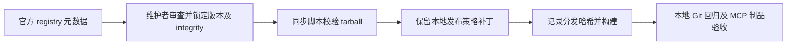

# TapTap 上游维护

## 规则、边界与接口

- vendor/instant-games-open-mcp/upstream-lock.json 是所分发 Maker 与 MCP 包的唯一版本及完整性来源；维护时查 npm 官方 registry 的 latest，并检查包差异后固定具体版本与 SHA-512，不把 latest 带入运行时。
- 同步沿用 scripts/sync-vendor.mjs；先校验 npm tarball integrity，再应用本地发布策略，最后记录分发文件的 distSha512。THIRD_PARTY_NOTICES.md 与锁定版本保持一致。
- Maker 本地工作区仍为文件快照唯一所有者。更新不得恢复远端 needs_pull 的快进覆盖或阻塞 preflight；远端推进时沿用 fetch 历史、ours 合并保留本地内容、重试 push。不得自动发布用户项目。
- 官方插件身份不变；本轮更新以 0.1.0 为当前清单基线，升级到 0.1.1，package、manifest、MCP 报告版本保持一致。官方目录由配置和真实清单重新生成。
- 上游技能只在明确来源、许可、接口兼容时同步；KayingCode 原创技能和预览归属逻辑不被上游整包覆盖。
- 0.0.38 的云端工作区修复诊断与项目 settings 健康规则适配进现有 game-publisher/gameplay-engineer；保留原有工具名、右侧预览和固定运行时。不会导入要求全局升级、独立控制台或另一套预览流程的技能。

## 所有者与时序

维护过程：官方 registry 元数据 → 固定 integrity 的 tarball → sync-vendor 校验/本地补丁 → lock 文件哈希 → 构建制品 → MCP 初始化与回归。运行时继续读取固定制品，不新增队列、缓存所有者或远程目录。

## 验收

1. 锁文件声明的 dist 文件存在且 SHA-512 一致；npm 版本、tarball 与 integrity 匹配。
2. 更新后 Maker 含本地发布策略，跳过远端内容同步 preflight；历史冲突仍保留本地快照。
3. 在临时本地 Git 远端上模拟双方历史推进，ours 合并后内容与删除项仍以本地为准，远端更新成功；不接触实际 TapTap 项目。
4. Manifest、package、MCP 版本一致；既有发布、预览、转写与项目管理测试通过。
5. 构建并初始化最终 MCP 制品，检查工具发现；不在验收中向平台发布游戏。
