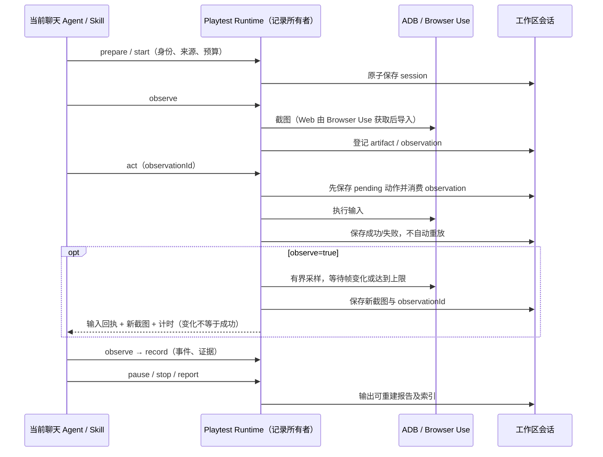
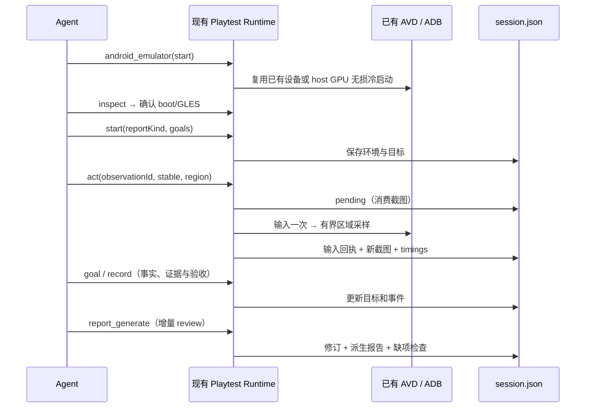

# 小咖游戏试玩助理

依据：[产品策划 V1.0](https://chatgpt.com/share/6ad9b614-4904-83ed-bfb4-692b803fd51b)。

## 产品规则与交付边界

`kaying-game-playtest` 是默认启用的官方内置插件，以现有聊天任务为入口，Skill
进行视觉理解与试玩决策，stdio MCP Runtime 执行确定性操作。不创建新的 Host、
Agent、模型客户端、任务队列或工作台业务状态。首版针对低频休闲、解谜、棋盘游戏。
中文显示名为“小咖游戏试玩助理”，统一由官方插件登记的展示信息提供。

- Android：校验本地 APK（大小、ZIP 标识、SHA-256），检查 ADB 设备，指定 serial
  安装、启动、截图、点击、滑动、长按、返回、限时等待与日志采集。包名由调用者明确提供。
  启动先经 Android Package Manager 解析属于目标包的 Activity，再显式 `am start -W -n`；
  不使用 monkey 随机事件启动。Android 16 实机验证中 monkey 可在 SYS_KEYS 检查阶段返回 251，
  而相同 APK 的显式 Activity 启动成功。解析无结果、跨包或启动错误必须保留为失败。
- 下载页与 APK URL 由 Agent 使用已有浏览器/文件工具处理，下载为本地文件后校验；
  不自动绕过登录、付费、验证码或自动下载不明链接。没有设备时复用 Android Emulator
  技能准备环境，不擅自管理 SDK 或重置用户设备。
- H5：复用 Browser Use 的真实浏览器和截图/录屏接口。本插件记录绑定 URL、
  已执行的外部动作以及导入的媒体，不另建浏览器控制器，也不宣称 MCP 自己执行了 Web 动作。
- 三种深度 quick/standard/deep 的默认时间预算为 10/30/60 分钟；策略 explore/objective/regression。
  回归由 Skill 根据历史操作逐步重新观察执行，不盲目重放历史坐标。
- 可选 scrcpy + ffprobe 录制并校验 Android 无音频 MP4；缺少工具仍可截图试玩，报告明确录像未覆盖。
  FFmpeg 按已登记录像裁剪事件片段。无真实录像时拒绝生成片段。
- 会话导出 session.json、manifest.json、actions.jsonl、events.jsonl、metrics.json，
  截图/日志/录像/片段，以及 report.html、report.md、report.json。HTML 仅使用相对媒体路径，
  无网络资源，桌面/手机、深浅主题均可读。
- 报告固定十二章；观察、推断、未验证明确区分。评分必须引用真实证据，未覆盖维度用 null，
  同时输出评分覆盖率与置信度。结论由当前 Agent 提交，Runtime 不伪造模型评价。
- 专属三栏原生面板、帧级控制、多点触控、音频分析、自动竞品检索、云设备池、
  自动创建 Issue 与性能基准不属于首版。版本比较仅比较已生成报告，注明环境差异。

## 唯一所有者与接口

Runtime 是试玩记录的唯一写入者。每个 workspacePath 下的 playtest-results 保存会话，
`workspaceIdentity?.trim() || workspacePath` 用于身份隔离；文件 IO 仍只使用 workspacePath。
所有工具经同一入口校验输入；工作区锁拒绝其他进程并发修改，进程内串行化。
session.json 是原子写入的唯一事实，JSONL、清单、指标和报告为可重建投影。
同工作区内设备由 running 会话独占；pause/stop 释放，resume 重新检查冲突与设备。
不跨工作区协调设备租约，禁止并行控制同一设备。日志仅采集目标包当前 PID；进程退出后
标记日志缺失，崩溃日志由 Agent 在明确需要时单独采集，不能默认导出其他应用日志。



输入操作必须使用当前会话最新且未消费的截图 observationId；截图后任何动作都使其失效。
`device_act(observe:true)` 复用同一 admission 路径，在动作完成后返回新截图、observationId
及 action 回执，减少一次模型往返。可选 waitForChangeMs（0–5000，缺省 1500）仅在设备端
比较前后 PNG 指纹，最多采样 16 次；无变化也返回实际截图和 frameChanged=false。
画面变化不等于目标成功，仍须模型复核，不自动选择或重放下一动作。采样失败时动作回执
维持已提交事实，返回 observationError；不可把截图失败改写为输入失败或重试输入。
耗时分别返回 actionMs、observationMs、totalMs，用于比较优化前后的设备链路。
过期 observation 拒绝，恢复后必须重新观察。动作先落 pending 再执行，因此崩溃后的
pending 只能记为 unknown，不可自动重放。设备错误保留记录并原样报错，不能当作游戏 bug。
达到时间预算或动作上限禁止继续操作，但仍允许采集、停止和生成部分报告。
MCP 退出时停止本进程录制并暂停会话；异常退出后 resume 记录中断并重新观察。
桌面 continuous 与手机 replayable 的交付仍使用现有聊天/Host 链路；插件文件不是远端队列或快照。

## 验收场景（先于实现）

1. 官方目录默认启用、manifest/MCP/Skill/命令与发布资源齐全，生成目录与 source map 通过检查。
2. 假 ADB 端到端：prepare → APK 安装启动 → observe → tap → 新截图 → 事件 → stop → 三种报告。
3. 操作缺少截图、复用旧截图、越界坐标、错误 workspace identity、达到预算均被拒绝。
4. 安装失败不创建 running 会话；设备断线不伪造成功；重复或并发操作不重复触发设备输入。
5. pause/resume 和进程重启保存原会话，pending 动作标记 unknown，恢复后旧截图不能操作。
6. Web 外部动作和媒体导入保留来源；禁止目录穿越、逃逸 symlink、未知或不存在证据引用。
7. 缺少录像/FFmpeg 返回明确限制；录制停止后再登记媒体，片段时间在录像范围内。
8. 未评分报告为未覆盖；评分、问题必须引用 artifact；HTML 转义不可信文本，离线媒体可打开。
9. stdio 真进程测试 initialize/tools/list/tools/call、无效输入、通知、EOF 清理和错误后继续服务。
10. 合并操作只发送一次输入并返回可用于下一动作的新截图；旧截图复用仍被拒绝。
    无帧变化时有界返回，截图失败保留 succeeded 动作且不重放；Web 不使用此 Android 路径。

## 实测反馈优化：环境、目标与报告

先明确规则，后实现。保留现有 Runtime/session.json 唯一所有者和 admission 路径，不另建
模型客户端、动作队列或游戏业务状态。新增字段向后兼容 schemaVersion=1 的历史会话。

- `android_emulator(inspect|start)` 仅管理已有 AVD 的无损启动。优先复用已连接设备，
  多设备必须明确 serial；无设备时选择明确 avd 或唯一 AVD。启动固定使用
  `-gpu host -no-snapshot-load -no-snapshot-save`，保留 userdata，不 wipe、不重建 AVD、
  不自动关闭已有模拟器、不静默回退 SwiftShader。inspect 返回启动完成状态、CPU/ABI、
  SurfaceFlinger GLES 渲染器及软件渲染警告；启动返回后由 inspect 检查，不把 spawn 当就绪。
  依据是相同 APK 在 Apple M5 上第二次冷启动实际使用 Metal，原 auto 曾回退软件渲染；
  不把该单机观察推广为所有平台的性能承诺。
- `playtest_start` 增加 reportKind（evaluation/diagnostic），目标清单和可选 relatedSessionIds。
  缺省 evaluation；diagnostic 不呈现综合游戏总分。每个目标有明确验收条件；
  `playtest_goal` 记录 not-tested/partial/verified/blocked/not-applicable，状态更新必须给原因，
  verified/partial 必须附证据。目标验证由 Agent 负责，输入成功不自动完成目标。
- report_generate 缺省按章节/评分维度增量更新，issues 显式提交时整体替换；
  reviewMode=replace 可明确整体替换，修订历史仍保存在 session.reviewRevisions。
  原始事件、媒体不变。relatedSessionIds 必须属于同 workspace identity；报告列出版本、设备、
  进度与原报告路径，关联会话不自动合并评分或把旧证据当本轮结果。
- 章节增加状态与原因，自动生成基础信息、目标/动作统计、事件和证据索引、问题清单状态。
  未提交的主观评价从有证据的对应事件生成事实草稿，不能自动评分；缺项检查列出有证据
  尚未分析的维度。评分覆盖率明确命名，与目标验证数分开；没有评分不显示 0% 试玩覆盖率，
  没有 issues 不能声称游戏无缺陷。未测试章节默认折叠，十二章仍可查看，HTML/MD/JSON 同源。
- 输入后支持 settleRegion（原图像素矩形），在 ffmpeg 可用时仅比较该区域灰度降采样帧，
  连续三个样本在阈值内且至少跨 250ms 才标 settled=true。缺省仍兼容 frameChanged，
  Skill 对棋盘优先选择 stable 模式；预算/最多 16 帧到达返回 settled=false，不凭动画变化
  判成功。没有 ffmpeg 则明确 stable unavailable，只重新观察，不重放输入。
- 原图永远是证据和坐标基准；可选 previewMaxWidth 返回缩略 PNG 和尺寸/缩放映射，
  不替换证据原图。缺 ffmpeg 返回原图并说明限制。稳定采样和预览属于观察路径，不选择动作。
- 指标自动汇总输入、观察、已测工具耗时和调用间未归因时间；后者不能称为纯模型推理。
  pause 时间与 wall/active 分开，预算不可通过暂停恢复重置。诊断报告给样本数、均值、
  中位数和 p95，不用三次样本声称 GPU 加速倍数。
- 录制新增 durationSeconds（缺省 60、上限 180）与 max-fps=15，到时自然封装；
  finalize 登记前 ffprobe 校验，stop 仍可主动终止。录像导入也校验可播放性，允许提供
  明确 startedAt；不把导入时刻作为录制开始，未给时间基准不能自动剪事件高光。



新增验收：

11. 模拟器复用不 spawn；冷启动参数正确且无 wipe；多设备拒绝猜测；软件 GLES 只警告不隐藏。
12. 有玩法事实但无 scores 时仍呈现事实和目标进展，不显示“覆盖 0%”；基础信息/证据自动生成。
13. 增量提交不丢旧章节；replace 明确生效并保留历史；关联会话隔离 identity 并显示环境差异。
14. verified 目标无证据拒绝；局部成功不代表完整关卡；blocked 有原因；旧会话仍可生成报告。
15. 区域内移动持续时不标稳定，区域外装饰动画不干扰稳定判断；有界超时不重复输入。
16. 缩略图像素映射可还原原坐标；损坏导入视频拒绝；限时录像自然结束后可以 finalize。
17. 真实 Android inspect 确认 Metal 渲染；旧报告重新生成后离线图文、折叠章节、手机布局可读。

## 面向读者的新游戏试玩报告

默认 evaluation 是《新游戏试玩报告》，目标是让没有亲自游玩的读者理解游戏定位、
设计风格、基本规则、玩法循环和可观察的亮点。正文以游戏为主语，避免将设备、工具回执、
动作数量、验证率或插件调优当作游戏介绍。diagnostic 保持运行诊断用途和现有结构。

文风像玩过后向朋友讲重点：先给判断，再用一个实际细节说明原因。真人感来自具体的
观察、选择和反馈，不靠口头禅、虚构情绪或反复自称“我”。避免“情绪通路、成长线索、
闭环完成度”等抽象评估腔，也不为常见机制补写“并非行业创新”之类的空泛比较。

导语一句话，正文通常约600–900字（不含图注、结构化问题和附录）。修订现有长报告时，
各节文字以原文约一半为目标，优先删除重复解释、操作流水账和无关数字；不能删掉会改变
结论的条件和不确定性。十二个 key 和现有呈现结构保持稳定，不为填满章节扩写内容。
每节通常只保留1–4个读者需要关注的点，多点用“1. / 2. / 3. / 4.”逐行写入 text，
每点一件事、1–2句；只有一点时直接写一句，不凑满四点。普通章节约40–90字，规则或
一局体验必要时可到120字；信息量少则更短，用户指定的篇幅优先。

规则在核心玩法讲清，上手只讲教学是否容易跟，一局体验只选一个有代表性的选择和反馈；
亮点不再复述整套规则，适合谁直接给人群与理由。问题正文不重复结构化问题的复现步骤，
图解不再清点素材。具体设备、包名、资源余额、操作坐标、输入回执和工具故障由附录承接。
未体验范围集中放在了解范围；推测附近仍须保留“只看到入口”等必要限定。图注一句话指出
看点。不使用夸张宣传、强行卖萌或未经体验的感受。详细写作示例与交付前自检由
`skills/game-playtest/references/reporting.md` 维护，Agent 在提交 review 前完成压缩与去重。

- 保持十二个稳定 section key 与既有 schemaVersion=1；evaluation 的呈现顺序/标题为：
  一句话认识、游戏名片、设计风格、核心玩法、如何上手、一局体验、值得关注的亮点、
  关卡之外的成长、体验疑问、适合谁、图解与玩法片段、了解范围。
- review 可提供 gameName、lede 和章节内 media:[{artifactId,caption}]。
  media 必须引用该章节 evidenceIds 中实际存在的 screenshot/recording/highlight，
  不允许日志充当插图；图注说明画面帮助理解的游戏特点。不得用虚构宣传图代替实测画面。
  gameName/lede 随 review 增量更新；旧会话缺字段仍可生成报告。
- 前台标题为“游戏名｜新游戏试玩报告”，导语一句话交代类型、主题和体验特点；
  无评分不影响正文，评分/置信度/目标/计时/环境/完整证据统一放到默认折叠附录。
  HTML 与 Markdown 使用同一顺序与内容；JSON 保留事实、主观判断标签、评分与原始来源。
- 正文解释玩家每步做什么、为什么这样做、得到什么反馈、奖励通往哪里；
  亮点至少对应一个具体设计及可见作用，不能把“命令成功”“Metal”当游戏亮点，
  不把同类常见机制夸成行业创新。货币/体力图标存在不代表已验证付费规则。
- 允许导入同工作区此前试玩的开场图片补充介绍，但必须实际查看、通过 attach 登记，
  图注及了解范围保留此前来源；不得宣称这次重新体验了这些环节。
- 读者报告不展示逐章“依据与来源”区块，Markdown 正文也不附逐章来源链接。
  事实和推断的可追溯信息保留在 JSON 和附录；正文保留必要的范围限制，
  不在每段重复工具限制。未接触的音频、商业化、后期难度和长期留存不下定论。

状态所有者、事件顺序和执行路径不变：

```text
Agent 观察/评价与选图 → report_generate 校验证据 → session.json 保存 review 修订
                                              └→ 同源 HTML/Markdown/JSON 呈现
```

新增验收：

18. evaluation 正文先讲风格与玩法，运行耗时/评分/原始日志仅在后置折叠附录；diagnostic 不变。
19. 读者导语与图注保留增量修订；插图必须属于章节证据，未知媒体/日志/跨章节引用被拒绝。
20. HTML/MD 标题、章节顺序和配图一致；不可信标题/图注转义，旧会话兼容。
21. 用《假日乐消消》既有证据重写文章，读者可理解三消和庭院任务的关系；不新增游戏操作。
22. HTML/Markdown 正文无“依据与来源”段落，JSON 章节 evidenceIds 和附录证据仍完整。
23. 以 Fishdom 快速试玩报告为文风验收样本：保留十二章，各节长段压缩到原文约一半，
    多点逐行编号且不凑数；普通三消/爆竹规则不在上手、体验和亮点中完整重复。
24. 一局体验保留一次具体选择与反馈，不复述坐标和步数流水；了解范围直接写进度及关键
    未体验项，输入成功率与工具故障留在附录；压缩后不把未打开的装扮入口写成已玩过养成。
25. Agent 自检覆盖篇幅、单点单意、跨章去重和事实边界；本轮只调整生成指导，不修改
    Runtime/schema、报告布局或已有试玩产物，文风按人工审读验收，不用关键词匹配代替。

## 本地产物与提交边界

`playtest-results/` 是工作区运行产物，包含实际游戏截图、录屏、日志和会话事实，不进入代码提交。
仓库根忽略该目录；清理工作区时可整体移出归档，保持各会话之间的相对媒体/报告链接。
插件源码、规格、Skill、测试和构建脚本属于交付内容；dist 为可重建的已忽略构建产物。
