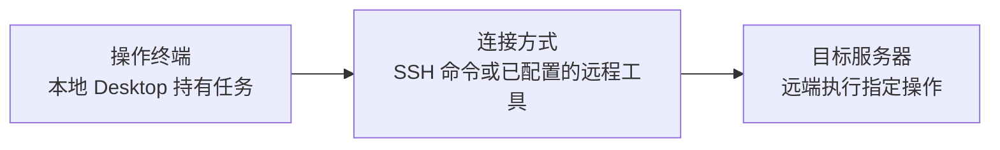

# 01 本地 Agent 调用远程工具



**连接方式**　从本地 Agent 可用的终端或已配置工具向远端发出操作。示例用 SSH 运行单条命令。

**适用场景**　项目、会话和 Agent 都留在本地，只把个别构建、测试或文件检查交给远端执行环境。远端用户、目录和沙箱边界由部署方配置。要让 Agent 本身运行在 Ubuntu 项目里，使用 [03 Desktop 受管 SSH](03-managed-ssh.md)。

## 部署与连接

1. 安装并启动本地 Desktop，打开本地项目。在「设置 → 模型设置」填写 Base URL、API Key 和模型 ID，在会话里选择该模型，确认能收到回复。 [Desktop 安装](../kayingcode-desktop.md)
2. 准备远端执行账号和测试目录。先从本地终端验证连通性和实际执行位置，将示例账号和目录替换为你的环境。

   ```sh
   ssh ubuntu@your-server 'cd /path/to/project && hostname && pwd'
   ```

3. 用本地 Agent 的终端或已配置的工具执行同一项远端检查，核对返回的主机和目录。需要隔离时，通过部署方配置的远端沙箱入口执行。

## 验收

确认会话留在本地、指定操作发生在远端。运行期间保持本地 Desktop、对应 Host 和工具连接。退出持有任务的本地 Desktop 会中断本地 Agent 任务。

返回 [连接方式总览](README.md)。
