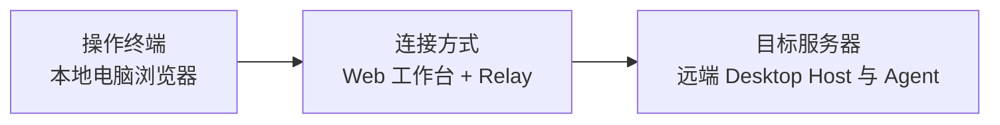

# 02 浏览器访问远端 Desktop

**连接方式**　用浏览器打开远端 Desktop 生成的 KayingCode V2 Web 授权链接。Relay 转发请求，远端 Desktop 提供工作区和会话。

**适用场景**　远端机器已有图形桌面，希望从另一台电脑接着操作。若从手机访问，见 [05 Taro / Flutter 访问 Desktop](05-mobile-webview.md)。

## 部署与连接

1. 在远端主机安装并启动 Desktop。Ubuntu 图形桌面可使用对应架构的 `.deb` 或 AppImage。打开项目，在**远端 Desktop** 的「设置 → 模型设置」配置供应商、API Key、Base URL 和模型 ID，再发送一条消息确认可用。 [Desktop 安装](../kayingcode-desktop.md)
2. 自托管时先部署同一个 HTTPS origin 上的 Relay 和 Web，配置远端 Desktop 使用该地址。 [Relay 部署](../../../apps/kayingcode-relay-cloudflare/DEPLOYMENT.md)
3. 在远端 Desktop 的左下角打开手机远控，开启后复制完整授权链接。在本地电脑浏览器打开链接，进入同一个项目和会话。邀请过期或已使用时，在远端 Desktop 生成新的邀请。

## 验收

确认远端 Desktop 已受理测试任务，再关闭本地浏览器。在远端 Desktop 确认进度，重新打开工作台核对同一会话的结果。远端 Desktop 和任务所属 Host 要持续运行，主机休眠会让访问端离线。 [远控验收范围](../../../packages/desktop/spec/mobile-web-remote.md)

返回 [连接方式总览](README.md)。
