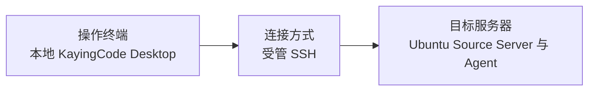

# 03 Desktop 受管 SSH



**连接方式**　在本地 Desktop 选择「连接远程环境 → SSH」。向导部署或复用 Ubuntu 上的 Source Server，再打开远端目录。

**适用场景**　Ubuntu 无需图形桌面。Agent、项目文件、Git 和终端都在 Ubuntu 上工作，操作者使用 Desktop 界面。

## 部署与连接

1. 准备 Ubuntu 的 SSH 账号和认证信息。用该账号登录，确认能读写项目目录。
2. 使用源码开发版时，在**客户端仓库根目录**准备远端资源并启动 Desktop。

   ```sh
   pnpm run bootstrap:with-remote
   pnpm run dev:desktop
   ```

3. 在客户端选择「连接远程环境 → SSH」，填入主机、SSH 用户和认证信息。开发态选择「本地下载后上传」。等待向导部署或复用服务，再选择 Ubuntu 上的项目目录。 [源码开发与 SSH 资源](../../../README.md)
4. 在**客户端 Desktop** 的「设置 → 模型设置」配置供应商、API Key、Base URL 和模型 ID。受管连接会把个人模型配置下发到 Ubuntu。模型请求从 Ubuntu 发出，Base URL 按 Ubuntu 能访问的地址填写。

## 验收

在远端会话发送消息，验证模型响应和文件操作。确认 Source Server 已受理一项测试任务后，退出本地 Desktop，保留 Ubuntu 和 Source Server 运行。重新连接同一设备和项目，打开原会话核对结果。把 Ubuntu 主机、客户端版本和退出步骤记入测试记录。

手工维护服务包时可用 `~/.kayingcode/server/bin/kayingcode status --json` 检查远端状态。当前请从受管「SSH」入口连接。独立「远程 Agent」向导的握手限制见总览。 [Linux Server 归档安装](../../kayingcode-v2/LINUX_SERVER.md) · [Provider 下发](../../../packages/desktop/src/main/desktopRemoteSessions.ts)

返回 [连接方式总览](README.md)。
