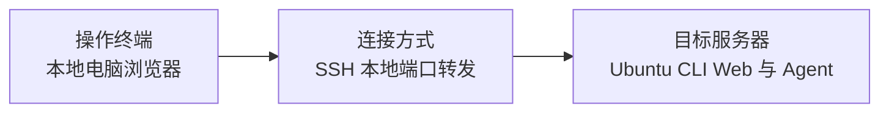

# 04 浏览器通过 SSH 访问 CLI Web



**连接方式**　让 Ubuntu 上的 Web 工作台监听回环地址，再用 SSH 把端口转发到客户端电脑。

**适用场景**　Ubuntu 无需图形桌面，客户端电脑只使用浏览器。准备能在 Ubuntu 上运行 `--web` 的统一 CLI 发行包和 SSH 账号。 [CLI 发行包说明](../kayingcode-cli.md)

## 部署与连接

1. 在 Ubuntu 安装统一 CLI 发行包。使用可持续运行的远端终端或进程管理器启动工作台，将 `/path/to/project` 换为远端项目目录。

   ```sh
   kayingcode --web --host 127.0.0.1 --port 3030 --workspace /path/to/project --no-open
   ```

2. 在客户端电脑执行端口转发，将账号与主机换成实际 SSH 目标。保持这条转发运行。

   ```sh
   ssh -N -L 3030:127.0.0.1:3030 ubuntu@your-server
   ```

3. 打开 [本地转发地址](http://127.0.0.1:3030)，在 Web 工作台的「模型设置」填写供应商、API Key、Base URL 和模型 ID，选中该模型并测试回复。

个人 Provider 配置默认在 Ubuntu 运行用户的 `~/.kayingcode/v2/provider_config.json`。设置 `KAYINGCODE_DATA_BASE_DIR` 会改变数据基目录。 [配置路径](../../../packages/services/src/model-provider/providerConfigRuntime.ts)

## 验收

确认 Ubuntu 已受理测试任务后，关闭浏览器和客户端转发，保留 Ubuntu 上的 Web 进程。重新建立转发并打开同一会话核对结果。如果 Web 进程从 SSH 登录终端启动，还要检查退出那条登录会话后进程是否仍在运行。

返回 [连接方式总览](README.md)。
