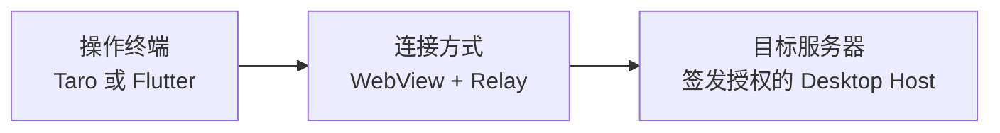

# 05 Taro / Flutter 访问 Desktop

**连接方式**　用 Taro 或 Flutter 扫码或粘贴 KayingCode V2 Web 授权链接，由 WebView 打开工作台。链接中的设备身份指向签发授权的 Desktop Host。

**适用场景**　在手机上接着操作桌面会话。目标项目可在签发授权的 Desktop 上，也可以是它通过 [03 受管 SSH](03-managed-ssh.md) 打开的 Ubuntu 项目。手机访问这个 Ubuntu 项目时，提供授权入口的 Desktop 需要保持运行。

## 部署与连接

1. 让 Desktop 和 Web 使用同一 Relay 部署，打开目标项目。若使用远端目录，先在 Desktop 连接 Ubuntu 并确认会话可用。Provider 沿用对应工作区的配置方式。 [Relay 部署与授权](../../../apps/kayingcode-relay-cloudflare/DEPLOYMENT.md)
2. 在 Desktop 开启移动远控，生成完整 HTTPS V2 授权链接。在手机「会话列表」添加设备，扫码或粘贴链接，再打开工作台。连接管理在会话模块内，终端与会话操作在 Web 工作台内完成。
3. Taro 微信真机使用有权限的小程序 AppID，配置工作台的 HTTPS WebView 业务域名。Flutter 按目标平台的固定 SDK 构建。验证「项目列表」前部署包含最近项目桥接的 Web 制品。 [Taro 构建](../kayingcode-mobile-taro.md#构建) · [Flutter 构建](../kayingcode-mobile-flutter.md#固定-sdk-与构建) · [Web 项目桥接](../../../packages/web/spec/mobile-web-workbench.md)

## 验收

从手机打开目标会话，发送消息并确认回复。切后台或更换网络后，回到同一会话检查恢复结果。打开项目后返回壳层，在「项目列表」中确认已记录并可重新打开。邀请过期或遇到旧 ZCode 档案时，从 KayingCode Desktop 生成新的授权链接并添加设备。

独立 Source Server 或 CLI Web 的地址用于各自的连接方式。Taro、Flutter 需要 Desktop 签发的 V2 授权链接。小程序构建、Flutter 测试、替身 WebView 测试与真机端到端验证分别记录。 [Taro 规范](../../../apps/kayingcode-mobile-taro/spec/mobile-webview-tabs.md) · [Flutter 规范](../../../apps/kayingcode-mobile-flutter/spec/mobile-webview-tabs.md)

返回 [连接方式总览](README.md)。
