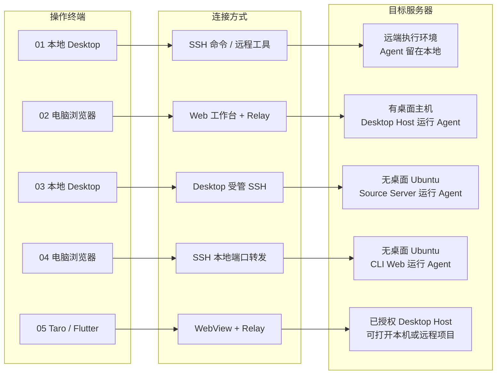

# Agent 连接方式总览

先选操作终端和目标机器，再按图中编号打开对应指南。目标服务器一栏同时标明 Agent 在哪里运行。

| 连接指南                                                     | 适用场景                                            | 任务运行时需要保留                                                    |
| ------------------------------------------------------------ | --------------------------------------------------- | --------------------------------------------------------------------- |
| [01 本地 Agent 调用远程工具](01-local-agent-remote-tools.md) | 项目和会话在本地，只把个别命令交给远端执行          | 本地 Desktop、任务所属 Host 和远程工具连接                            |
| [02 浏览器访问远端 Desktop](02-desktop-web-remote.md)        | 远端机器已有图形桌面和 KayingCode，从另一台电脑操作 | 远端 Desktop 和 Host。可关闭本地浏览器                                |
| [03 Desktop 受管 SSH](03-managed-ssh.md)                     | 用本地 Desktop 在无桌面的 Ubuntu 上开发             | Ubuntu 上的 Source Server。可关闭本地 Desktop，再重连查看已受理的任务 |
| [04 浏览器通过 SSH 访问 CLI Web](04-ubuntu-web-tunnel.md)    | 无桌面 Ubuntu 独立运行工作台，用浏览器访问          | Ubuntu 上的 CLI Web。可关闭本地浏览器和转发，再重新连接               |
| [05 Taro / Flutter 访问 Desktop](05-mobile-webview.md)       | 在手机上打开 Desktop 已授权的项目和会话             | 签发授权的 Desktop 和 Host。可关闭移动端                              |

**先确认远端已经受理任务，再关闭操作端。** 关闭客户端会停止查看进度。待批准的操作仍要在重连后处理。终端连接和会话任务分别验收。

当前原生 Desktop 的「远程 Agent」入口无法直接接管单独启动的 `kayingcode-server` Core。该入口要求 SSH 隧道认证和非空工作区列表，Core 使用 ingress token 并返回空列表。用受管 SSH 连接 Ubuntu，或用浏览器连接远端 Desktop / CLI Web，按上表选择。 [桌面握手](../../../packages/desktop/src/host/remoteAgentConnection.ts) · [常驻 Core](../../../packages/zcode-server-cli/src/server-core/http.ts)

返回 [部署入口](../../deploy.md)。
