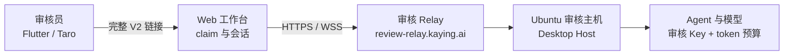

# Flutter 与 Taro 应用审核方案

面向 App Store、Google Play 与微信小程序提审的审核方案、已部署环境、平台提交位置和审核说明模板。环境搭建、Relay 变量与 Ubuntu 主机操作以[审核环境部署](kayingcode-review-environment.md)为准；Taro 客户端规则见[审核接入规范](../../apps/kayingcode-mobile-taro/spec/review-environment.md)；Flutter 构建与签名见 [Flutter 部署](kayingcode-mobile-flutter.md) 和[平台发布文档](../../apps/kayingcode-mobile-flutter/docs/release/)。

## 1. 方案

审核使用独立的 Relay、Desktop Host、数据目录和模型 Key，不复用生产环境。Flutter 与 Taro 不实现独立的审核协议，只打开 Desktop 生成的完整 V2 授权链接；邀请、领取次数和终端凭据由审核 Relay 拥有，token 预算由审核 Host 拥有，claim 与会话由 Web 工作台拥有。



| 项           | 生产                              | 审核                             |
| ------------ | --------------------------------- | -------------------------------- |
| Relay origin | `https://relay.service.kaying.ai` | `https://review-relay.kaying.ai` |
| Web 审核入口 | `/remote/v4`                      | `/remote/v4`                     |
| 邀请策略     | 5 分钟、单次领取                  | 30 天、同一邀请最多 20 次        |
| 终端凭据     | 30 天                             | 30 天                            |
| 数据与凭据   | 生产 owner/工作区                 | 独立 owner、数据目录和工作区     |

审核环境不得复用生产 Relay、生产 owner、生产工作区或生产模型 Key。审核结束应整体下线，而不是只撤销某条链接。

## 2. 当前审核环境

核验时间：2026-11-10。

| 项                   | 值                                                                     |
| -------------------- | ---------------------------------------------------------------------- |
| 审核 origin          | `https://review-relay.kaying.ai`                                       |
| Worker 名            | `kayingcode-relay-review`                                              |
| 当前版本             | `8c4ded21-c847-4d2f-8648-eaa1a16a7c88`（2026-11-09 部署，100% 流量）   |
| 代码来源             | `review/0.1.2` 的 `e90df725`，尚未合入 `main`；生产 Relay 未部署该分支 |
| 邀请有效期           | `KAYINGCODE_REMOTE_INVITE_TTL_DAYS=30`                                 |
| 同一邀请领取次数     | `KAYINGCODE_REMOTE_INVITE_MAX_CLAIMS=20`                               |
| 终端凭据有效期       | `KAYINGCODE_REMOTE_TERMINAL_TTL_DAYS=30`                               |
| 微信业务域名校验文件 | `/69txzPKb7q.txt`，HTTP 200，SHA-256 与仓库文件一致                    |
| 已知域名             | 是（`kaying.ai` 子域）；Flutter 和 Taro 不弹「未知服务器」确认         |

已核对：

- `/healthz` 返回 `{"ok":true}`，`/readyz` 返回 `{"ready":true}`。
- `mobile-web-manifest.json` 的 `relayOrigin` 为 `https://review-relay.kaying.ai`，`entryVersion` 为 2，`auth` 为 `desktop-invitation`。
- 部署的 Web 认证制品包含同一邀请重开复用的摘要逻辑，与 `review/0.1.2` 一致。
- `/remote/v4` 与全部 JS 资产返回 200；根路径 `/` 返回 404，符合只开放 `/remote` 和校验文件的预期。

提醒：

- `MAX_CLAIMS=20` 比常见示例大，链接一旦扩散，多个浏览器可各自领取独立终端凭据。只通过受控渠道发放，并优先为每位审核员单独生成链接。
- 当前 Worker 运行的是未合入 `main` 的审核分支。后续修改必须重新构建并以审核 origin 部署；生产部署仍使用生产 origin 重新构建。
- 变更 Worker 名、域名或三个变量后，同步更新本文。

复核命令：

```sh
curl --fail https://review-relay.kaying.ai/healthz
curl --fail https://review-relay.kaying.ai/readyz
curl --fail https://review-relay.kaying.ai/remote/mobile-web-manifest.json
curl -I https://review-relay.kaying.ai/remote/v4
curl --fail https://review-relay.kaying.ai/69txzPKb7q.txt

wrangler deployments list --name kayingcode-relay-review
wrangler versions view <version-id> --name kayingcode-relay-review
```

## 3. 发布平台对照

| 平台                 | 客户端/产物       | 链接交付位置                               | 域名要求                                           | 备注重点                                         |
| -------------------- | ----------------- | ------------------------------------------ | -------------------------------------------------- | ------------------------------------------------ |
| iOS App Store        | Flutter IPA       | App Store Connect → App Review Information | 无白名单                                           | 真机可安装、WebView 可打开、Desktop 在线         |
| Google Play          | Flutter AAB/APK   | Play Console → App access                  | 无白名单                                           | 写明链接有效期、重复领取和备用链接               |
| 微信小程序           | Taro `dist/weapp` | 微信公众平台审核备注（限 200 字）          | 审核 origin 必须加入业务域名，保持 `urlCheck` 开启 | 使用紧凑链接；校验文件已就绪；Desktop 在线说明   |
| H5                   | Taro `dist/h5`    | 非商店产物，按受控渠道提供                 | 无白名单                                           | 跨域 iframe 存储分区可能多 claim 一次            |
| HarmonyOS / 其他市场 | Flutter HAP 等    | 对应平台审核信息                           | 无白名单                                           | 当前仓库只有构建与签名文档，上架时按平台要求补充 |

Flutter 和 Taro 使用同一条链接，追加参数不同：Flutter 为 `kayingPlatform=flutter`，Taro 微信为 `kayingPlatform=weapp`，H5 额外带 `kayingParentOrigin`。这些参数不影响授权和 claim。

## 4. 提审前准备

### 4.1 审核主机

在 Ubuntu 审核主机设置并保持运行：

```sh
export KAYINGCODE_OFFICIAL_CLOUDFLARE_RELAY_ORIGIN=https://review-relay.kaying.ai
export KAYINGCODE_DATA_BASE_DIR=/srv/kayingcode-review
export KAYINGCODE_REVIEW_TOKEN_BUDGET=500000
export KAYINGCODE_REVIEW_BUDGET_DIR=/srv/kayingcode-review/budget
export KAYINGCODE_REVIEW_BUDGET_SCOPE=environment
export KAYINGCODE_REVIEW_COMPACT_LINK=1
```

Desktop 必须使用包含进程环境 origin 支持的审核构建，否则仍会生成生产链接。审核工作区只放示例项目、历史会话和演示文件，不放入源码、凭据或真实用户数据。模型使用审核专用供应商、Key 和配额，审核结束撤销。详细安装、Xvfb 和 systemd 配置见[审核环境部署](kayingcode-review-environment.md)。

### 4.2 签发链接

1. 在审核 Desktop 打开左下角手机远控，确认状态为等待手机连接。
2. 复制完整链接，形如 `https://review-relay.kaying.ai/remote/v4?sid=…#authorize=…`。
3. 核对域名是审核 origin，不是 `relay.service.kaying.ai`。
4. 为每位审核员生成单独链接；如共用一条，按人数确认剩余领取次数。
5. 准备一条备用链接，审核备注中同时给出。

链接规则：

- 每条邀请自签发起 30 天有效，最多领取 20 次；每次领取生成独立终端凭据。
- 同一浏览器重开同一链接不重复消耗次数；清除存储后重开会再 claim 一次。
- 刷新远控二维码会签发新邀请，旧邀请在有效期内仍然有效。不要反复刷新并分发多张链接。
- 链接本身即凭据，不放入公开说明、截图、日志、代码仓库或工单附件。
- 微信提审备注限 200 字。审核主机设置 `KAYINGCODE_REVIEW_COMPACT_LINK=1` 后，链接只保留 `sid` 和 authorize fragment，省略 `name`、`mid`、`app_version`，示例约 135 字，可留出说明文字空间；修改后需重启 Desktop 才生效。
- 使用紧凑链接时审核期间必须保持 Desktop 在线。Desktop 重启导致 SID 变化后，旧链接不能按机器自动接续，需要重新生成并更新审核备注。

### 4.3 平台配置

**Flutter**

按[平台发布文档](../../apps/kayingcode-mobile-flutter/docs/release/)完成构建、签名和上传。提审时在 App Review Information 或 App access 中附上链接、有效期、领取次数、Desktop 在线要求和操作步骤。iOS 真机需要能安装并打开 WebView；Android 侧确认 WebView 与网络可达。

**Taro / 微信小程序**

1. 在提交审核的小程序「开发管理 → 开发设置 → 业务域名」加入 `review-relay.kaying.ai`。校验文件已由审核 Relay 在根路径提供，保持 `urlCheck` 开启。
2. 从仓库根执行 `pnpm --filter @kayingcode/mobile build:weapp`，在微信开发者工具导入 `dist/weapp` 上传并提审。
3. 在审核备注中附链接、有效期、Desktop 在线要求和粘贴/扫码步骤。
4. H5 不需要业务域名，但页面在跨域 iframe 中运行；浏览器存储分区导致重开多 claim 一次属于预期，不作为缺陷。

换用其他小程序 AppID 时，微信生成的校验文件名不同，当前 Worker 只放行 `69txzPKb7q.txt`；需先扩展 Relay 静态白名单并重新构建，见[审核接入规范](../../apps/kayingcode-mobile-taro/spec/review-environment.md)。

## 5. 审核备注模板

中文：

```text
应用核心功能需要连接一台在线桌面主机，演示环境已准备。

操作步骤：
1. 打开应用，进入「添加设备」或「连接 KayingCode」。
2. 粘贴审核链接：<完整链接>
3. 等待 Web 工作台打开，即可查看示例项目并发起任务。

说明：
- 链接有效期至 <日期>，可重复领取 <次数> 次，请勿公开分享。
- 桌面主机需保持在线；如提示设备离线，请稍后重试或联系 <联系方式>。
- 演示工作区只包含示例数据，模型请求有额度限制。
- 审核过程中请勿截图或转发链接。

备用链接：<备用链接>
```

English：

```text
The core feature requires an online desktop host. A demo environment is ready.

Steps:
1. Open the app and choose "Add device" or "Connect KayingCode".
2. Paste the review link: <full link>
3. Wait for the web workbench to open, then open the sample project and start a task.

Notes:
- The link is valid until <date> and can be claimed up to <count> times. Do not share it publicly.
- The desktop host must stay online. If the device appears offline, retry later or contact <contact>.
- The demo workspace contains sample data only, and model usage is budget-limited.
- Please do not screenshot or forward the link.

Backup link: <backup link>
```

## 6. 审核员操作与预期

**Flutter**

1. 在「添加设备/粘贴连接信息」粘贴或扫码完整链接。
2. WebView 打开工作台并自动 claim；地址栏 fragment 被清除。
3. 可打开示例项目、查看会话并发送消息。
4. 重开同一链接仍进入现有会话，不增加领取次数。

**Taro（微信小程序）**

1. 在会话列表或设备管理粘贴或扫码完整链接。
2. 微信原生 WebView 挂载完整链接；业务域名正确时直接打开工作台。
3. 重开、切后台和返回仍进入同一会话。
4. 业务域名未配置时微信显示原生错误页，外壳可重试或复制链接，不自动改用浏览器。

**共同预期**

- 设备离线时提示联系维护人，不显示伪造的成功状态。
- 达到 token 预算后，模型请求被拒绝，工作台显示“审核用量已达上限”。
- 领取次数耗尽后 claim 失败，需要从 Desktop 生成新链接。

## 7. 审核期间检查

| 检查点     | 期望                                                      |
| ---------- | --------------------------------------------------------- |
| Relay      | `/healthz`、`/readyz` 200；manifest origin 与审核域名一致 |
| 授权       | 新链接可 claim；claim 后 fragment 被清除                  |
| 工作台     | `/remote/v4` 能打开项目、会话和输入框                     |
| 会话       | 审核工作区能收到模型回复并读写示例文件                    |
| 重复打开   | 同一浏览器重开不增加领取次数                              |
| 次数耗尽   | 超过 20 次后拒绝 claim，需生成新链接                      |
| Token 预算 | 达到上限后请求被拒绝并显示提示                            |
| Desktop    | 远控面板显示在线，主机不休眠、不退出                      |
| 微信       | 业务域名已配置；WebView 可打开；`urlCheck` 开启           |

建议每天检查一次 Relay 健康、Desktop 在线状态和剩余领取次数。审核期间不要升级 Desktop 或 Relay，除非已准备回退版本。

## 8. 审核结束与撤销

1. 停止 Desktop 远控，删除审核设备。
2. 删除审核 Worker 和 `review-relay.kaying.ai` 域名；微信小程序同步移除业务域名。
3. 撤销审核模型 Key、配额和预算目录。
4. 保留审核记录：Worker 版本、代码提交、审核 origin、签发时间、领取次数和验收结果。不要归档完整链接或终端凭据。

如果暂时不能删除 Worker，至少停止 Desktop 并删除设备。需要长期保留服务时，使用全新的 Desktop 数据目录重新注册 owner，避免复用审核 owner。

## 9. 常见问题

| 现象                     | 处理                                                                 |
| ------------------------ | -------------------------------------------------------------------- |
| 链接过期或已使用         | 检查领取次数和有效期；从 Desktop 生成新链接                          |
| 授权服务不可达           | 检查审核域名、Worker 路由、`/healthz`、`/readyz` 和变量              |
| 页面能开但一直等待       | 检查 Desktop 远控在线、SID 对应和 Host 运行状态                      |
| 审核员看到设备离线       | 检查审核主机、Desktop 进程、网络和休眠设置                           |
| 模型无回复               | 检查审核 Key、Base URL、配额和出网策略                               |
| 微信提示业务域名不合法   | 确认域名已加入业务域名、校验文件 200 且无重定向；不要关闭 `urlCheck` |
| 微信校验文件 404         | 换用其他 AppID 时文件名不同；改用默认 AppID 或扩展 Relay 白名单      |
| 页面 404 或静态资源失败  | 确认用审核 origin 重新执行 `build:web`，manifest 与部署版本一致      |
| 提示审核用量已达上限     | 确认审核计划，停止 Desktop、删除预算目录后重启                       |
| 审核结束仍需保留部分会话 | 只导出必要产物，不把链接、凭据或生产用户数据带入新环境               |

## 10. 文档职责

| 内容                                           | 文档                                                                                                                                                                                                                     |
| ---------------------------------------------- | ------------------------------------------------------------------------------------------------------------------------------------------------------------------------------------------------------------------------ |
| 审核环境搭建、Relay 变量、Ubuntu 主机、systemd | [审核环境部署](kayingcode-review-environment.md)                                                                                                                                                                         |
| 审核方案、当前域名、平台提交位置、备注模板     | 本文                                                                                                                                                                                                                     |
| Taro 客户端审核规则与验收                      | [Taro 审核接入规范](../../apps/kayingcode-mobile-taro/spec/review-environment.md)                                                                                                                                        |
| Taro 构建、微信发布与业务域名                  | [Taro 部署](kayingcode-mobile-taro.md)                                                                                                                                                                                   |
| Flutter 构建、签名与商店发布                   | [Flutter 部署](kayingcode-mobile-flutter.md) · [App Store](../../apps/kayingcode-mobile-flutter/docs/release/ios-app-store.md) · [Google Play](../../apps/kayingcode-mobile-flutter/docs/release/android-google-play.md) |
| Relay 协议与邀请策略                           | [Relay 协议规范](../../apps/kayingcode-relay-cloudflare/spec/upstream-v2.md)                                                                                                                                             |
