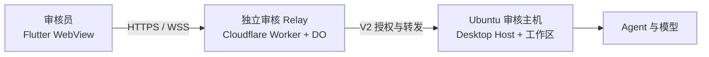

# Flutter 审核环境部署（Ubuntu + Cloudflare Relay）

用于应用商店审核（2–4 周、多名审核员）。审核员在 Flutter 中粘贴一条自托管 V2 连接链接，WebView 打开官方 Web 工作台，业务仍由 Ubuntu 上的 Desktop Host 执行。返回[部署入口](../deploy.md)。



审核环境**不要复用生产 Relay、生产 owner 或生产工作区**。独立 Relay 和独立数据目录让审核链接可以放宽有效期，也能在审核结束后整体下线。

## 1. 准备值

| 项             | 示例                        | 说明                                       |
| -------------- | --------------------------- | ------------------------------------------ |
| 审核 origin    | `https://review.example.com` | 绑定到独立审核 Worker 的自定义域名         |
| 审核 Worker 名 | `kayingcode-relay-review`   | 不能与生产 Worker 同名                     |
| Desktop 数据目录 | `/srv/kayingcode-review`    | 与生产 Desktop 数据隔离                    |
| 邀请有效期     | `30`（天）                  | 覆盖整个审核周期；支持小数天               |
| 邀请领取次数   | `5`                         | 按审核员数量调整；越大暴露面越大           |
| 终端凭据有效期 | `30`（天）                  | 每次领取后独立计算                         |
| 审核工作区     | `/srv/review-workspace`     | 只放演示文件，不放源码、凭据或用户数据     |
| 模型           | 审核专用供应商/Key          | 设置预算与配额，审核结束撤销               |
| 审核 token 预算 | `500000`                    | Agent 运行时累计上限；按审核员数和模型价格调整 |

Flutter 对已知域名（`z.ai`、`bigmodel.cn`、`kayingai.com`、`kaying.ai`、`kaying.video` 及其子域）跳过额外确认；其他域名会弹一次「未知服务器」确认。审核域名若不在列表内，请在审核备注中写明点击继续，或改用已知域名的子域。

## 2. 部署独立审核 Relay

在仓库根执行。第一步把审核 origin 写入 Web 制品，第二步部署独立 Worker：

```sh
KAYINGCODE_REMOTE_ORIGIN=https://review.example.com mise exec -- pnpm --dir apps/kayingcode-relay-cloudflare run build:web
mise exec -- pnpm --dir apps/kayingcode-relay-cloudflare exec wrangler deploy --name kayingcode-relay-review --keep-vars
```

在 Cloudflare 控制台完成：

1. 给 `kayingcode-relay-review` 绑定 `review.example.com` 自定义域名，等待 HTTPS 生效。
2. 在 Worker 的 **Settings → Variables and Secrets** 添加三个普通变量：
   - `KAYINGCODE_REMOTE_INVITE_TTL_DAYS=30`
   - `KAYINGCODE_REMOTE_INVITE_MAX_CLAIMS=5`
   - `KAYINGCODE_REMOTE_TERMINAL_TTL_DAYS=30`
3. 确认变量保存在审核 Worker 上，不是生产 Worker。

时长变量以**天**为单位，支持小数（`0.5` 为 12 小时）。变量只影响新签发的邀请；已经签发的邀请保留签发时的有效期和剩余领取次数。详细规则见 [Relay 部署](kayingcode-relay-cloudflare.md) 与 [协议规范](../../apps/kayingcode-relay-cloudflare/spec/upstream-v2.md#邀请与凭据有效期配置)。

验证：

```sh
curl --fail https://review.example.com/healthz
curl --fail https://review.example.com/readyz
curl --fail https://review.example.com/remote/mobile-web-manifest.json
curl -I https://review.example.com/remote/v4
```

`manifest.relayOrigin` 必须等于 `https://review.example.com`。`/remote/v4` 应直接返回页面，不重定向丢失路由。

## 3. 安装 Ubuntu 审核主机

要求 Ubuntu 22.04/24.04 x64、长期在线、非 root 用户、至少 4 GB 内存。Desktop 安装包使用内部发布渠道的 Linux `.deb` 或 AppImage，安装后核对版本和 SHA-256。

审核主机必须使用包含“进程环境 relay origin”修复的 Desktop 构建（`resolveDesktopRemoteOrigin`）。旧安装包可能忽略进程环境并继续指向默认生产 Relay；启动后复制远控链接，确认域名是审核 origin，不是生产 origin。

### 3.1 有图形桌面时

直接登录图形会话，从终端设置环境变量后启动 Desktop：

```sh
export KAYINGCODE_OFFICIAL_CLOUDFLARE_RELAY_ORIGIN=https://review.example.com
export KAYINGCODE_DATA_BASE_DIR=/srv/kayingcode-review
export KAYINGCODE_REVIEW_TOKEN_BUDGET=500000
export KAYINGCODE_REVIEW_BUDGET_DIR=/srv/kayingcode-review/budget
export KAYINGCODE_REVIEW_BUDGET_SCOPE=environment
exec /path/to/kayingcode
```

以实际安装路径为准，可用 `command -v kayingcode` 或 `dpkg -L <包名>` 查找。

### 3.2 无图形桌面时（Xvfb）

安装 `xvfb` 和 Desktop 的运行依赖，用虚拟显示启动。先创建审核用户的数据目录和主机目录并授权：

```sh
sudo install -d -o kayingreview -g kayingreview \
  /srv/kayingcode-review /srv/kayingcode-review/budget /srv/review-workspace
```

以下 systemd 单元是模板，必须替换可执行路径并在目标机实测：

```ini
[Unit]
Description=KayingCode review Desktop host
After=network-online.target
Wants=network-online.target

[Service]
Type=simple
User=kayingreview
Environment=HOME=/srv/kayingcode-review
Environment=KAYINGCODE_DATA_BASE_DIR=/srv/kayingcode-review
Environment=KAYINGCODE_OFFICIAL_CLOUDFLARE_RELAY_ORIGIN=https://review.example.com
Environment=KAYINGCODE_REVIEW_TOKEN_BUDGET=500000
Environment=KAYINGCODE_REVIEW_BUDGET_DIR=/srv/kayingcode-review/budget
Environment=KAYINGCODE_REVIEW_BUDGET_SCOPE=environment
ExecStart=/usr/bin/xvfb-run -a -s "-screen 0 1440x900x24" /path/to/kayingcode --no-sandbox --disable-gpu
Restart=always
RestartSec=5

[Install]
WantedBy=multi-user.target
```

- 首次启动需要看到窗口完成模型配置和远控开启。可临时启动 Xvfb + `x11vnc` 或使用图形会话完成，再切回无头运行。
- Electron 在部分无沙箱环境需要 `--no-sandbox`；这降低进程隔离，只应在专用审核主机使用。
- 如果 Xvfb 下出现白屏、GPU 或输入法问题，改用轻量桌面会话（如 XFCE）通常更稳定。
- 审核期间关闭系统休眠和自动更新，避免 Desktop 中途退出：

  ```sh
  sudo systemctl mask sleep.target suspend.target hibernate.target hybrid-sleep.target
  ```

- Desktop 重新启动会尝试恢复上次开启的远控状态；仍需在重启后核对远控面板显示在线。

## 4. 配置审核工作区

1. 用审核用户打开 `/srv/review-workspace`，不要把生产项目放进该目录。
2. 在「设置 → 模型设置」配置审核专用供应商、API Key、Base URL 和模型 ID。
3. 新建会话发送一条简单消息，确认模型、文件读写和权限提示正常。
4. 打开左下角手机远控，确认状态为等待手机连接，生成连接链接和二维码。
5. 保持 Desktop、Host、工作区和网络在线；主机休眠或 Desktop 退出会让审核员看到设备离线。

审核工作区可以预置一个只读示例项目、几条历史会话和一个简单任务，帮助审核员在几分钟内走到核心功能。

### 4.1 限制审核 token 用量

在 **Ubuntu Desktop 主机**设置（不是 Relay）：

```sh
export KAYINGCODE_REVIEW_TOKEN_BUDGET=500000
export KAYINGCODE_REVIEW_BUDGET_DIR=/srv/kayingcode-review/budget
export KAYINGCODE_REVIEW_BUDGET_SCOPE=environment
```

- `KAYINGCODE_REVIEW_TOKEN_BUDGET`：累计 token 上限，正整数；未设置时不启用。
- `KAYINGCODE_REVIEW_BUDGET_SCOPE=environment`（默认）所有任务共享一份账本；`session` 每个任务独立计数，新建任务会重置。
- 计数优先使用 provider 报告的 `totalTokens`；缺失时按 input（input 为 0 时用 cache read/write）加 output。
- 每次模型请求发出前检查；达到上限后拒绝继续请求，审核员会看到“审核用量已达上限，请联系维护人”。
- 用量缺失或账本不确定时按失败关闭处理，不会把未知用量当作零。
- 需要重置额度时停止 Desktop 并删除预算目录；不要在运行中删除账本。
- 不要同时设置 `KAYINGCODE_REVIEW_WORKSPACE_ROOT`（只读代码审核模式）；同时设置会在启动时失败。
- 修改环境变量后需要重启 Desktop/Host 才会生效。

预算账本只留在审核主机；不要提交到仓库、写入日志或发给审核员。

## 5. 签发审核链接

1. 在远控面板复制完整链接，形如 `https://review.example.com/remote/v4?sid=…#authorize=…`。
2. 审核员在 Flutter 的「添加设备/粘贴连接信息」中粘贴完整链接，WebView 自动领取授权。
3. 同一条链接在有效期内可被 claim 最多 `maxClaims` 次；每个审核员/设备各自领取独立终端凭据。同一浏览器重开同一链接不会重复消耗次数。
4. 每次刷新远控二维码都会签发新邀请；旧邀请在有效期内仍然有效，不会自动撤销。不要反复刷新并分发多个链接；需要收回时按第 7 节下线审核 Worker/域名。
5. 审核备注中写明：
   - 完整链接与备用链接；
   - 链接有效期和剩余可领取次数（不要写具体凭据）；
   - Desktop 必须在线，设备离线时联系维护人；
   - 审核期间不要公开截图或转发链接。

链接只放在 App Store Connect 的 App Review Information、Play Console 的 App access 或受控工单中，不进入公开说明、截图、日志或代码仓库。

## 6. 审核期间检查

| 检查点       | 期望                                                       |
| ------------ | ---------------------------------------------------------- |
| Relay        | `/healthz`、`/readyz` 200；manifest origin 与审核域名一致  |
| 授权         | 新链接可 claim；claim 后 URL fragment 被清除               |
| 工作台       | `/remote/v4` 打开项目、会话和输入框                        |
| 会话         | 审核工作区能收到模型回复并读写文件                         |
| 恢复         | 刷新、切后台、换网络后回到同一会话                         |
| 重复打开     | 同一浏览器已领取后重开链接仍进入工作台，且不再消耗领取次数 |
| 清除存储     | 浏览器存储被清除后重开链接会再 claim 一次（若仍有次数）    |
| 次数耗尽     | 超过 `maxClaims` 后 claim 被拒绝，需要生成新链接           |
| Token 预算   | 达到上限后模型请求被拒绝，会话显示“审核用量已达上限”       |
| 预算持久化   | 重启 Desktop 后已用额度不重置；删除预算目录才重置          |
| Desktop 在线 | 远控面板显示已连接；主机不休眠、Desktop 不退出             |

建议每天检查一次 Relay 健康、Desktop 远控状态和剩余领取次数。审核期间不要升级 Desktop 或 Relay，除非已准备回退版本。

## 7. 审核结束与撤销

1. 停止 Desktop 远控，删除审核设备。
2. 删除审核 Worker 和 `review.example.com` 域名，这是最干净的撤销方式；旧链接和 terminal 凭据随服务下线失效。
3. 撤销审核专用模型 Key 或配额。
4. 保留审核记录：Worker 版本、Git 提交、审核 origin、链接签发时间、领取次数和验收结果。不要归档完整链接或凭据。

如果暂时不能删除审核 Worker，至少停止 Desktop 并删除设备。注意：terminal 凭据属于 owner 账号；同一 owner 以后登记的新设备仍可能被旧 terminal 凭据看到。需要长期保留服务时，应使用全新的 Desktop 数据目录重新注册 owner，避免复用审核 owner。

## 8. 常见问题

| 现象                         | 处理                                                                 |
| ---------------------------- | -------------------------------------------------------------------- |
| 链接提示过期或已使用         | 检查是否达到领取次数；在 Desktop 刷新二维码生成新链接                |
| 授权服务不可达               | 检查审核域名、Worker 路由、`/healthz`、`/readyz` 和 Cloudflare 变量  |
| 页面能开但一直等待           | 检查 Desktop 远控是否在线、SID 是否对应、Host/工作区是否仍在运行     |
| 审核员看到设备离线           | 检查 Ubuntu 主机、Desktop 进程、网络和休眠设置                       |
| 模型无回复                   | 检查审核专用 Key、Base URL、配额和出网策略                           |
| 提示审核用量已达上限         | 达到 token 预算；确认审核计划后停止 Desktop、删除预算目录再重启      |
| 页面 404 / 静态资源失败      | 确认用审核 origin 重新执行了 `build:web`，manifest 与部署版本一致     |
| 审核结束仍需保留部分会话数据 | 只导出必要产物；不要把审核链接、凭据或生产用户数据带入新环境         |

源码依据：[Relay 部署](../../apps/kayingcode-relay-cloudflare/DEPLOYMENT.md)、[协议规范](../../apps/kayingcode-relay-cloudflare/spec/upstream-v2.md)、[审核 Token 预算规范](../../apps/zcode-cli/packages/bootstrap/specs/review-token-budget.md)、[Flutter 部署](kayingcode-mobile-flutter.md)、[移动 WebView 接入](agent-connection/05-mobile-webview.md)。
