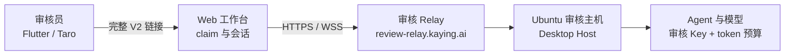

# 审核环境操作手册（Ubuntu 主机与审核链接）

面向 App Store、Google Play 与微信小程序提审：在一台长期在线的 Ubuntu 主机上运行 Desktop Host，审核员用一条完整的 V2 邀请链接在 Flutter / Taro 中打开 Web 工作台。本文是**逐步操作清单**，规则与背景以[审核环境部署](kayingcode-review-environment.md)和[应用审核方案](kayingcode-app-review.md)为准；两份文档与本文不一致时，先改那两份，再同步本文。

核对日期：2026-11-11（Relay 健康与 manifest 已现场复核）。变更域名、Worker 名、三个 Relay 变量或 Desktop 版本后，同步更新本文与[应用审核方案](kayingcode-app-review.md)第 2 节。



**操作顺序速查**

1. 核对审核 Relay 健康、manifest 与邀请变量。
2. 在 Ubuntu 主机安装审核 Desktop，设置 6 个环境变量。
3. 配置审核工作区、模型 Key 与 token 预算，发一条测试消息。
4. 在 Desktop 左下角「移动端远程控制」生成并复制链接（无图形桌面见 5.2.5）。
5. 每位审核员一条链接，另备一条；核对域名和剩余领取次数。
6. 填入平台审核备注；微信侧先配置业务域名。
7. 审核期间每日检查；结束后整体下线。

## 0. 当前审核环境

| 项                   | 当前值                                                                 |
| -------------------- | ---------------------------------------------------------------------- |
| 审核 origin          | `https://review-relay.kaying.ai`                                       |
| Worker 名            | `kayingcode-relay-review`                                              |
| Worker 版本          | `09085ec3-c55b-4bdc-bd90-7bd07d192056`（2026-11-10 部署，100% 流量）   |
| Relay 代码来源       | `review/0.1.2` 的 `4912044d`，尚未合入 `main`；生产 Relay 未部署该分支 |
| 审核 Desktop         | `KayingCode Preview 0.1.2 linux-x86_64`（SHA-256 `b7caf89b…`）         |
| 邀请有效期           | `KAYINGCODE_REMOTE_INVITE_TTL_DAYS=30`                                 |
| 同一邀请领取次数     | `KAYINGCODE_REMOTE_INVITE_MAX_CLAIMS=20`                               |
| 终端凭据有效期       | `KAYINGCODE_REMOTE_TERMINAL_TTL_DAYS=30`                               |
| 紧凑链接             | `KAYINGCODE_REVIEW_COMPACT_LINK=1`                                     |
| 微信业务域名校验文件 | `/69txzPKb7q.txt`                                                      |
| 已知域名             | 是（`kaying.ai` 子域），Flutter / Taro 不弹「未知服务器」确认          |

Worker 版本以 `wrangler deployments list --name kayingcode-relay-review` 的实际输出为准。审核 Worker 当前运行未合入 `main` 的审核分支：任何改动都要重新构建并以审核 origin 部署；生产部署仍用生产 origin 重新构建。

## 1. 责任边界

排障时先按所有者定位，不要跨层猜：

| 对象                | 拥有                                                       |
| ------------------- | ---------------------------------------------------------- |
| 审核 Relay          | 邀请、领取次数、终端凭据、heartbeat 与转发                 |
| Ubuntu Desktop Host | owner/设备身份、工作区、模型请求与 token 预算              |
| Web 工作台          | claim、清除 authorize fragment、会话摘要                   |
| Flutter / Taro 外壳 | 只保存并原样打开完整链接，不 claim、不计数、不建第二条连接 |

一条链接就是一张邀请；链接本身即凭据。审核环境不得复用生产 Relay、生产 owner、生产工作区或生产模型 Key。

## 2. 开工前准备

| 输入            | 来源与要求                                                              |
| --------------- | ----------------------------------------------------------------------- |
| Cloudflare 权限 | 该账号可部署 Worker、静态资源与 SQLite-backed Durable Objects           |
| 审核 origin     | 独立于生产的自定义域名，已绑定审核 Worker                               |
| Ubuntu 主机     | 22.04 / 24.04 x64，长期在线，非 root 用户，至少 4 GB 内存               |
| Linux 安装包    | 内部发布渠道或 GitHub Actions 签名制品；核对版本与 SHA-256              |
| 审核模型        | 专用供应商、Base URL、Key 与配额；审核结束撤销                          |
| 链接发放渠道    | App Store Connect / Play Console / 微信审核备注或受控工单，不进公开文档 |

先确认三件事，再往下做：审核 Relay 的 `/healthz`、`/readyz` 正常；Desktop 进程环境能指向审核 origin；审核主机不会休眠或自动更新。

## 3. 步骤 A：部署并核对审核 Relay

首次搭建或变更 Worker 时执行；日常审核只需做第 3.3 节的复核。

### 3.1 构建与部署独立 Worker

在仓库根执行：

```sh
KAYINGCODE_REMOTE_ORIGIN=https://review-relay.kaying.ai \
  mise exec -- pnpm --dir apps/kayingcode-relay-cloudflare run build:web
mise exec -- pnpm --dir apps/kayingcode-relay-cloudflare exec wrangler deploy \
  --name kayingcode-relay-review --keep-vars
```

- `build:web` 会把 origin 编入 `packages/web/dist` 和 `apps/kayingcode-relay-cloudflare/public`；之后若发生产，必须用生产 origin 重新构建。
- `--keep-vars` 保留远端已配置的普通变量，不会替你写 origin。
- 审核 Worker 与生产 Worker 必须不同名，使用独立 Durable Object namespace。

### 3.2 Cloudflare 控制台配置

1. 为 `kayingcode-relay-review` 绑定 `review-relay.kaying.ai` 自定义域名，等待 HTTPS 生效。
2. 在该 Worker 的 **Settings → Variables and Secrets** 添加普通变量：
   - `KAYINGCODE_REMOTE_INVITE_TTL_DAYS=30`
   - `KAYINGCODE_REMOTE_INVITE_MAX_CLAIMS=20`
   - `KAYINGCODE_REMOTE_TERMINAL_TTL_DAYS=30`
3. 确认变量落在审核 Worker 上，不是生产 Worker。变量只影响新签发的邀请；已签发的邀请保留签发时的有效期和剩余次数。

### 3.3 复核

```sh
curl --fail https://review-relay.kaying.ai/healthz
curl --fail https://review-relay.kaying.ai/readyz
curl --fail https://review-relay.kaying.ai/remote/mobile-web-manifest.json
curl -I https://review-relay.kaying.ai/remote/v4
curl --fail https://review-relay.kaying.ai/69txzPKb7q.txt

wrangler deployments list --name kayingcode-relay-review
```

通过条件：`healthz` 为 `{"ok":true}`，`readyz` 为 `{"ready":true}`，`manifest.relayOrigin` 等于 `https://review-relay.kaying.ai`，`/remote/v4` 直接 200 且不丢路由，校验文件 200 且无重定向。根路径 `/` 返回 404 属于预期。

## 4. 步骤 B：准备 Ubuntu 审核主机

### 4.1 取得 Linux 安装包

优先级从高到低：

1. GitHub Actions 的 **Build signed Linux release** 制品（`kaying-code-preflight-v*` 预验收标签或 `kaying-code-v*` 正式标签）。x64 制品名形如 `KayingCode-<版本>-linux-x64-<preflight|release>-signed`，内含 AppImage、deb、rpm、pkg.tar.zst、`SHA256SUMS-linux-x64`、其 `.asc` 分离签名和公钥。
2. 内部发布渠道提供的 Linux `.deb` 或 AppImage。以实际交付记录的版本和 SHA-256 为准。

需要与正式版并排安装的 Preview 身份时，在 Linux 构建机上执行：

```sh
KAYINGCODE_ENV=production KAYINGCODE_PREVIEW_IDENTITY=1 \
  pnpm run bundle:desktop -- --os linux --arch x64
```

产物在 `packages/desktop/dist/`。`KAYINGCODE_ENV=test` 会生成带 `_TEST` 的测试后端包，不要用于审核；审核用生产后端加 Preview 身份时文件名不带 `_TEST`。

校验签名与哈希（文件名按实际制品替换）：

```sh
gpg --import KayingCode-linux-release-public-key.asc
gpg --verify SHA256SUMS-linux-x64.asc SHA256SUMS-linux-x64
sha256sum -c SHA256SUMS-linux-x64
```

审核主机必须使用包含「进程环境 relay origin」修复的 Desktop 构建（`resolveDesktopRemoteOrigin`）。旧包可能忽略进程环境，继续指向生产 Relay；启动后必须复核链接域名。

### 4.2 创建用户与目录

```sh
sudo adduser kayingreview          # 已有则跳过
sudo install -d -o kayingreview -g kayingreview \
  /srv/kayingcode-review /srv/kayingcode-review/budget /srv/review-workspace
```

数据目录、预算目录和工作区必须与生产隔离。工作区只放示例项目、演示文件和历史会话，不放源码、凭据或真实用户数据。

### 4.3 安装

deb：

```sh
sudo apt install ./KayingCode-<版本>-linux-amd64.deb
```

AppImage：

```sh
chmod +x KayingCode-<版本>-linux-x86_64.AppImage
```

以实际安装路径为准，用 `command -v kayingcode` 或 `command -v kayingcode-preview` 确认可执行名，`dpkg -L <包名>` 可查安装文件。Preview 身份的包名和可执行名是 `kayingcode-preview`。

## 5. 步骤 C：以审核环境启动 Desktop

六个环境变量缺一不可，全部设置在**审核主机进程**上：

```sh
export KAYINGCODE_OFFICIAL_CLOUDFLARE_RELAY_ORIGIN=https://review-relay.kaying.ai
export KAYINGCODE_DATA_BASE_DIR=/srv/kayingcode-review
export KAYINGCODE_REVIEW_TOKEN_BUDGET=500000
export KAYINGCODE_REVIEW_BUDGET_DIR=/srv/kayingcode-review/budget
export KAYINGCODE_REVIEW_BUDGET_SCOPE=environment
export KAYINGCODE_REVIEW_COMPACT_LINK=1
```

修改任何变量后都要重启 Desktop / Host 才生效。

### 5.1 有图形桌面

登录审核用户的图形会话，在终端设置上述变量后启动：

```sh
exec /path/to/kayingcode-preview
```

首次启动需要看到窗口，完成模型配置并确认远控面板可用。

### 5.2 无图形桌面（固定 Xvfb + VNC + systemd）

无图形桌面时，Desktop 仍然跑在一个虚拟 X 显示上，审核链接也只能从它的界面复制。做法是：用固定 `:99` 启动 Xvfb 和 Desktop；需要签发链接时临时启动只监听本机的 `x11vnc`，通过 SSH 隧道连上去点「复制链接」；再用 `xclip` 从主机侧把剪贴板里的完整链接读出来。这样不需要给服务器接显示器，也不需要让 5900 端口对外。

> 这里不用 `xvfb-run -a`：它每次随机分配 display，`x11vnc` 无法稳定附着。固定 `:99` 和独立 Xauthority 是下面所有步骤的前提。本节是对[审核环境部署](kayingcode-review-environment.md)中 Xvfb 模板的展开。

#### 5.2.1 安装依赖

```sh
sudo apt-get update
sudo apt-get install -y xvfb x11vnc xclip xauth x11-utils
# 可选：没有窗口管理器时 Electron 窗口可能无法聚焦
sudo apt-get install -y openbox
```

#### 5.2.2 固定显示并启动 Desktop

生成 Xauthority（只做一次）：

```sh
sudo -u kayingreview install -d -m 700 /srv/kayingcode-review/.vnc
sudo -u kayingreview sh -c 'xauth -f /srv/kayingcode-review/.Xauthority add :99 . "$(mcookie)"'
sudo chmod 600 /srv/kayingcode-review/.Xauthority
```

创建 `/usr/local/bin/kayingcode-review-host.sh`，把 `/path/to/kayingcode-preview` 换成实际可执行路径：

```sh
#!/bin/sh
set -eu
export DISPLAY=:99
export XAUTHORITY=/srv/kayingcode-review/.Xauthority

# 固定 display，x11vnc 才能一直附着在 :99。
Xvfb :99 -screen 0 1440x900x24 -nolisten tcp -auth "$XAUTHORITY" &
xvfb_pid=$!

cleanup() {
  [ -n "${app_pid:-}" ] && kill "$app_pid" 2>/dev/null || true
  kill "$xvfb_pid" 2>/dev/null || true
}
trap cleanup EXIT INT TERM

for _ in $(seq 1 50); do
  xdpyinfo -display :99 >/dev/null 2>&1 && break
  sleep 0.2
done
xdpyinfo -display :99 >/dev/null 2>&1 || {
  echo "Xvfb :99 未就绪；检查 /tmp/.X99-lock 和残留 Xvfb" >&2
  exit 1
}

if command -v openbox >/dev/null 2>&1; then
  openbox &
fi

/path/to/kayingcode-preview --no-sandbox --disable-gpu &
app_pid=$!

wait "$app_pid"
```

```sh
sudo chmod 755 /usr/local/bin/kayingcode-review-host.sh
```

`/etc/systemd/system/kayingcode-review.service`：

```ini
[Unit]
Description=KayingCode review Desktop host
After=network-online.target
Wants=network-online.target

[Service]
Type=simple
User=kayingreview
Environment=HOME=/srv/kayingcode-review
Environment=KAYINGCODE_DATA_BASE_DIR=/srv/kayingcode-review
Environment=KAYINGCODE_OFFICIAL_CLOUDFLARE_RELAY_ORIGIN=https://review-relay.kaying.ai
Environment=KAYINGCODE_REVIEW_TOKEN_BUDGET=500000
Environment=KAYINGCODE_REVIEW_BUDGET_DIR=/srv/kayingcode-review/budget
Environment=KAYINGCODE_REVIEW_BUDGET_SCOPE=environment
Environment=KAYINGCODE_REVIEW_COMPACT_LINK=1
ExecStart=/usr/local/bin/kayingcode-review-host.sh
Restart=always
RestartSec=5

[Install]
WantedBy=multi-user.target
```

```sh
sudo systemctl daemon-reload
sudo systemctl enable --now kayingcode-review
sudo journalctl -u kayingcode-review -f
```

- Electron 在部分无沙箱环境需要 `--no-sandbox`；它降低进程隔离，只应在专用审核主机使用。
- Desktop 重启会尝试恢复上次开启的远控状态，重启后仍要核对面板在线。

#### 5.2.3 VNC：只在需要操作界面时启动

生成 VNC 密码（交互输入，写入 `/srv/kayingcode-review/.vnc/passwd`）：

```sh
sudo -u kayingreview env HOME=/srv/kayingcode-review x11vnc -storepasswd
```

`/etc/systemd/system/kayingcode-review-vnc.service`：

```ini
[Unit]
Description=KayingCode review VNC (localhost only)
After=kayingcode-review.service
Requires=kayingcode-review.service

[Service]
User=kayingreview
Environment=DISPLAY=:99
Environment=XAUTHORITY=/srv/kayingcode-review/.Xauthority
ExecStart=/usr/bin/x11vnc -display :99 -localhost -rfbport 5900 -forever -shared -rfbauth /srv/kayingcode-review/.vnc/passwd
Restart=no
```

```sh
sudo systemctl daemon-reload
sudo systemctl start kayingcode-review-vnc
```

- `-localhost` 只监听 `127.0.0.1`；不要在云安全组放行 5900，也不要改成公网监听。
- 从本机建 SSH 隧道：

  ```sh
  ssh -N -L 5900:127.0.0.1:5900 <审核主机用户>@<审核主机>
  ```

- 本机连接 VNC：macOS 执行 `open vnc://127.0.0.1:5900`；Windows/Linux 用 TigerVNC 等连接 `127.0.0.1:5900`，输入上一步设置的密码。
- 操作完成后 `sudo systemctl stop kayingcode-review-vnc` 即可，Desktop 继续运行，不影响已发放的链接。

#### 5.2.4 首次配置（在 VNC 里做）

1. 确认 `kayingcode-review` 与 `kayingcode-review-vnc` 都在运行，SSH 隧道和 VNC 已连上。
2. 在窗口里打开 `/srv/review-workspace`，进入「设置 → 模型设置」配置审核 Key、Base URL 和模型 ID。
3. 新建会话发一条消息，确认模型回复、文件读写和权限提示正常。
4. 点击左下角手机图标「移动端远程控制」，确认能打开面板并显示「等待手机连接」。
5. 先不要发放链接；按 5.2.5 生成并读取。

#### 5.2.5 在无界面主机上获取连接串

每次签发或补发链接都按下面做。链接由 Desktop 写入 X11 剪贴板，`xclip` 读出来就是完整 URL。

1. 确认 Desktop 与 VNC 服务在运行，SSH 隧道和 VNC 已连上。
2. 在 VNC 窗口点击左下角手机图标「移动端远程控制」。
3. 等状态显示「等待手机连接」（不是「远程控制未开启」或「正在准备二维码」）。
4. 点击「复制链接」。
5. 在**主机侧**读取剪贴板，不依赖 VNC 客户端的剪贴板同步。读取前不要在 VNC 客户端里复制其他文本，避免覆盖 X11 剪贴板：

   ```sh
   sudo -u kayingreview env DISPLAY=:99 XAUTHORITY=/srv/kayingcode-review/.Xauthority \
     xclip -selection clipboard -o
   ```

   输出应为：

   ```text
   https://review-relay.kaying.ai/remote/v4?sid=<设备 SID>#authorize=<邀请密文>
   ```

6. 需要多条链接时：回到 VNC 点「刷新二维码」→ 等「等待手机连接」→ 点「复制链接」→ 再执行第 5 步的 `xclip` 命令。每条单独保存，不要混发。
7. 核对域名和长度：

   ```sh
   link=$(sudo -u kayingreview env DISPLAY=:99 XAUTHORITY=/srv/kayingcode-review/.Xauthority \
     xclip -selection clipboard -o)
   printf '%s\n' "$link"
   printf '%s' "$link" | wc -c
   ```

   - 域名必须是 `review-relay.kaying.ai`；
   - 紧凑链接约 135 字符（单测上限 150），普通链接更长；
   - 不要把链接写进 shell 历史、脚本日志或仓库；要保存就放进受控的密码库或工单字段。

8. 发放完成后 `sudo systemctl stop kayingcode-review-vnc`，Desktop 保持在线。

排障：

- VNC 黑屏或点不动：确认已安装并启动 `openbox`；查看 `journalctl -u kayingcode-review` 是否有 Xvfb 报错。
- `xclip` 没有输出：回到 VNC 确认已点「复制链接」；核对命令里的 `DISPLAY`、`XAUTHORITY` 与启动脚本一致；确认 Desktop 仍在运行（剪贴板由它持有）。
- 启动时提示 `Xvfb :99 未就绪`：检查 `ls -l /tmp/.X99-lock`，确认没有残留 Xvfb 进程，清理后再重启服务。
- VNC 连不上：确认 SSH 隧道仍在运行、VNC 服务只监听 `127.0.0.1`、5900 端口未被占用。
- 链接域名仍是生产地址：Desktop 没继承进程环境，按 5.4 检查 `/proc/<pid>/environ`。

### 5.3 关闭休眠与自动更新

```sh
sudo systemctl mask sleep.target suspend.target hibernate.target hybrid-sleep.target
```

审核期间不要升级 Desktop 或 Relay，除非已准备回退版本。

### 5.4 确认 origin 生效

打开远控面板复制链接（无图形桌面按 5.2.5 读取），核对域名是 `review-relay.kaying.ai`。也可直接查进程环境：

```sh
pid=$(systemctl show -p MainPID --value kayingcode-review)   # 单元名按实际配置替换
tr '\0' '\n' < /proc/$pid/environ | grep KAYINGCODE_OFFICIAL_CLOUDFLARE_RELAY_ORIGIN
```

显示生产 origin 或为空，说明进程没继承变量，先修启动方式，不要继续签发链接。

## 6. 步骤 D：配置审核工作区与预算

1. 用审核用户打开 `/srv/review-workspace`，不要把生产项目放进该目录。
2. 在「设置 → 模型设置」配置审核专用供应商、API Key、Base URL 和模型 ID。
3. 新建会话发送一条简单消息，确认模型回复、文件读写和权限提示正常。
4. 预置一个只读示例项目、几条历史会话和一个简单任务，让审核员几分钟内走到核心功能。
5. 保持 Desktop、Host、工作区和网络在线。

预算规则：

| 变量                             | 作用                                                            |
| -------------------------------- | --------------------------------------------------------------- |
| `KAYINGCODE_REVIEW_TOKEN_BUDGET` | 正整数，累计 token 上限；未设置时不启用                         |
| `KAYINGCODE_REVIEW_BUDGET_DIR`   | 账本目录，必须是绝对路径                                        |
| `KAYINGCODE_REVIEW_BUDGET_SCOPE` | `environment`（默认，所有任务共享）或 `session`（每个任务独立） |

- 每次模型请求发出前检查；达到上限后拒绝请求，审核员看到「审核用量已达上限」。
- 用量缺失或账本不确定时失败关闭，不会把未知用量当作零。
- 重置额度：停止 Desktop，删除预算目录，再启动；不要在运行中删除账本。
- 不要同时设置 `KAYINGCODE_REVIEW_WORKSPACE_ROOT`（只读代码审核模式），同时设置会在启动时失败。
- 预算账本只留在审核主机，不提交仓库、不写日志、不发审核员。

## 7. 步骤 E：生成并复制审核链接

链接由 **Desktop 向审核 Relay 注册后生成**，不是从 Cloudflare 控制台拼出来。操作如下：

1. 在 Desktop 打开审核工作区，不要打开生产工作区；无图形桌面的主机通过 5.2.4 的 VNC 会话操作。
2. 点击左下角手机图标「移动端远程控制」（`data-testid="desktop-mobile-pairing-button"`）。
3. 对话框打开时会为当前工作区启动远控，或复用同目标的现有会话；状态应显示「等待手机连接」。
4. 点击「复制链接」（`data-testid="mobile-remote-copy"`）。手机已连接时该按钮禁用，因此链接要在任何人领取前生成并保存，不要等审核员连上后再回头找链接。
5. 核对 URL 形状：

   ```text
   https://review-relay.kaying.ai/remote/v4?sid=<设备 SID>#authorize=<邀请密文>
   ```

   - 域名必须是 `review-relay.kaying.ai`，不是 `relay.service.kaying.ai`。
   - `authorize` 只放在 fragment；不要手工复制或改写 `sid`、查询串和 fragment。

6. 紧凑链接：设置 `KAYINGCODE_REVIEW_COMPACT_LINK=1` 后，链接只保留 `sid` 和 authorize fragment，省略 `name`、`mid`、`app_version`，约 135 字符（单测要求不超过 150），适合微信 200 字审核备注。设备名、MID 和 Desktop 版本在连接后由 Relay 与 Web bootstrap 取得。
7. 每位审核员一条链接：在第一位审核员领取前，点击「刷新二维码」逐条生成并保存，再分别发放。刷新会签发新邀请，旧邀请在有效期内仍然有效；不要反复刷新后把多张链接混发。
8. 另备一条备用链接，与主链接一起写入审核备注。
9. 链接只放在 App Store Connect 的 App Review Information、Play Console 的 App access、微信审核备注或受控工单中，不进入公开说明、截图、日志、代码仓库或工单附件。

链接生命周期（当前配置）：

| 行为                        | 结果                                                           |
| --------------------------- | -------------------------------------------------------------- |
| 有效期                      | 自签发起 30 天                                                 |
| 同一邀请领取次数            | 最多 20 次                                                     |
| 每次领取                    | 生成独立终端凭据，有效期 30 天，按领取时间单独计算             |
| 同一浏览器重开同一链接      | 直接进入现有会话，不重复消耗次数                               |
| 清除浏览器/小程序存储后重开 | 会再 claim 一次；仍有次数时成功，属于预期                      |
| 刷新二维码                  | 签发新邀请；旧邀请在有效期内仍可用                             |
| Desktop 重启                | SID 变化；紧凑链接缺少 `mid`，不能按机器接续，必须重新生成链接 |

只通过受控渠道发放。`MAX_CLAIMS=20` 比常见示例大，链接一旦扩散，多个浏览器可各自领取独立凭据；优先为每位审核员单独生成链接。

## 8. 步骤 F：分发链接与提审备注

| 平台          | 产物              | 链接交付位置                               | 额外要求                                        |
| ------------- | ----------------- | ------------------------------------------ | ----------------------------------------------- |
| iOS App Store | Flutter IPA       | App Store Connect → App Review Information | 真机可安装、WebView 可打开、Desktop 在线        |
| Google Play   | Flutter AAB/APK   | Play Console → App access                  | 写明有效期、领取次数和备用链接                  |
| 微信小程序    | Taro `dist/weapp` | 微信公众平台审核备注（限 200 字）          | 审核 origin 加入业务域名，保持 `urlCheck` 开启  |
| H5            | Taro `dist/h5`    | 受控渠道，不作为商店提审产物               | 跨域 iframe 存储分区可能多 claim 一次，属于预期 |

Flutter 与 Taro 共用同一条链接，只追加参数：Flutter `kayingPlatform=flutter`，微信 `kayingPlatform=weapp`，H5 另带 `kayingParentOrigin`。这些参数不影响授权和 claim。

微信提审前额外确认：

1. 在提交审核的小程序「开发管理 → 开发设置 → 业务域名」加入 `review-relay.kaying.ai`。
2. 校验文件由 Relay 根路径提供，当前只精确放行 `69txzPKb7q.txt`；换其他 AppID 时文件名不同，必须先扩展 Relay 静态白名单并重新构建。
3. 保持 `urlCheck` 开启，不为审核关闭域名校验。
4. 备注写明：链接与备用链接、有效期、可领取次数、Desktop 必须在线、粘贴/扫码步骤、未知服务器确认方式。

备注模板见[应用审核方案第 5 节](kayingcode-app-review.md#5-审核备注模板)。

## 9. 步骤 G：验收与日常检查

首次部署或每次重新签发链接后，按表验收：

| 检查点     | 通过条件                                                  |
| ---------- | --------------------------------------------------------- |
| Relay      | `/healthz`、`/readyz` 200；manifest origin 与审核域名一致 |
| 授权       | 新链接可 claim；claim 后 URL fragment 被清除              |
| 工作台     | `/remote/v4` 能打开项目、会话和输入框                     |
| 会话       | 审核工作区能收到模型回复并读写示例文件                    |
| 重复打开   | 同一浏览器重开不增加领取次数                              |
| 次数耗尽   | 超过 20 次后拒绝 claim，需要生成新链接                    |
| Token 预算 | 达到上限后模型请求被拒绝并显示「审核用量已达上限」        |
| Desktop    | 远控面板显示在线，主机不休眠、Desktop 不退出              |
| 微信       | 业务域名已配置；WebView 可打开；`urlCheck` 开启           |

审核期间每天检查一次 Relay 健康、Desktop 在线状态和剩余领取次数。记录 Worker 版本、代码提交、审核 origin、链接签发时间、领取次数和验收结果，但不要归档完整链接或终端凭据。

## 10. 步骤 H：审核结束与撤销

1. 停止 Desktop 远控，删除审核设备。
2. 删除审核 Worker 和 `review-relay.kaying.ai` 域名；旧链接和终端凭据随服务下线失效。
3. 微信小程序同步从业务域名移除审核域名。
4. 撤销审核模型 Key、配额，删除预算目录。
5. 保留审核记录，不保留完整链接或凭据。

如果暂时不能删除 Worker，至少停止 Desktop 并删除设备。需要长期保留服务时，用全新的 Desktop 数据目录重新注册 owner，避免复用审核 owner。

## 11. 常见问题

| 现象                          | 处理                                                                 |
| ----------------------------- | -------------------------------------------------------------------- |
| 链接过期或领取次数耗尽        | 检查有效期和剩余次数；从 Desktop 重新生成链接                        |
| 授权服务不可达                | 检查审核域名、Worker 路由、`/healthz`、`/readyz` 和三个变量          |
| 页面能开但一直等待            | 检查 Desktop 远控是否在线、SID 是否对应、Host 与工作区是否运行       |
| 审核员看到设备离线            | 检查 Ubuntu 主机、Desktop 进程、网络和休眠设置                       |
| 模型无回复                    | 检查审核 Key、Base URL、配额和出网策略                               |
| 提示审核用量已达上限          | 达到 token 预算；停止 Desktop、删除预算目录后重启                    |
| 页面 404 / 静态资源失败       | 确认用审核 origin 重新执行了 `build:web`，manifest 与部署版本一致    |
| 微信提示业务域名不合法        | 确认域名已加入业务域名、校验文件 200 且无重定向；不要关闭 `urlCheck` |
| 微信校验文件 404              | 换 AppID 后文件名不同；改用默认 AppID 或扩展 Relay 白名单            |
| 链接域名仍是生产地址          | Desktop 没继承进程环境；核对启动方式与 `/proc/<pid>/environ`         |
| 紧凑链接在 Desktop 重启后失效 | 缺少 `mid` 无法按机器接续；保持 Desktop 在线，或重新签发链接         |

## 12. 相关文档

| 主题                                   | 文档                                                                              |
| -------------------------------------- | --------------------------------------------------------------------------------- |
| 审核环境规则、Relay 变量、systemd 模板 | [审核环境部署](kayingcode-review-environment.md)                                  |
| 审核方案、当前域名、提交位置、备注模板 | [应用审核方案](kayingcode-app-review.md)                                          |
| Taro 客户端审核规则                    | [Taro 审核接入规范](../../apps/kayingcode-mobile-taro/spec/review-environment.md) |
| Relay 首次部署与排障                   | [Relay 部署](../../apps/kayingcode-relay-cloudflare/DEPLOYMENT.md)                |
| 审核 token 预算规则                    | [预算规范](../../apps/zcode-cli/packages/bootstrap/specs/review-token-budget.md)  |
| Desktop 构建与打包                     | [Desktop 部署](kayingcode-desktop.md)                                             |
| 微信小程序构建与业务域名               | [Taro 部署](kayingcode-mobile-taro.md)                                            |
