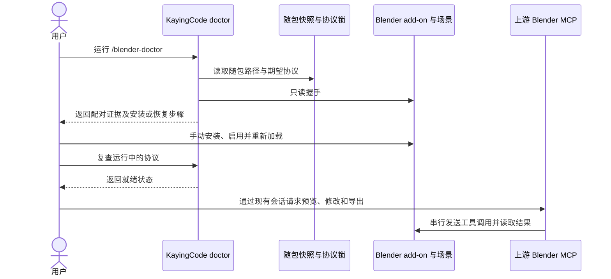

# Blender 内置插件专项优化评估

| 项目         | 内容                                                                              |
| ------------ | --------------------------------------------------------------------------------- |
| 状态         | 实施评审稿，待开发与验收                                                          |
| 评估基线     | 2026-11-17，`feat/blender-plugin-optimization`，`35a73dd6`，与 `origin/main` 一致 |
| 对象         | `blender@kayingcode-plugins-official`，展示名 KayingForBlender，插件版本 `0.1.0`  |
| 当前上游快照 | `mcp-for-blender` 2.2.2，`5a3618fccb2d982d0dd61e7a1879912c3100073b`，protocol 14  |
| 升级候选     | `mcp-for-blender` 2.3.0，`b6a2ce30c14636a562b5549684d9db6fc01f29ab`，protocol 16  |

本文用于当前分支评审。产品行为、接口和验收用例在实现前写入插件的 [integration.md](../../apps/zcode-cli/packages/blender-plugin/specs/integration.md)，执行结果写入 [verification.md](../../apps/zcode-cli/packages/blender-plugin/specs/verification.md)。

## 本轮交付目标

用户在插件市场启用 KayingForBlender 后，能通过 `/blender-doctor` 找到随包 add-on，完成手动安装，确认配对，并通过已有 Blender 工具完成预览、工作副本和 GLB 导出。老用户升级时，诊断应能说明当前加载版本、期望版本和恢复步骤。维护者能从固定上游提交更新快照，并由 CI 验证插件的回归用例。

| 顺序 | 当前分支工作                            | 验收结果                                                                             |
| ---- | --------------------------------------- | ------------------------------------------------------------------------------------ |
| 1    | 修复目录测试与上游同步 CLI，接入现有 CI | 插件单测通过，真实同步入口覆盖成功及失败情形                                         |
| 2    | 审阅 2.3.0、统一安装和版本诊断          | 两端随同一快照交付，版本不匹配时给出固定配对的恢复路径                               |
| 3    | 降低首次安装摩擦，验收游戏资产闭环      | 从 staged 插件定位随包 add-on，在真实 Blender 中手动安装、正常启动并产出可验证的 GLB |

本轮沿用插件 ID、默认关闭策略、官方目录、两个 stdio MCP 和通用 Blender 工具。引擎专属导出规则、自动安装与启动、市场素材、MCP Apps viewport 和新场景审计命令留在后续范围。当前交付的游戏开发场景是可预览、可保存、可导出的游戏资产工作流。

## 当前证据与优先级

| 发现                           | 证据与影响                                                                                                                                                                                                                                                                                                                                                                        |
| ------------------------------ | --------------------------------------------------------------------------------------------------------------------------------------------------------------------------------------------------------------------------------------------------------------------------------------------------------------------------------------------------------------------------------- |
| 目录单测失败                   | 复跑为 9 通过、1 失败。`mcp.test.mjs` 从 `pluginRoot` 读取 `../../config/official-plugins.json`，落在 `apps/zcode-cli/config`。指向仓库根的相对路径是 `../../../../config/official-plugins.json`。在内存中修正后 10 项通过。现有 Source checks 包含官方插件目录生成校验，Blender 包内单测尚未接入。                                                                               |
| 同步 CLI 部分写入后失败        | 在临时仓库用真实 CLI 复现。`sync-upstream.mjs` 先替换快照并写入插件版本及 lock，再用 `resolve(pluginRoot, "../..")` 到 `apps/zcode-cli` 读取许可证登记并报 `ENOENT`。退出失败时临时副本的版本已经变更。现有 `sync.test.mjs` 调用导出函数，未经过 CLI 的登记与生成步骤。                                                                                                           |
| 主服务与 doctor 的版本判断不同 | 上游对更高协议返回 `up_to_date=true`，doctor 已按随包协议精确匹配，遇到更新或更旧的协议均返回错误。主服务的状态及错误提示还可能给出未固定版本的 `uvx mcp-for-blender install-addon`。Skill 已告知用户使用随包文件，这条指引需要覆盖首次安装和故障恢复。                                                                                                                           |
| 随包 add-on 存在独立更新路径   | Blender GUI 启动后检查 GitHub `main`，用户可在面板手动检查并安装更新，重启后会加载新版本。`BLENDERMCP_NO_UPDATE_CHECK` 只跳过启动检查，手动检查仍可触发。升级到 protocol 16 可以建立新的配对，GitHub `main` 未来仍会推进。                                                                                                                                                        |
| 首次安装和宿主验收有缺口       | README 指向插件安装目录，用户仍需自行定位。现有真实 GUI E2E 直接加载测试 add-on、关闭更新计时器和自动监听，再用随机端口启动。它验证场景工具链路。正式手动安装、正常启动、升级以及实际 Desktop 安装包仍待验收。                                                                                                                                                                    |
| 上游升级有明确收益和审阅成本   | 2.3.0 候选比当前 pin 多 23 个提交，包含生成图片输入的安全修复，也改变了监听地址配置、生成服务能力和渲染默认行为。按安全修复的适用性和现有工作流回归决定是否采纳。 [提交比较](https://api.github.com/repos/ahujasid/mcp-for-blender/compare/5a3618fccb2d982d0dd61e7a1879912c3100073b...b6a2ce30c146) · [安全修复](https://github.com/ahujasid/mcp-for-blender/commit/38e47dcc28a6) |

## 实施方案

### 1. 先修回归与同步入口

- 修正 [mcp.test.mjs](../../apps/zcode-cli/packages/blender-plugin/test/mcp.test.mjs#L53) 的目录定位，在现有 [Source checks](../../.github/workflows/source-checks.yml) 中执行 `pnpm --filter @kayingcode/blender-plugin test`。这套单测使用 Node 和 Git，适合现有 Windows 源码检查，不依赖 uv 或 Blender。
- 修正 [sync-upstream.mjs](../../apps/zcode-cli/packages/blender-plugin/scripts/sync-upstream.mjs#L75) 的仓库根定位，在替换前验证许可证登记和生成器等先决条件。定义替换后生成失败时的回退方式，保持 vendor、lock、版本、登记与生成文件一致。用隔离的仓库夹具执行真实 CLI，分别验证成功更新、先决条件失败和生成失败。
- 插件的上游版本和发行版本分别维护。采用新快照时通过现有同步入口更新版本及第三方来源，并生成官方插件目录、源码图和声明。以根 [official-plugins.json](../../config/official-plugins.json) 为官方发行登记来源。

### 2. 再收口固定配对与升级

- 以候选完整 SHA 审阅上游变化。优先验证生成图片输入修复、默认 loopback 监听与受保护的远程连接、服务端遥测关闭、状态返回、`look` 和 GLB 导出。升级候选通过本轮验收后再替换两端快照。候选有回归时，记录未采纳原因和当前安全缺口的处置结论。
- 用 [upstream-lock.json](../../apps/zcode-cli/packages/blender-plugin/upstream-lock.json) 中的协议定义 KayingCode 支持的配对，继续通过独立 doctor 读实时握手。分别说明旧版、更新版和文件已替换但 Blender 尚未重启的情况。Skill 和 README 将用户引导到随包副本。首次使用或连接恢复后，在首次场景写入前通过 doctor 确认配对。
- [integration.md](../../apps/zcode-cli/packages/blender-plugin/specs/integration.md) 要求在用户手动升级后由 doctor 提示配对恢复。本轮建议保留现有面板行为，补齐版本偏离的提示与恢复验收。若产品要求 Blender 面板也只能提供固定版本，则先在 spec 决定安装产物和维护责任，再评估派生安装副本及对已有安装的影响。单靠环境变量或升到 2.3.0 无法兑现这一承诺。上游 vendor 按原样快照校验。
- 对升级主服务时继承的未固定版本提示，至少在 KayingCode 的已支持工作流中明确覆盖，并加入版本不匹配的验收。若要让主服务输出本身也统一为固定安装提示，将适配方式及兼容性写入 spec。

### 3. 缩短首次安装路径

- 在现有 doctor、命令和 README 提供当前执行主机上随包 `addon.py` 的绝对路径、期望协议和安装步骤。以已加载插件根目录为准，并验证包含空格的路径。Blender 在远端时，说明随包文件与安装目标分别在哪台主机。
- 继续采用 Blender 的 Install from Disk。上游 `install-addon` 没有 `--dry-run`，能处理多份已有文件，备份失败时也可能继续写入。显式写盘安装器涉及多版本命中、备份和回退，等手动路径验证后再评估。
- 用已有 `look`、场景读取和导出能力完成验收。工作流以真实预览、可继续编辑的 `.blend` 工作副本、用户指定位置的 GLB 和复读校验为交付证据。

## 所有者与运行顺序



Blender 持有场景和实际加载的 add-on，快照锁记录 KayingCode 随包版本，doctor 返回实时证据。上游 MCP 持有进程内连接和 socket 锁。修改超时或断连后由 Agent 先复读场景再决定是否重试。Desktop 和手机继续复用既有会话与 Host，远程依赖按 MCP 执行主机和 Blender 目标主机分别判断。

## 验收与完成条件

| 场景                           | 本轮完成条件                                                                                                                                                         | 当前证据                                                                                                                                           |
| ------------------------------ | -------------------------------------------------------------------------------------------------------------------------------------------------------------------- | -------------------------------------------------------------------------------------------------------------------------------------------------- |
| 目录和维护者同步               | 包内单测在现有 CI 通过。真实同步 CLI 成功后生成结果一致，失败后受影响文件与同步前一致。                                                                              | 单测原样 9/10。临时副本已复现同步 CLI 部分写入。                                                                                                   |
| 版本不一致与恢复               | 匹配版本可连接。只升级服务或只升级 add-on 时，doctor 能报告实际和期望协议，文案指向随包文件，重新加载后复查可恢复。验证自动检查和面板手动检查所对应的产品行为。      | doctor 单测已有旧版与更新版协议用例。正式更新和恢复流程待验收。                                                                                    |
| 模拟 add-on 与真实 Blender GUI | 快照校验、模拟 add-on E2E 和真实 GUI E2E 通过。真实 GUI 保留草模预览、工作副本、局部细化、动画和 GLB 校验。                                                          | macOS arm64、Node 25.2.0、pnpm 10.31.0、uv 0.12.9、Blender 5.2.1 LTS，基线两项 E2E 通过。仓库及 CI 使用 Node 24.14.0。                             |
| staged 插件首次安装            | 使用临时 Blender 用户配置及 staged 插件，从实际路径完成手动安装，正常启动后握手，交付预览、`.blend` 和 GLB。覆盖 Blender 未开、uv 缺失或 Python 未准备时的有效提示。 | 现有 GUI 夹具覆盖工具链。staged 安装流程待验收。                                                                                                   |
| 平台与宿主                     | 新增单测走现有 Windows CI。记录实际验证过的系统、插件制品和宿主。内联 viewport 单独记录是否验收。                                                                    | Windows/Linux Blender 实机、Desktop 安装包、手机远控及内联 viewport 尚无本轮实测。宿主代码已声明 MCP Apps 能力，Blender 测试客户端以空能力初始化。 |

从仓库根执行现有验证命令，并把新增用例纳入对应包入口。

```sh
pnpm --filter @kayingcode/blender-plugin run verify
pnpm --filter @kayingcode/blender-plugin test
pnpm --filter @kayingcode/blender-plugin run test:upstream
pnpm --filter @kayingcode/blender-plugin run test:blender
pnpm run source:check
pnpm run architecture:check --changed
pnpm run typecheck
pnpm run lint
```

涉及快照、版本或插件元数据时，先运行 `pnpm run source:plugins`、`pnpm run source:map` 和 `node scripts/licenses.mjs notices`，再运行 `node scripts/licenses.mjs check`，按实际结果记录许可缺口。实现前更新集成 spec 和对应用例，合入前在验收记录中注明运行命令、版本、平台及待验证项。
