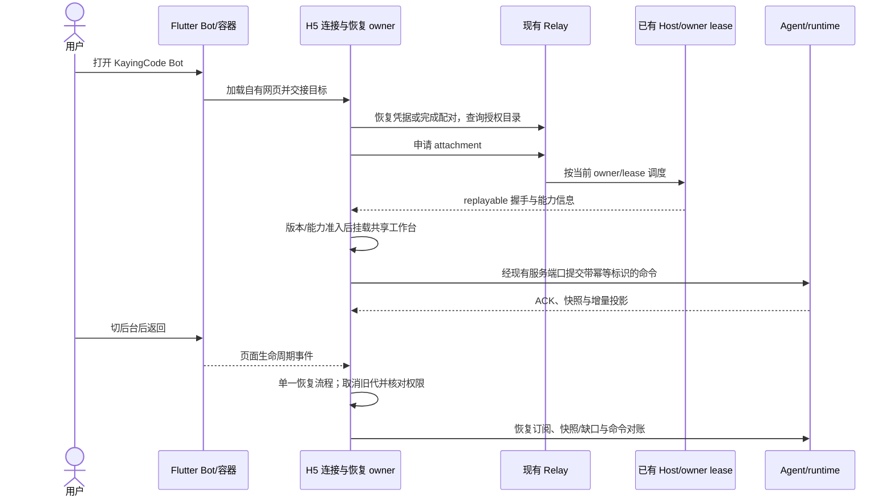

# Flutter WebView 与手机 Web 工作台迁移计划

轮次：`2026-10-29-mobile-web-workbench`。创建日期：2026-10-29（Asia/Shanghai）。状态：迁移代码已接入，本机自动化验证已执行；发布前平台验收进行中。实时进度以 [status.md](status.md) 为准。

## 1. 交付目标与范围

Flutter 的 KayingCode Bot 打开自有 Web 工作台。消息、思考过程、工具调用、权限和问题确认、输入与会话导航等共同能力，按本轮固定上游版本对齐布局和操作语义。品牌、无账号使用方式、模型配置以及明确的平台能力差异遵循 KayingCode 产品规则。

完成标准包括完整工作台体验；只将现有精简 Relay H5 放进 WebView，不算本轮完成。对齐目标是本轮固定源码及可复现页面，后续上游页面变化须进入新的更新轮次。

| 领域       | 本轮处理                                                                            |
| ---------- | ----------------------------------------------------------------------------------- |
| Flutter    | Android/iOS WebView 与 Windows WebView2 的 Bot 入口、持久化、返回、刷新、失败与重开 |
| Web/UI     | 自有 H5、共享会话组件、手机布局、交互完整性、中英双语、明暗主题                     |
| 接入与状态 | 现有配对、设备凭据、grant、attachment、workspace identity、命令对账                 |
| 稳定性     | 页面暂停恢复、取消、代际隔离、版本兼容与资源发布                                    |
| Relay      | 保留现有授权体系；必要扩展同步覆盖 Docker 与 Cloudflare                             |
| 产品差异   | 不引入 ZCode OAuth/同账号门禁、商业订阅或官方私有服务依赖                           |
| 其他渠道   | Taro 保留当前入口；共享 core 变更须回归；鸿蒙内嵌支持单独验收，不列为已支持         |

## 2. 已确认基线与证据

上游工作副本：`/Users/feng/codes/kaying-office/ZCode-all/ZCode`。本地源码：`/Users/feng/codes/kaying-office/kaying-code`。绝对位置仅用于本轮复现；下一轮须重新确认。

| 证据                                                                      | 已确认结论                                                                          |
| ------------------------------------------------------------------------- | ----------------------------------------------------------------------------------- |
| 上游 `aac47556` 的 `packages/shared/src/web-remote-control.ts`            | 3.15.1 二维码包含 `sid/hash/t`，保留旧鉴权协议                                      |
| 上游 `0a1fc56d`，2026-10-19 公开同步                                      | 已包含 Relay V2、账号门禁、设备列表与网页远控模块化；公开同步日期不等于内部开发日期 |
| 上游 `3c5b2276`，2026-10-20 公开同步；根版本 3.16.2                       | HTTP 取消改用基础 AbortController，兼容缺少 AbortSignal.any/timeout 的浏览器        |
| 上游 `packages/web/src/main.tsx`、`web-remote-control/app/`               | 远控通过工作区服务桥挂载共享 Root，包含生命周期与版本恢复编排                       |
| 本地 `packages/desktop-web/src/main.tsx`、`src/relay/`             | 已有 `?relay` 配对、选择、订阅、收发与对账；会话行渲染仍为精简实现                  |
| 本地 `packages/mobile-client-core/src/relayDeviceIdentity.ts`             | H5 使用单个凭据存储槽，尚未提供多个 Relay Bot 的隔离方案                            |
| 本地 `packages/agent-gateway/src/relayIngress.ts`、`relayMobileAccess.ts` | 移动接入受权限边界限制，不能假设拥有 Root 所需完整 IServiceAccessor                 |
| 本地 Flutter `lib/ui/root_shell.dart`、`zcode_webview_page.dart`          | ZCode 已打开网页；KayingCode 仍走原生 AppSession/Adapter                            |

上游给出的是手机 Web 页面；Flutter 容器属于本地工程。上游 Go Relay 服务不在本次给定开源目录中，前端源码及假 Relay 测试不能证明其生产部署行为。

## 3. 源码映射与迁移决定

以下上游路径相对上游根目录，本地路径相对本仓库根目录。

| 编号 / 优先级        | 上游来源                                                                                        | 本地落点                                                                       | 决定与依赖                                                                             |
| -------------------- | ----------------------------------------------------------------------------------------------- | ------------------------------------------------------------------------------ | -------------------------------------------------------------------------------------- |
| U01 / must-inspect   | `packages/web/src/main.tsx`、`web-remote-control/app/webRemoteControlWorkspaceBridgeSession.ts` | `packages/desktop-web/src/`、`packages/ui/src/`、`packages/client/src/` | 适配共享工作台和服务装配；先证明最小权限下可运行，不能直接复制 Root 启动代码           |
| U02 / must-inspect   | `webRemoteControlLifecycle.ts`、`webRemoteControlBridgeRecovery.ts`、transport                  | Web 的连接编排、`packages/mobile-client-core/src/`                             | 迁移暂停/恢复、取消与过期回包隔离；保持单个恢复 owner                                  |
| U03 / must-inspect   | `webRemoteControlVersion.ts`、`webRemoteControlRoute.ts`、上游 Vite 配置                        | Web 入口与构建、现有协议、`docs/deploy/kayingcode-desktop-web.md`              | 适配兼容性协商与版本资源；不能仅复制 app_version 参数                                  |
| U04 / should-inspect | `webRemoteControlEntry.ts`、设备列表与设备分组                                                  | Web 选择页、mobile-client-core                                                 | 借鉴最近目标与明确选择，改用 node/server/workspace/grant，不按 MID 合并授权            |
| U05 / should-inspect | `webRemoteControlHttpSignal.ts`                                                                 | mobile-client-core 的网络端口及 Web 适配器                                     | 按需迁入可取消请求与旧 WebView 兼容；不能用超时掩盖同步问题                            |
| U06 / must-inspect   | 上游手机工作台实际调用的共享 UI                                                                 | `packages/ui/src/` 的现有组件、hooks 与平台接口                                | 对齐共同交互；保持本地主题、i18n、服务边界                                             |
| U07 / invariant-only | 上游 Main/shared-host 与 acknowledged RPC 桥                                                    | 本地 desktopMobileRelay、agent-gateway、现有协议                               | 参考 owner/lease 与 stale 防护；保留现有 attachment 和 V4 命令路径，避免第二套业务队列 |
| U08 / evidence-only  | 上游 Relay V2 HTTP、OAuth、账号设备目录                                                         | 现有 Relay 与配对模块                                                          | 记录差异；本轮不迁入账号体系或替换服务端协议                                           |

本次先建立应用内规范。实现时按需在 `packages/ui/spec/`、`packages/mobile-client-core/spec/`、`packages/shared` 所属规范与 `packages/relay-core/spec/` 补充规则，然后修改各自代码。

## 4. 状态所有者和事件顺序

| 事实                             | 唯一所有者                            | 客户端允许保存的内容                                              |
| -------------------------------- | ------------------------------------- | ----------------------------------------------------------------- |
| Bot 档案、最近入口               | Flutter AccountStore                  | 本地名称、入口与最近使用偏好                                      |
| 网页配对与凭据                   | H5 经存储端口管理的连接范围           | 按 Relay origin/设备身份等隔离的凭据；不把整个 profile 当授权边界 |
| 配对批准、grant、attachment 许可 | 现有 Relay / Node 控制面              | 展示与临时申请结果                                                |
| Host 选择及 owner/lease          | Desktop 路由与已有 Host               | 当前 attachment 的派生目标信息                                    |
| 已接受输入、任务与会话           | Agent/runtime CommandInbox 与现有服务 | 未提交草稿、pending optimistic overlay、可对账命令关联            |
| socket、恢复代际、在途取消       | 单个网页连接编排 owner                | 当前连接视图；Flutter 不创建并行原生 Adapter                      |
| 页面版本准入                     | Web 启动/兼容性编排                   | 当前兼容判定与待确认更新；旧回包不得覆盖新连接                    |



`workspaceIdentity?.trim() || workspacePath` 用于隔离；`workspacePath` 用于执行和展示，远端同时保留 remoteSessionId。桌面 continuous 与移动 replayable 分别验证。Relay/Main 不承载任务队列或会话快照。

## 5. 分阶段执行与完成门槛

阶段按依赖顺序执行；每阶段应能独立评审、验证和回退。本轮沿用用户当前 `upZCode` 分支，工作区尚未提交；新建实现分支时使用 `codex/` 前缀。

| 阶段                 | 依赖   | 工作内容与产物                                                                                                             | 完成门槛                                                                                 |
| -------------------- | ------ | -------------------------------------------------------------------------------------------------------------------------- | ---------------------------------------------------------------------------------------- |
| M0 调查与计划        | 无     | 固定双仓库基线、迁移决定、应用内待实现规范、日志与复用指南                                                                 | 文件可读、链接有效、明确已评估/已迁移差异；本次交付                                      |
| M1 服务与契约验证    | M0     | 枚举共享工作台实际调用；建立能力矩阵；用现有移动白名单验证挂载/订阅/发送；确定 URL 交接、凭据隔离、版本准入和旧档案策略    | 形成可评审的技术决策与最小运行证据；不得通过放开全部服务、伪造成功或大量 no-op 满足 Root |
| M2 网页入口与容器    | M1     | 通用网页容器按后端保留不同入口策略；KayingCode 配对交接、自有网页路由、多 Bot 存储、返回/刷新/重开；保留 ZCode 原 URL 规则 | 三个入口一致；一次打开只建立一条会话链路；跨 Bot 不串凭据；完成对应 widget 与浏览器场景  |
| M3 完整 Agent 工作台 | M1、M2 | 适配共享组件及必要上游手机布局；补齐消息、工具、交互卡片、模型/模式、附件、历史与导航；逐项记录平台差异                    | 下述共同能力矩阵逐项有截图和操作证据；精简 RelayRowView 不作为最终验收替代               |
| M4 恢复与版本发布    | M2、M3 | lifecycle suspend/recover、单航班、stale guards、幂等对账、兼容策略、版本资源与缓存、旧链接引导；更新部署文档              | 冻结/断网/权限吊销/换代均按约定恢复或明确失败；不会重复提交、无限导航或混用资源          |
| M5 跨端验收          | M3、M4 | Android/iOS WebView、Windows WebView2；Docker/Cloudflare；桌面 continuous；Taro 共享核心回归；记录鸿蒙能力                 | 自动化检查和要求的平台场景均有结果；未执行项列为待验收，不能写已完成                     |
| M6 发布与收尾        | M5     | 可回退发布；验证旧 Bot 档案、存储升级/降级与资源回滚；审查旧 adapter 删除引用；整理后续上游差异                            | 发布/回退证据齐备；没有未解决的必需场景；更新已迁移基线及每个 U 编号处理记录             |

## 6. 共同能力与代表性验收

以下为纳入目标的 **accepted** 场景；实际已执行范围和剩余证据见 [当前状态](status.md)，不能以计划表代替通过记录。每项须记录环境、测试路径或步骤、协议/状态证据及截图。上游截图用相同虚构会话、视口和主题；没有可运行上游环境时标记缺少视觉基准，不能写像素一致。

| ID                 | 前置与操作                                                            | 断言                                                              | 证据层                         |
| ------------------ | --------------------------------------------------------------------- | ----------------------------------------------------------------- | ------------------------------ |
| C01 入口一致       | Bot 卡片、设备管理、冷启动最近 Bot 分别打开；连续点击并返回重开       | 打开同一目标；无重复 WebView/原生 Adapter；返回历史优先           | Flutter widget + 真机/桌面容器 |
| C02 配对/隔离      | 新设备配对获批；在两个 Bot、两个 Relay origin 间切换并冷启动          | 目标和凭据不串用；拒绝/过期清晰；旧 Bot 档案保留本地名称          | 浏览器 E2E + 存储/请求         |
| C03 会话导航       | 新会话、历史、工作区切换；相同路径但不同 identity                     | 导航/返回与上游共同语义一致；订阅、草稿与命令关联按身份隔离       | UI + Host/V4                   |
| C04 内容展示       | 流式文本、Markdown/代码、思考折叠、工具成功/失败/展开、引用与产物入口 | 信息完整，流式结束正确；无原始内部 directive 泄漏；差异有能力说明 | 共同 fixture + 截图 + 投影     |
| C05 输入与控制     | 输入、模型/模式选择、运行中继续输入、暂停/停止；ACK 前后断网          | 当前授权内的操作有效；已接受命令归 CommandInbox；对账无重复执行   | UI + 命令 ID/ACK/账本          |
| C06 交互卡片       | 权限确认与问题选择；迟到作答、过期 run、只读 grant                    | 当前交互可作答；过期与越权请求被服务端拒绝；不伪装成功            | UI + 运行时校验                |
| C07 附件           | 选择文件/图片、取消选择、上传失败、重新发送、预览/下载                | 遵守 WebView 能力与限额；文件生命周期正确；不可用动作有明确提示   | 真机/文件 fixture + Host       |
| C08 页面生命周期   | 首屏 pageshow、hidden/pagehide/freeze 后 visible/resume/online        | 首屏不重复建连；真实暂停后由单 owner 恢复；草稿/位置按约定保存    | 浏览器 E2E + WebView           |
| C09 重连与旧代     | 断网、Host 换代、切 Bot/工作区时旧请求晚到、socket 重复 close         | 旧结果失效；快照/缺口恢复；pending 可对账；无第二个 Host/Agent    | 网络故障注入 + owner/lease     |
| C10 授权失效       | access 过期、refresh 失败、grant/device 吊销、只读设备请求写操作      | 区分可恢复与终止；吊销及时关闭；重新配对有明确入口                | 两种 Relay 适配器 + UI         |
| C11 版本资源       | 兼容/不兼容网页与 Host、缓存旧页面、更新中旧 bootstrap 晚到           | 准入前不提交业务副作用；更新有界；资源版本一致；回滚可恢复        | 构建产物 + 部署环境            |
| C12 布局平台       | 中英、明暗、窄屏、键盘弹出、安全区、Windows 调整大小                  | 主要操作可达、文本可读；遵循 DESIGN；共同功能与上游截图对照       | Android/iOS/Windows 视觉与操作 |
| C13 桌面/共享 core | 桌面与手机并行、手机退出重连；Taro 原路径                             | continuous 不受移动恢复影响；Taro 共享接口兼容                    | 桌面 E2E + core/Taro 测试      |
| C14 发布回退       | 旧版原生 Bot 档案升级、取消迁移、切回旧制品/网页                      | 不丢会话或档案；不复用另一身份凭据；记录重新配对条件              | 安装升级 + 存储/资源回退       |

通知/未读的产品决定见 M1：网页拥有会话状态；未经定义与验证的原生桥不显示伪造连接、未读或后台提醒。离线完成后台通知需明确平台支持和证据，不以 WebView 常驻推断可用。

## 7. 当前测试入口与实施时补齐项

所有命令从仓库根执行；Flutter 使用应用内真实脚本路径，不能误写成根目录不存在的 `scripts/flutter-target.mjs`。

```sh
node scripts/check-workspace-freshness.mjs
bun run typecheck
bun run lint
bun run source:check
bun run architecture:check --changed
bun run --filter @kayingcode/mobile-client-core test
bun run --filter @kayingcode/web test
bun run --filter @kayingcode/web build
bun run --filter @kayingcode/web test:e2e
```

现有 Web `relayAgentConnection.e2e.test.ts` 使用真实内存 Relay、connector/ingress 和假 Agent，属于协议集成证据，不能替代浏览器 UI 或真机。现有 Flutter `test/zcode_webview_test.dart`、`test/root_shell_test.dart`、`test/mobile_interaction_flow_test.dart` 等需按行为扩展；当前不存在 Flutter `integration_test/`，不得记录为已具备。

```sh
node apps/kayingcode-mobile-flutter/scripts/flutter-target.mjs android check
node apps/kayingcode-mobile-flutter/scripts/flutter-target.mjs android analyze
node apps/kayingcode-mobile-flutter/scripts/flutter-target.mjs android test
node apps/kayingcode-mobile-flutter/scripts/flutter-target.mjs android debug
```

iOS/Windows/鸿蒙先执行对应 `check`，再调用同一入口的实际支持动作；Windows 构建在 Windows 运行。遵循 Flutter AGENTS 的 SDK 隔离规则，不修改全局 PATH 或为平台切换改根锁文件。

实现新增浏览器/容器 E2E 时先确认现有 runner，选择可运行入口并将命令写回本计划；已新增共享 UI 的浏览器 `test:e2e`，仍没有覆盖 C01–C14 所有真机/部署条件的统一命令。涉及共享 core 时执行 Taro 包的 `test`/`typecheck`；涉及 Relay API、控制消息、管理页或存储时执行 Docker `test` 及 Cloudflare `test`、`test:integration`，并检查两端失败语义；管理页变更另跑 Cloudflare `test:admin:e2e`。

## 8. M1 必须收敛的决策与风险

| 编号             | 当前状态 / 风险                                                              | 收敛证据与责任阶段                                                                                                    |
| ---------------- | ---------------------------------------------------------------------------- | --------------------------------------------------------------------------------------------------------------------- |
| D01 服务桥       | 已收敛：组合共享 Timeline/PermissionDialog/QueuePanel；不扩大 gateway 白名单 | M1 建立方法/读写/grant 矩阵与最小挂载验证；优先受限服务装配，必要时组合共享会话组件；必须保持完整交付目标             |
| D02 入口与凭据   | 已收敛：Relay client-config、fragment v1、Bot scope；旧原生 token 不复制     | M1 确定受信自有 origin、最小 URL/交接契约、日志脱敏、网页凭据隔离；默认允许重新配对，不直接复制旧凭据或注入长期 token |
| D03 版本策略     | 已收敛：入口 v1 + 严格 V4 hello；manifest/哈希资源原子发布                   | M1 定义兼容条件；M4 联合 Host/网页/资源缓存验证，不能要求独立发布的双方版本号机械相等                                 |
| D04 原生辅助能力 | 已收敛：V4 附件事务；Android chooser；无原生通知桥，容器下载能力待真机验收   | M1 定义受限宿主接口与能力矩阵；M3/M5 验证；发现会改变现有承诺的缺口时单独对齐                                         |
| D05 视觉基准     | 待采集：本次只有源码与测试，未获取真实上游工作台对照截图                     | M1/M3 建立共同 fixture 和固定视口；M5 保存对照和差异说明                                                              |
| D06 多端与回退   | 待验证：Windows、鸿蒙 WebView 差异，旧档案与资源降级                         | M2/M5/M6 逐平台记录；鸿蒙单列，环境不足保持待验收                                                                     |

pruned：ZCode OAuth/账号设备目录和商业能力（本轮保留无账号配对）；Flutter/Taro 双入口共建新协议（沿用现有 core）；手机新建 Host/Agent（复用已有 attachment）。这些裁剪不免除共同 Agent 交互体验的验收。

graph-drift-candidate：现有 feature graph 包含 conversation runtime、workspace identity 和两类 clientMode，但未完整描述 Flutter WebView→Relay H5 的表面关系。M1/实现时只为已确认边界补充节点和一跳关系，不将计划能力写成已实现能力，也不恢复 graph 中已失效的文档引用。
