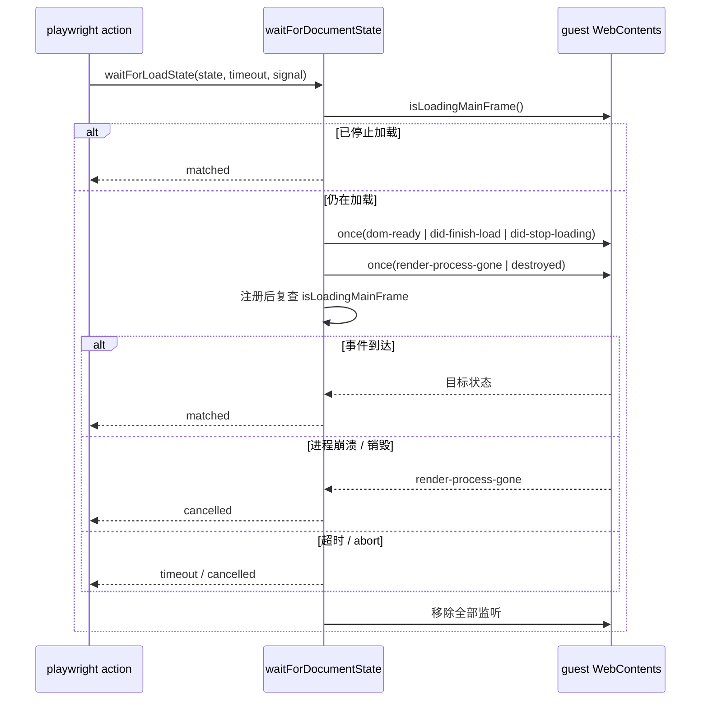

# 内置浏览器加载状态等待（waitForLoadState / waitForURL）

`browserPlaywrightExecutor` 的 `waitForLoadState` 与 `waitForURL(waitUntil)` 需要判断页面是否到达
`domcontentloaded` / `load`。本文件约束等待实现与失败语义。

## 根因与取舍

旧实现每 50ms 通过 `webContents.executeJavaScript("document.readyState")` 轮询。开发态实测
（2026-11-28）出现 guest renderer 原生崩溃（`0xC0000005`，12 次同一 Electron 代码偏移），
崩溃都发生在同一窗口：新建 guest 后 `playwright` 命令开始约 200ms，ref-null / guest 重建都是
崩溃后的结果，不是面板重挂载导致取消。因此等待不再向 guest 注入脚本，改用 Electron 的加载事件：

- `error-mitigation`：移除轮询注入可以避免在 guest 启动/导航窗口反复执行脚本；
- 语义更准：`dom-ready` / `did-finish-load` 就是 Chromium 的 DOMContentLoaded / load；
- 代价更低：不再每 50ms 一次 IPC + 脚本执行。

## 规则

- 判定只看 Electron 事实，不依赖 `executeJavaScript`：
  - `isLoadingMainFrame()` 为 false：文档已停止加载，两种目标状态都视为已到达（DOMContentLoaded
    必然早于主 frame 停止加载），立即返回 `matched`。
  - 否则等待事件：`domcontentloaded` → `dom-ready` 或 `did-stop-loading`（后者作为 DOMContentLoaded
    已错过的兜底）；`load` → `did-finish-load` 或 `did-stop-loading`。
- 注册监听后立即复查一次：事件可能在首次检查与监听注册之间到达；已停止加载则直接 `matched`。
- 失败语义（必须收敛，不允许悬挂）：
  - `render-process-gone` / `destroyed` → `cancelled`（guest 已不在，等待没有意义）；
  - 等待开始前就 `isCrashed()`（renderer 已崩溃但 WebContents 仍存在）→ `cancelled`，不能因为
    `isLoadingMainFrame()` 变为 false 而误判 `matched`；
  - AbortSignal → `cancelled`；
  - 超时 → `timeout`（由调用方转成结构化 `timeout` 结果）。
- 所有监听、timer 与 abort 订阅在同一 `cleanup` 中释放；settle 后重复事件不改变结果。
- `networkidle` 仍明确不支持（抛错），不引入新的等待状态。

## 事件顺序

## newTab 初始文档就绪门

`newTab` 的 guest ready ack 只证明 webview 已 attach，不保证初始 `about:blank` 已停止加载。
开发态实测：attach 后立刻 `loadURL` 会在约 300ms 后触发 guest renderer 原生崩溃
（`0xC0000005`，`crash-capture` 记录 `render-process-gone` / `about:blank`）。
因此 `newTab` 在返回前复用 `waitForDocumentState("domcontentloaded")` 等待初始文档：

- 已停止加载：立即命中，不增加可见延迟；
- 等待中 guest 崩溃/销毁或命令 abort：返回 `cancelled`，关闭该 tab；
- 超时（3s）：记录日志后放行，避免把慢启动误判为命令失败；
- 只注册 Electron 加载事件，不向 guest 注入脚本。

## 验收

1. 已停止加载的页面立即 `matched`，不注入任何脚本。
2. `dom-ready`、`did-finish-load`、`did-stop-loading` 分别触发对应目标状态。
3. `dom-ready` 已错过但 `did-stop-loading` 到达时，`domcontentloaded` 仍 `matched`。
4. `render-process-gone`、`destroyed`、等待前已 `isCrashed()`、abort 返回 `cancelled`；超时返回 `timeout`。
5. settle 之后的事件不会二次结算，监听被移除。
6. `newTab` 返回后立即 `goto` 不再触发 `render-process-gone`（初始文档就绪门生效）。

验证：`pnpm --filter @zcode/desktop exec vitest run src/main/browserView/browserPlaywrightExecutor.test.ts`。

## 非目标

- 不改变 `waitForLoadState` 的 action 契约，不新增 `networkidle` 支持。
- 不在本次修复里自动重试整个 browser 命令；guest 崩溃后的重建仍由 `UnifiedBrowserView` 负责。
- 不改变 CDP 命令、viewport、截图与权限链路。
