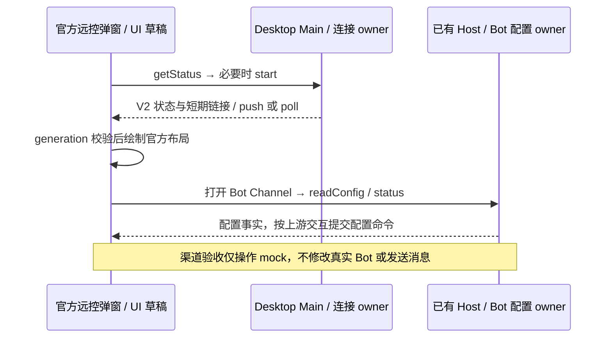

# 桌面手机远控：官方 Web V2

左下角入口使用现有 WebRemoteControlManager 与 V2 设备/连接协议；自有 NodeRelayConnector、手机配对 IPC、Host v1 ingress 与对应死代码已移除。手机复用已有 window-scoped Host attachment、owner/lease、workspaceIdentity 和 remoteSessionId，不创建第二个 Host 或独立会话队列。

部署原 Relay origin 保持不变。自托管时 `KAYINGCODE_OFFICIAL_CLOUDFLARE_RELAY_ORIGIN` 优先从进程环境读取，其次本地 `.env` 快照，最后才回退默认生产 origin；打包版从终端/systemd 启动也必须生效。Main 的 desktopRemoteAccount 经安全凭据服务保存本机 owner secret；首次注册幂等，先保存 secret 再请求服务。每次开启/刷新签发邀请，默认五分钟一次性；受控部署可在 Relay 端配置邀请有效期、领取次数和 terminal 凭据有效期。URL 使用官方 /remote/v4 参数，秘密只放 authorize fragment；owner 凭据绝不进入 QR。审核/受控部署可设置 `KAYINGCODE_REVIEW_COMPACT_LINK=1`，让链接只保留 `sid` 与 authorize fragment，省略 `name`、`mid`、`app_version`，以适配微信提审备注 200 字限制；设备名、MID 和 Desktop 版本在连接后由 Relay 注册信息与 Web bootstrap 取得。审核期间必须保持 Desktop 在线，重启导致 SID 变化后应重新签发链接。面板本地 busy 时隐藏旧 QR、禁用复制，避免刷新拿到上一张已消费链接。关闭/换代后迟到结果不能写 UI。

唯一状态 owner 与事件顺序图见 packages/web/spec/mobile-web-workbench.md，账号/V2 服务契约见 Cloudflare spec/upstream-v2.md。Web 页面、设备选择、连接及恢复均由官方源码构建；Main 和 Host 只补缺失接口。

Host 的 web-remote-replayable attachment 将三个品牌化内部频道映射到官方 zcode-task / zcode-agent / zcode-session，只改注册名，复用 scoped/controller 实例，不同时提供旧别名。desktop-continuous 原频道与订阅语义不变。Renderer 恢复完整工作区快照发布和手机动作 handler。已退役的 CUA 不恢复；未提供的营销服务明确返回 feature_disabled，不伪造商业状态。

官方 Web 所需 session lifecycle RPC 与事件转发已补齐，CLI SessionLifecycleController 仍是唯一 owner，stopping 按会话撤销订阅并拒绝迟到 ACK，dispose 清理事件。详见 services/spec/upstream-session-lifecycle.md。

官方 Web 切换项目或新建任务时，Main 发送 `prepare-project-workspace` 请求 Host 准备目标目录。Host 必须通过 `createProjectWorkspaceNavigation` 统一解析本地/远端项目；本地目录由 ProjectService 唯一准备，远端复用窗口连接 registry 的 logical session 并等待 workspace 可附着，失败时回收本次 provisional session。Host 退出或 Main 取消（`CancelRemoteWorkspaceConnect`）必须中止在途导航，迟到结果不得写入新 Host。

官方 Web 的侧栏、命令中心与任务动作会直接调用 `project`、`remote-projects` 与 `window-controller`，这些能力必须与上游一致：

- 本地 Window Host 的 ProjectService 必须能按 `hostId` 路由到在线 Source；离线统一 `project.host-offline`，不得回退本地库。远端树经稳定身份绑定后返回。
- 远端项目目录必须投影实时连接状态，并支持重连与写入后的 `state:projects` 广播。
- `web-remote-replayable` 的远端 attachment 必须把控制端的 project / remote-project / task-group 频道注册进 attachment 服务集合；Remote Agent 连接原本没有这些频道，不能只放 override。
- Window Controller 支持 `workspaceScopes: "host"`、`kind: "all"`、`getTaskMeta`、`rename` 与 source 身份；未读信号只向桌面本地 attachment 暴露。
- 手机 attachment 的窗口项目树叠加待处理交互；只有存在手机 attachment 时才监听投影并广播。终端 PTY 按 `terminalOwnerId` 隔离，页面换代回收。
- agent hello 声明 `genUiContext`、`workflowRunDeltas`、`historyFirst`，并转发客户端声明；带 Gen UI 上下文的发送必须先确认执行端支持。

验收：账号持久化/并发初始化/失败幂等重试；Host upstream 频道及 scoped 实例；项目路由在线/离线；远端项目状态与重连；attachment project 频道；控制器 host scope/getTaskMeta/rename；终端 owner；真实 Desktop 扫码→生产 V2→390px 官方 Web→远端项目任务、发送消息与权限交互、刷新恢复，测试结束注销本次浏览器凭据。仍需独立手机真机验收。

## 验证记录（2026-11-05）

- `desktopRemoteAccount` 单测通过：owner secret 先落盘再注册、并发初始化只注册一次、注册失败重试同一 secret。
- `windowHostUpstreamRpc` 单测通过：`web-remote-replayable` 只注册 `zcode-task/zcode-agent/zcode-session` 三个官方名并复用已有 scoped 实例；`desktop-continuous` 名称不变。
- 本地 Wrangler V2 集成通过：账号注册/邀请/claim、角色限制、一次性 token 重放、lease 换代与 socket 转发。
- UI 状态映射测试通过：idle/starting/running/connecting/active/auth-required/error 均有独立文案。
- Host 项目导航回归 3 项通过：本地项目只准备目录；远端项目复用连接并等待 bind；bind 失败回收 provisional session。
- 真实 Desktop dev + 生产 V2 + 官方 Web（390×844）通过：新建任务打开 composer；项目选择切到 `server`；打开 `20260929` 项目内任务成功；未发送消息，测试浏览器 terminal 凭据已注销。
- 验收注意：`dev:runtime` 的 tsup watch 重建 `out/` 不会重启已运行的 Main/Host 进程；验证 Host 改动必须完整退出并重新启动 Desktop，仅刷新 H5 页面不够。
- 未执行：独立手机真机；当前已完成桌面 dev + 手机尺寸浏览器的整链验证。

## 上游 Web 能力对齐（2026-11-05）

- Project：`createLocalServices` 新增 `resolveProjectHostService`；Window Host 按 `hostId` 解析在线 Source（registry / Manager），用 `bindRemoteProjectIdentities` 补稳定身份；无解析器或离线保持 `project.host-offline`。
- Remote projects：新增 `connectHost` / `readConnectionStates`，目录投影实时连接状态；项目写入广播 `state:projects`。
- Attachment：`web-remote-replayable` 远端 attachment 补注册控制端 project / remote-project / task-group 频道；Remote Agent 连接不再缺频道。
- Controller：支持 `workspaceScopes: "host"`、`kind: "all"`、`getTaskMeta`、`rename`、sourceServerId/serverDisplayName 与事务性重连；未读信号只向桌面本地 attachment 暴露。
- 窗口项目树：手机 attachment 叠加待处理交互并只在其存活期间监听投影；终端按 `terminalOwnerId` 隔离，页面换代回收。
- Agent：hello 声明 `genUiContext` / `workflowRunDeltas` / `historyFirst`，转发客户端声明并在发送前确认 Gen UI 支持。
- 单测：services 56 项、desktop host 10 项、web auth 3 项通过；`pnpm run typecheck`、`pnpm run lint`（0 error）、`pnpm run architecture:check --changed`、官方 Web 构建与 relay 测试通过。
- 真实链路（Desktop dev + 本地 Wrangler 8792 + 官方 Web 390×844）：扫码授权、已有会话、发送 “Reply with exactly OK. Do not use any tools.” 并收到 `OK`、刷新恢复通过；浏览器凭据已注销。
- 本环境远端 SSH Source 处于离线，`project.readTree` 由新解析器返回 `project.host-offline`（栈已落到 `resolveProjectHostService`），在线远端项目切换仍需在 Source 在线时复验。
- 未完成：`prepareForkCreation` / `resolveSessionDirectories` / `getWorkspaceProviderConfigFile` 等 agent 创建钩子仍待补；本地 relay 构建未设置 `KAYINGCODE_REMOTE_ORIGIN`，页面会请求生产 `client/configs` 并被 CORS 拒绝（仅本地验收环境问题）。

## 桌面弹窗对齐官方（2026-11-06）

用户提供的双栏弹窗是官方 WebRemoteControlDialog，必须直接采纳该组件及 presentation helper，不能继续维护简化单栏扫码壳。外层 max-w-4xl / 限高滚动、图标标题、左侧连接状态和复制行/二维码、右侧四个 Bot Channel 卡片及真实渠道图标，均以上游固定提交为准；窄窗口按上游断点单列。

打开弹窗按上游先查询并复用 Main 连接，不可用时启动；连接状态、owner/lease 与既有 Host 仍由 Main 唯一拥有。自建账号不跳官方 OAuth；失败时在相同状态卡显示并允许重试。保留一次性邀请所需的刷新操作、busy 隐藏旧码和已连接时禁止复制已消费链接。异步开启/停止、poll 与 QR 生成必须有关闭/换代守卫，迟到响应不能复活旧 UI。

Bot Runtime 和 IBotsService 已存在于本仓，恢复官方 BotsDialog 与所属子组件/状态 hook，复用服务读取与保存配置，不新增配置状态 owner。入口缺服务时须显式禁用/提示，不能存在可点击但不可用的卡片。渠道快捷入口遵循上游行为：没有配置时会创建该渠道 Bot，再进入配置；所有保存仍走现有 IBotsService。本次渠道验收只在隔离 mock 中执行，不向真实服务保存 Bot、测试凭据或发送消息。

验收：与参考图的双栏/标题/卡片/QR 位置一致，四渠道图标和配置入口，窄窗口不溢出；开启/复制/停止与状态变化；关闭后迟到结果丢弃；实际 Desktop 截图与隔离 mock 的 Telegram 配置；根 typecheck/lint/source/architecture。保留与本次 UI 无关的本地变更。

### 弹窗对齐验收结果（2026-11-06）

- 直接恢复官方 WebRemoteControlDialog、presentation、BotsDialog 与渠道子组件/图标/文案；侧栏入口已直接挂载官方组件，简化单栏组件与旧状态 helper 已删除。自建授权重试与一次性二维码刷新属于必要适配。
- 隔离浏览器 E2E 通过：1240px 双栏、480px 单栏、四渠道图标；同一连接复用；完整 remoteSessionId/workspaceIdentity/task context；刷新忙时不可复制、关闭后的迟到结果不覆盖新连接；Telegram 配置仅在内存 mock 创建；缺 Bot service 时禁用入口；停止失败与重试。截图在 `.tmp/upstream-remote-dialog/`，不入库。
- 状态/identity 投影 3 项单测通过。根 typecheck、lint、source 与 architecture 检查通过，lint 保留既有警告、0 error；图索引新增桌面弹窗节点，唯一 ID、关系端点/rank 与源码种子验证通过。
- 实际 Desktop dev 已重新运行：官方双栏、4 个真实图标、V2 二维码和复制入口可用；没有通过真实 Bot service 保存配置、测试账号或发送消息。此次没有改动 Relay 后端部署或移动容器。

## 旧自有 Relay 退役

当前仅使用 V2 注册身份 `webRemoteControlRelayV2Device`。启动不再读取旧 external-relay 身份、调用旧凭据清理或等待旧协议迁移；旧磁盘/钥匙串数据不由此次代码清理删除。设置合同移除旧字段。`WebRemoteControlDeviceStorage` 只拥有 V2 身份 load/save，manager 的窗口生命周期、账户换代、Host attachment 与双交付语义保持原有所有者。

验收：V2 注册/重连/换号与停止继续通过原有测试；所有产品入口不再引用 external-relay 凭据或 v1 设备字段。
