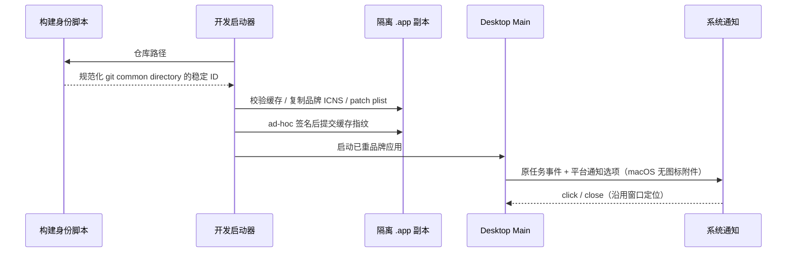

# 任务系统通知品牌

任务通知由 Desktop Main 的 `desktopNotifications` 唯一创建，Renderer 只发送已有任务通知协议。已有焦点抑制、去重、声音、对象保活和点击定位逻辑保持不变。

- Windows/Linux 使用 Main 启动时选择的应用 KY PNG，不接受 Renderer 提供任意图标路径。
- macOS 左侧应用图标由应用包身份与品牌 ICNS 提供，不传 `Notification.icon`；该字段会成为右侧内容附件，不能替代应用身份图标。
- 正式/Preview 安装包沿用现有 electron-builder 的身份和品牌资产；本规则不修改产品发布 ID。

## macOS 开发身份

多个 clone 共用开发 bundle ID 会产生原生应用解析歧义。开发启动器使用 `desktop-product-identity.mjs` 唯一派生身份：异步读取 git common directory，经过 realpath 规范化后取 SHA-256 的前 16 位，追加到 `dev.kayingcode.app.development.r` 命名空间。

同一 clone 的子目录、worktree 和符号链接身份相同，不同 clone 身份不同。仓库位置移动后身份也会改变，需要新的系统通知授权；任务与会话不随 bundle ID 迁移。仓库无法解析时明确失败，不回退旧共享 ID。

该变更经用户同意，只用于 macOS 开发副本。应用显示名称、原 Electron 可执行文件名与 defaultApp 语义、Windows AUMID、运行时 userData/sessionData 路径及任务存储保持原契约。旧应用条目和通知历史不自动清理。

## 准备副本与启动顺序

开发副本必须在 ad-hoc 签名前写入来自 `build/icon.icns` 的品牌资源，并将 CFBundleIconFile 指向该文件；原 Electron 图标资源从副本中移除。资源名含内容哈希，缓存指纹包含来源二进制、品牌图标内容和派生应用 ID。图标或身份变化必须重新准备并签名，不能仅调用 Dock#setIcon。

缺失身份或图标、仓库解析失败和签名失败均不得启动或缓存半成品；修正后可重试。不会修改 node_modules 原 Electron、其他 clone、用户数据或系统通知偏好。新身份需由系统单独授权通知。

## 验收与结果（2026-11-06）

身份与开发副本测试共 12 项通过：clone 隔离，同 clone 的 worktree/子目录/符号链接稳定，非仓库失败，签名前品牌资源与身份一致，缓存复用，身份与图标变化重新签名，失败重试，Windows 品牌与 AUMID 不回归。任务通知测试 5 项通过，覆盖平台图标语义、焦点抑制、去重、保活和点击定位。

当前仓库开发副本已重建并启动，严格签名校验通过。实机通过该副本的原生 Notification API 发出隔离测试通知，收到 show 回调并截图确认左侧为 KY，无右侧 icon 附件。截图位于本地 ignored `.tmp/notification-brand/repository-main.png`。对照旧共享 ID 下相同品牌资源仍显示 Electron 的结果，说明身份隔离解决了本机开发环境的通知图标问题；不据此断言 macOS 缓存内部实现。

本次未发送真实模型请求、修改任务或点击模拟 taskId，也未对正式安装包进行新的横幅实测。用户已授权临时允许共享期间显示通知，验收后已从系统设置读回“当镜像或共享屏幕时：关闭通知”；新仓库开发身份保留正常通知授权。
