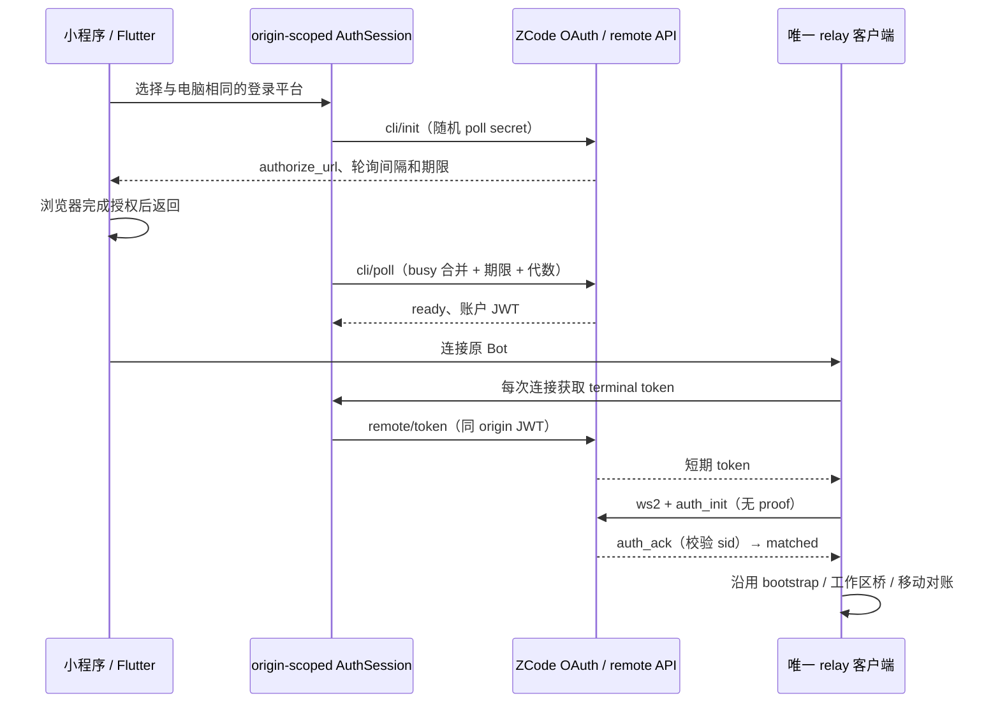

# ZCode Relay V2 移动端接入

## 规则与兼容边界

- ZCode URL 必须有 sid 且没有 hash/t；旧字段即使为空也拒绝，不降级鉴权。仅允许 HTTPS/WSS，账户鉴权使用同一 HTTPS origin。
- V2 使用与电脑相同的 Z.ai / BigModel 账户。通过 `POST /api/v1/oauth/cli/init` 创建登录，客户端用密码学随机 32 字节 hex 作为 Bearer 轮询凭据；保留服务端返回的 HTTPS authorize_url 和 callback，不改写为自定义 scheme。
- 按服务端 poll_interval_sec 轮询 `/api/v1/oauth/cli/poll/:flow_id`；pending 继续，ready 仅保存返回的账户 token 与 user_id，failed/过期终止。关闭登录入口、切换账户或重新登录会使旧结果失效。网络失败允许用户重试，不将失败当成登录成功。
- 账户 JWT 仅发给其绑定 origin 的 OAuth/remote HTTP API。每次连接或重连通过 `POST /api/v1/remote/token`、`{role:"terminal"}` 获取短期 token；401 清除登录并要求重新授权。无 JWT 不发出 socket 请求。
- V2 socket 为 `/api/v1/remote/ws2?token=…`，可附 mid。auth_init 不带 role/proof，client_ts 为 Unix 秒；auth_ack 的 device_sid 必须匹配且 pair_status 合法，之后才接收 pair_status_ack/data。data 仅在 paired 时交付。所有发送帧使用秒，心跳不带旧版 device_sid。
- AUTH_FAILED/WRONG_PARAM/INTERNAL 按确定错误结束本次连接；DEVICE_OFFLINE 可重连；KICKED 维持现有显式失败语义，避免两个终端抢占。鉴权有界等待，不用定时重试掩盖协议错误。
- token、JWT、poll secret、带 token 的 socket URL 不写日志。V2 不回退旧版鉴权。旧版 challenge/proof 已移除；当前桥恢复和命令账本保持原有语义。

## 所有者与接口

- `ZcodeAuthSession` 每个 origin 一个登录所有者，拥有 pending flow、JWT、在途 poll 与失效代数；平台注入 HTTP、密码学随机源及时间。TS 壳仅在内存保留 JWT；Flutter 通过安全存储保存 JWT，不放设备 URL/备份里。
- relay 拥有 socket generation、鉴权状态、心跳及队列；`getTerminalToken` 只提供一次 token，不拥有第二个 socket。等待 token 后和 socket ready 后都核对 generation/disposed，防止关闭后复活。
- 应用层负责登录 UI 和账户切换；core 不依赖 Taro、React 或 Flutter。workspaceIdentity、owner/lease、stale run 与现有 bridge generation 不变。
- desktop-continuous 不受修改；移动恢复仍走原 bridge 恢复与 snapshot/resync，对业务命令保留既有幂等账本。

## 验证

- V2 链接接受、旧格式拒绝、空 sid 和明文源；官方 3.16.3 链接形状可保存但不包含任何真实连接标识。
- OAuth pending/ready/failed/过期、轮询并发与间隔、重新登录/取消后的迟到结果、401 不复用旧凭据、origin 隔离。
- V2 帧无 role/proof、秒级时间、sid 不匹配/鉴权前 data 不交付、重连重新取 token、dispose 期间 token 晚到不建 socket、URL 不出日志；不生成旧 proof。
- 两端 E2E：添加 V2 Bot → 选择平台 → 浏览器授权 → 返回应用 → matched → bootstrap → 打开工作区。取消登录、拒绝授权、过期、桌面离线、断线恢复和旧版 Bot 拒绝均覆盖；外部授权需实际账户，不能把模拟鉴权写成真机通过。

## 旧渠道退役（2026-11-06）

以 `packages/shared/spec/legacy-relay-retirement.md` 为准：移除 KayingCode 旧配对/Node attachment 渠道及 hash/t HMAC 协议，不再维护兼容分支。自建 `/remote/v4#authorize=…` 继续由 Web 单次领取凭据，App 打开完整 Web 链接；原生上游 V2 OAuth / ws2 渠道保留。旧档案只能删除或重新添加有效 V2 链接，不能恢复旧凭据或降级鉴权。CLI/runtime 的任务 admission、命令账本、workspaceIdentity 和 stale 防护不变。
