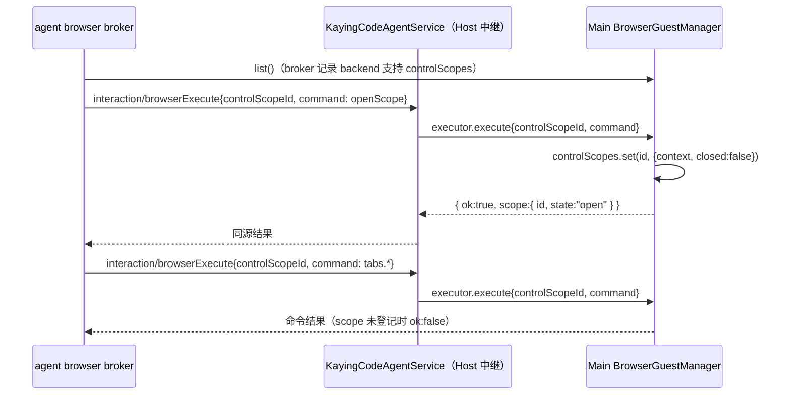

# Browser execute 反向请求中继

`kayingcodeAgentService` 是 `interaction/browserExecute` 在 Host 侧的中继：agent 的
`agent.browsers.*` 由 bootstrap 的 `BrowserControlPort` 组装成命令，经协议到达这里，再由注入的
`BrowserAmbientContextExecutor`（Desktop 为 host→main 桥）执行。本文件约束该中继的字段语义。

## 规则

- **控制作用域 owner 是 Main**：`controlScopeId` 由 agent 侧 broker 在 `list()` 读到
  `metadata.controlScopes === "1"` 后分配，先以 `openScope` 在 Main 的 `BrowserGuestManager`
  登记，后续命令都携带同一 id。Host 中继是无状态转发，必须**原样透传 `controlScopeId`**，
  不得丢弃、改写或按顺序重建。
- 透传缺陷的失败语义：`openScope` 缺少 id 时 Main 返回
  `backend_unavailable / "Browser control scope is required"`；业务命令则会退化为无 scope 的兼容
  路径，只保留 `visibility` 与 ambient 只读能力，标签（`tabs.*`、`claimTab`、截图定位）全部不可用。
  这不是权限开关，UI 设置无法修复。
- **无 executor 时的 openScope 必须显式拒绝**：返回体必须带
  `scope: { id: controlScopeId, state: "rejected" }`。agent 侧 broker 只有在看到同一 id 的
  `rejected` 时才删除未确认连接并换新 scope；缺该标记会让它保留连接、反复用同一 scope 重试，
  永久失败。
- 非 `openScope` 且无 id 的命令不伪造 `scope` 字段（避免把 release/closeSession 误报为已释放）。
- 其余字段语义不变：`workspaceKey` 缺省回退会话 workspace，`clientMode` 缺省
  `desktop-continuous`，`sessionContext` 缺省 `live`；中继不缓存命令结果。

## 事件顺序

## 验收

1. `interaction/browserExecute` 携带 `controlScopeId` 时，`executor.execute` 收到完全相同的 id。
2. 未注入 executor 时，带 id 的 `openScope` 返回 `scope.state === "rejected"` 且 id 一致。
3. 未注入 executor 且命令不是 `openScope` 时，响应不含 `scope` 字段。
4. 缺 `controlScopeId` 的请求仍按无 scope 兼容语义转发，不被中继补造 id。

验证：`pnpm --filter @zcode/services exec vitest run test/browserExecuteRelay.test.ts`。

## 非目标

- 不新增协议字段，不在 Host 侧建立第二份 scope 表或连接缓存。
- 不改 Main 的 owner / generation / 释放屏障语义，也不放宽 `sameScope`。
- 不把 scope 校验搬回 Host：Host 只中继，准入仍由 Main 判定。
