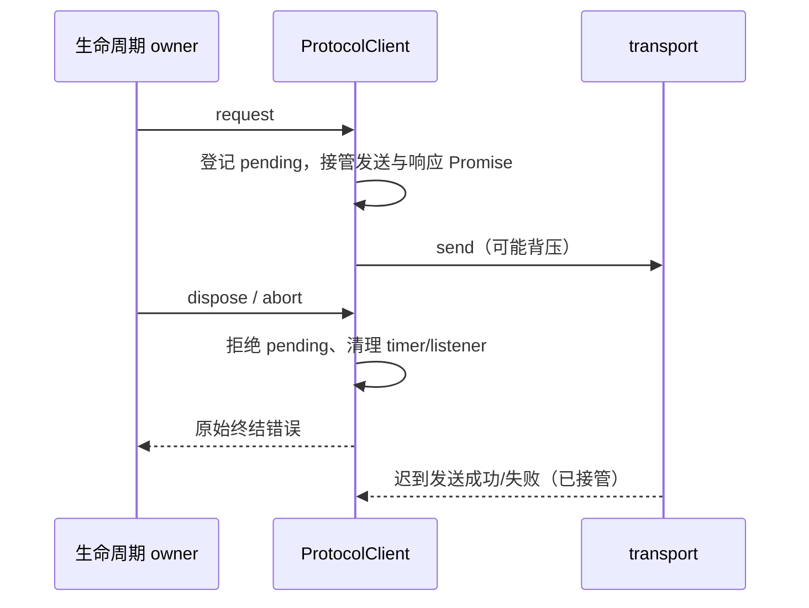

# 协议请求发送与终结

- ProtocolClient 是 pending 请求、超时与 abort listener 的唯一所有者；transport 只负责发送和关闭。
- 请求在登记 pending 后，必须同时接管发送 Promise 与响应 Promise 的失败。不能等发送完成后才监听响应，否则发送背压期间 dispose、abort、transport close 或超时会产生未处理 rejection。
- 成功仍需发送与响应都完成；任一失败立即结束外层请求。另一 Promise 迟到失败也必须已被接管，不改写首次失败结果，不吞掉调用方错误。
- 终结后及时清理 pending、timer 和 abort listener；同步发送异常、异步发送失败均不能遗留请求。dispose 幂等，不等待无法完成的发送才能让业务请求失败。
- 不改变 stdio / WebSocket、Desktop continuous / mobile replay 的协议和业务 admission 语义。

回归：阻塞发送期间 dispose、abort、transport close 和超时，外层及时失败且无 unhandledRejection；发送迟到失败不产生二次错误；普通响应、发送失败与同步发送异常保持行为。
