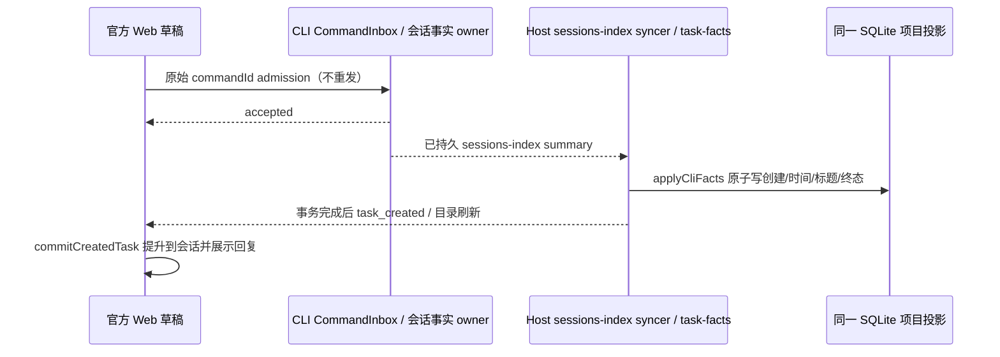

# 官方 Web 草稿首发的会话事实提交

已确认：Web 的 createSession/sendText 已接收并在 CLI 执行，但 Host 仍只写旧 task meta 字段，没有写新项目目录查询要求的 cli_created_at / cli_updated_at 等 CLI 事实。ProjectRepository 过滤掉新行，上游 commitCreatedTask 等不到目录行，首发一直 busy 且不提升到会话 UI。

## 唯一 owner 与事件顺序

CLI sessions-index 是会话持久化事实唯一来源；Host 通过已有 task-facts.ingest → TaskIndexRepo.applyCliFacts 镜像到同一 tasks-index.sqlite。不能从 UI accepted 标记、Host 时间或普通 metadata 占位行伪造 CLI 创建事实。项目/分组/pin/archive/unread 仍由原组织 owner 管理。

- 采用上游事实摄入和初始基线修复；sessions-index 已过滤未提交草稿，不能再次按执行 phase=draft 丢弃已持久的首发。
- CLI 事实写入同一行并保留已有 workspaceIdentity、host、project、pin/archive/read/group；标题交接与明确删除按官方位标记收敛，不以快照缺席推断删除。
- 首帧基线也刷新现有缺 CLI 事实行，修复此前已经执行却未显示的会话，不重新发送任何输入。
- await 后保留 topic/代际与 stale 防护；广播必须在事实提交后。desktop-continuous 与 web-remote-replayable 共用原 CLI/Host owner。

验收先补回归：真实 SQLite 预留行在事实摄入前不进项目树；已持久的 draft-phase summary 摄入后可见；原组织态不变；重复/基线刷新不重复行。实际生产 Web 专用测试会话验证首发后聊天 UI、OK 回复及刷新恢复；不重发用户原始指令。根 typecheck/lint/source/architecture 如实记录。

## 验证记录（2026-11-06）

- 回归先以 `store.applyCliFacts is not a function` 失败，补齐后通过；覆盖真实 SQLite 预留行、初始基线修复、draft-phase 在线新增、提交后广播、旧订阅隔离、明确删除、组织态保留和迟到事实拒绝。
- services 全部 23 个测试文件、58 项通过；根 typecheck、source 与 architecture 通过，架构新违规 0；lint 0 errors、127 个既有 warnings。
- 已重启真实 Desktop Main/Host。生产 Relay + 官方 Web 首轮手工整链通过：点击发送、提升到对话页、对话正文收到 OK、刷新后重开同一会话、390×844 手机视口无横向溢出。用户原始输入没有重发，原先失败会话的 CLI 创建/终态事实已补齐。
- 完整自动化回复验收本轮未通过：后续 QA 运行出现模型接口 429 限流，已停止并归档该 QA 任务。`packages/web/test/firstSend.e2e.mjs` 已收紧为对话正文断言、独立首发/回复等待与上游归档两次确认；最终脚本未完整重跑，不能据此宣称自动化整链通过。
- 未执行手机真机；Web 核心工作台与生产 Relay 本轮没有代码修改或部署变更，修复位于桌面 Host 的事实镜像。
