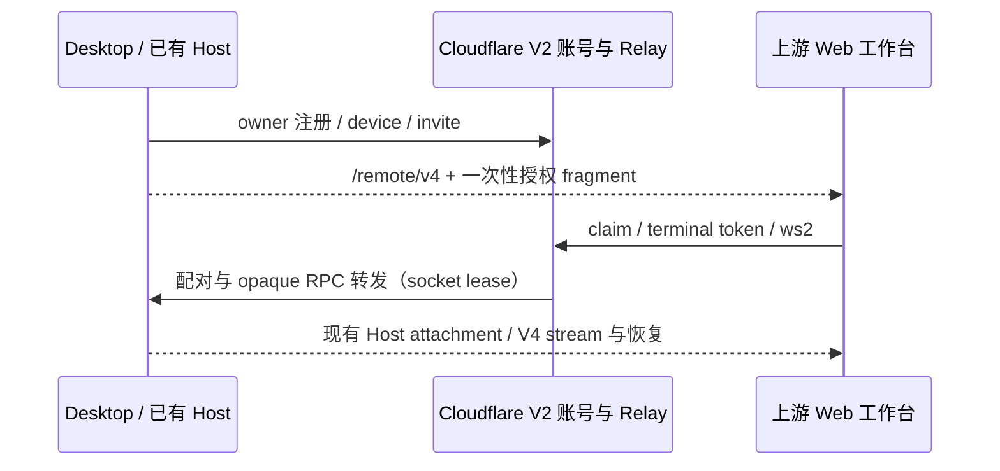

# 旧远控链路退役

当前交付以固定上游 Web 工作台、Desktop 已有 Host attachment、Cloudflare V2 Relay 和轻量账号为准。不兼容旧配对码、审核体验码、Node control、双腿 binary attachment、旧 HMAC/hash/t 协议或旧 Docker Relay。

删除范围：Docker Relay 应用及发布流水线，共用旧 Relay core 与 agent-relay wire 合同，Cloudflare 的旧 /v1 与 admin 业务，Web Host 的旧 Node connector，client 的旧 attachment 传输，以及 Taro/Flutter 的自有旧后端和上游旧版 HMAC 分支。同步清理公开导出、工作区依赖、测试、生成包地图和旧部署文档。

保留：上游常驻 server-cli 与 Desktop SSH/WSL/Docker 开发容器连接；现用 V4 RPC、workspaceIdentity、owner/lease、stale 防护及 desktop-continuous / web-remote-replayable 语义。手机打开自建授权链接时复用 Web；原生上游 V2 渠道不回退旧协议。不会恢复自有 Web 工作台。

V2 账号与邀请凭据、设备及 socket lease 的唯一所有者为 WebRemoteRelayObject；任务、队列与快照属于 Desktop 已有 Host/CLI。Relay 不持有业务状态，不重放 data。

旧服务路由返回 404，不保留兼容入口。Cloudflare 仅保留历史 RelayObject 的无业务导出，以保持已部署 DO migration 历史可升级；移除其 binding，不能引入 deleted_classes 自动销毁云端数据。旧账号/SQL/Redis 数据不迁移、不清除；生产删除历史数据是另一次明确运维操作。本任务不操作运行中的 Docker 容器、生产 DO 或数据卷。

验收：旧 HTTP/WS 路由不可用；V2 注册、邀请一次性、角色隔离、token 重放防护、lease、数据转发和凭据注销通过真实 Wrangler 集成；Web 静态入口、资源及 no-cache 授权响应正常；移动端拒绝旧连接串且保留 V2；Desktop/Server 编译与现有 Host 模式不回归。教程仅记录现有命令、变量、存储、构建/部署/升级及验收边界。
