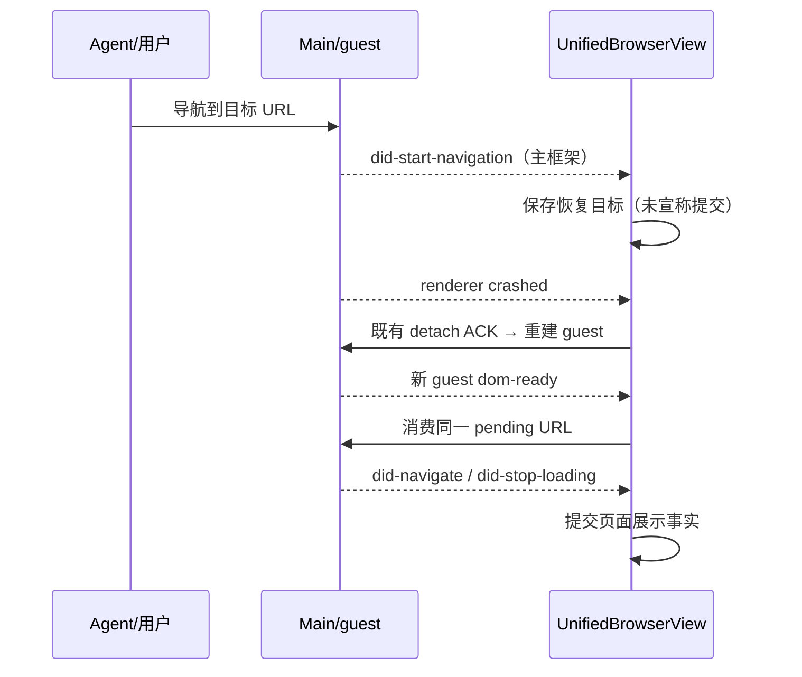

# 浏览器首次导航恢复与视口操作

## 规则与所有者

- 内嵌浏览器的首次 Agent 导航可能在 did-navigate 前发生 guest renderer 崩溃；原 UI 只在导航提交后记录恢复地址，因而重建后停留 about:blank。通过同一 webview 的 did-start-navigation 记录已开始的主框架目标，复用既有 lastRestorableUrlRef、pendingUrlRef 和重建链路。不把导航意图当作已提交页面，不触发第二次并行导航。
- 初始 about:blank、恢复 bootstrap、子框架导航和不支持的 URL 不覆盖恢复目标。原 guest 的事件监听随换代解除，迟到的旧 guest 事件不能覆盖新 guest 状态；不新增超时或无限重试。取消/关闭仍遵守现有 owner 与 attach ACK 边界。
- 现有“自由尺寸 + 适应窗口”是固定 CSS 视口的等比预览，会有留白；不能为消除空白而拉伸网页或偷偷改写既有 Agent 视口。
- 分辨率工具栏新增“横竖屏切换”：交换已提交的宽高，经同一 updateResponsiveViewportSize 路径同步 Main viewport。若交换后超出共享协议范围，按钮禁用并说明原因；无效/未提交草稿不参与交换。正方形不产生尺寸变化。
- 同一工具栏提供“填满面板”：退出固定视口模式，复用 toggleResponsiveMode，将 Main override 设为 null，网页使用容器真实尺寸；不 reload、不换 webview、不丢场景/历史。保留原固定尺寸，以便重新进入自由尺寸。
- 字体、色系、按钮、图标与工具提示复用 DESIGN.md、Button/Tooltip 和 text-ui 尺度，中英文文案配套。视口状态仍由现有 hook/Main owner 管理，无独立 orientation 状态。
- `BrowserViewLoadUrl` 的 owner 校验必须同时允许 UnifiedBrowserView 使用的两个受控 partition：内置浏览器与 TapTap 预览。两者都要安装受控本地预览协议并封锁原生 `file`；只允许单一 session 会把右侧“TapTap 预览”误报为 `Browser navigation owner mismatch`。新增内嵌浏览器 partition 时必须同步扩展 allowlist。

## 顺序

横竖屏：按钮 → 现有 viewport hook → platform viewport IPC → Main 串行 metrics → 页面 resize；填满面板：同一路径提交 null。Desktop 连续链路改变；手机 replay 协议、场景文档和聊天状态不变。

## 验收

1. 首次导航尚未提交时崩溃，新 guest 自动请求原 URL，无需 Agent 再补 URL。
2. 子框架/初始空页不会成为恢复目标；旧 guest 的迟到事件不覆盖新目标；重复崩溃不无限循环。
3. 1280×720 → 720×1280 → 1280×720，数值与 Main override 同步，zoom 保留；越界尺寸不能旋转，无效草稿不被提交。
4. 点击填满面板，override=null，网页占用可用区域；webview DOM 身份、页面 URL、文档标记保持不变。再进入自由尺寸保留原尺寸。
5. 360/600px 工具栏可访问，键盘/中英文/明暗主题正常；场景人工微调、Agent 续改不因尺寸操作丢失。

## 验证记录 · 2026-10-26

- `node packages/ui/test/browserGuestAttachment.e2e.mjs`：新增用例在修复前因没有恢复导航而超时；修复后通过，包括子框架、初始空白页和旧 guest 迟到事件隔离。
- `node packages/ui/test/browserFirstNavigation.native.e2e.mjs`：独立 Electron 使用临时用户目录，首次主框架导航尚未提交时 forcefullyCrashRenderer，确认 guest ID 换代且自动加载同一目标文档；通过。不操作用户现有场景。
- `node packages/ui/test/browserViewport.e2e.mjs`：真实组件与视口 hook 验证横竖屏往返、无效输入、越界/正方形禁用、中英文；填满面板提交 null，iframe DOM 身份和人工编辑标记保留，实际宽高等于面板。通过，截图在 `.kayingcode-runtime/browser-viewport/`。
- 根 typecheck、verify:pre-push 通过；根 Lint 为 0 errors / 129 warnings，架构 0 新违规。

本修复解决首次导航崩溃后的恢复目标丢失，未声称定位 Chromium 原生 exitCode 11 的内部原因。替代 guest 如果继续失败，沿用既有失败展示和手动重试，不无限重建。Mac 锁屏期间未直接点击用户正在运行的应用窗口；隔离 Electron 回归已执行。
