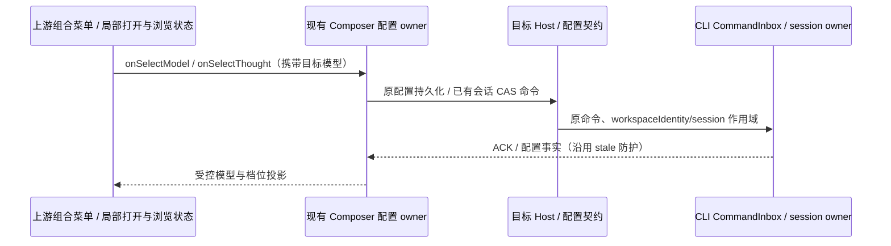

# Composer 模型与思考强度交互排查

基线为已验收官方 ZCode 3.17.2（`a9fe401eede6e6e5e01be9048679c206fe6f02d9`）。2026-11-06 排查后，用户已授权完成交互对齐；以下差异作为实现前回归依据。

## 已确认差异

- 用户截图为桌面工作台；它使用本仓 `packages/ui`，与 Web 构建导出的官方 UI 并非同一份文件。
- 本仓 `v4/composer/V4ComposerToolbar.tsx` 无条件分开渲染模型选择和 `ThoughtLevelCycleControl`，所以普通模型仍显示独立的“低 / 高 / 最高”下拉。
- 上游普通模型通过 `ModelConfigSelect.composerOptions` 使用 `ComposerModelMenu`，将供应商、模型和思考档位合并；思考档位使用 range 滑杆，支持拖动、点击和键盘。
- 上游只对 `modelLocked || highspeedPresented` 的特定状态保留独立强度控件；不能据此认为普通模型的分离下拉已经对齐。
- 本仓 `ModelConfigSelect` 缺少 `composerOptions`、打开时触发器过渡、选模型后保持组合菜单展开等接线；`ComposerModelMenu`、`ComposerProviderMenu`、`ComposerEffortHeading`、`ComposerTriggerTransition` 等组件没有迁入当前 UI。差异来自组件与调用链未采纳，不是截图主题或 Logo 导致。

## 后续对齐边界

恢复上游组合菜单展示与交互，通过现有模型选择 owner 提交配置；不把菜单局部状态当作已提交模型/档位，不引入第二条配置持久化路径。复用现有 CAS 命令、workspaceIdentity/session 作用域和 stale 防护。

供应商来源需要适配 KayingCode 现有 Built-in / Personal / 自定义 Provider；官方订阅、计费、Highspeed 服务不能随菜单整体复制进产品。交互验收包括：打开/取消、供应商与模型切换、强度滑杆点击/拖动/键盘、缺失与固定档位、配置加载/失败、窄布局、焦点恢复，以及实际发送携带正确模型与强度。

非 Composer 的自动化/子 Agent 等调用保留原 ModelConfigSelect 行为；组合菜单只在传入 composerOptions 时启用。选择模型后菜单保持打开，允许继续设置档位；取消、外侧点击、Escape 不提交选择。供应商行只展示目录中真实配置；空目录提供已有管理模型入口。档位缺失不伪造最低/最高值，固定单档不渲染可拖滑杆。控件在目录/目标切换期间不得提交旧模型的档位。

组合触发器的 Tooltip 始终使用同一受控模式；菜单打开时关闭提示，关闭后不能因旧 hover 状态自动重开，避免 Radix 受控/非受控切换告警或 Escape 被提示层截获。

## 验证记录（2026-11-06）

Chrome 浏览器回归使用实际 ModelConfigSelect 与 V4ComposerModelControls：桌面/390px 窄屏，供应商导航，选模型后菜单保持展开，滑杆拖动和 Home/End，缺失/单档档位，外侧关闭与输入焦点恢复，Escape，禁用，目录加载与失败重试均通过。实际 Toolbar 的回调断言确认 sourceModel 为原模型、thought target 为新模型；同一次操作经 createComposerSubmissionConfig 冻结后保留正确 provider/model/reasoningLevel。测试使用隔离目录和 hooks fixture，不请求真实模型；不将配置构造通过等同于新一轮线上模型回复验收。

本地真实 Electron 已重启并人工式 UI 验证：组合菜单展示当前供应商、真实模型列表、思考强度滑杆及 Ctrl+T 提示，Escape 关闭后焦点回到输入区。未在真实用户会话中切模、调档或发送测试指令。
