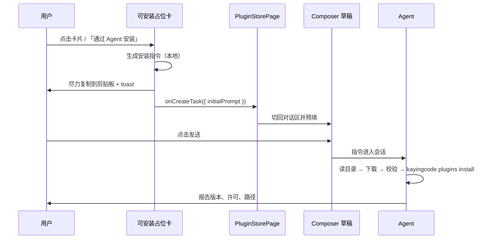

# 游戏开发专区：社区插件占位

在现有「游戏开发」分段内增加**可安装占位卡**：插件本体不随应用分发，点击卡片把安装指令复制到剪贴板、切换到 Agent 对话区并预填到输入框，用户提交后由 Agent 按社区目录协议完成安装（`packages/shared/spec/game-plugin-installers.md`）。

## 产品规则

- 数据来自 `GAME_PLUGIN_INSTALLERS`（生成契约）；占位不是内置插件，不进入 `pluginManagementStore`，不显示安装/启停/更新/卸载状态。
- 占位卡参与专区的引擎、阶段与搜索筛选，计数与通用能力规则与内置卡片一致：
  - `engines` 为空数组时匹配所有引擎；
  - `stages` 非空，跨维度取交集；
  - 搜索匹配显示名、名称、描述（当前语言）与阶段标识；阶段标签不在卡片上展示。
- 专区列表在现有开源/闭源分组之后新增独立分组「社区插件」（英文 Community plugins），显示全部占位条目。分组标题带数量，不新增分段或新的安装来源。
- 同名插件已在任意 marketplace 安装时，占位卡切换为已安装态：复用内置卡片的「已启用」开关、更新与菜单，卡片点击打开该安装条目的详情；不再生成安装指令。安装事实只来自 inventory，不由占位推断，卡片状态与详情页不得出现割裂。
- 卡片视觉复用 32px 字母头像、16px 水平内边距与卡片底部操作区；不展示阶段标签。顶部角标按 `source.tier` 显示「开源 · 官方」（official）或「开源 · 社区」（community），链接走平台外链端口；闭源占位不显示角标。
- 右侧操作区是唯一主操作按钮「通过 Agent 安装」（英文 Install with Agent），整卡点击等价于该按钮；banner 与外部链接点击/键盘操作不触发安装，不互相误触。
- 卡片点击后的顺序固定：
  1. 生成当前语言的安装指令；
  2. 尽力写入剪贴板（`navigator.clipboard.writeText`，失败不阻断）；
  3. 通过 `onCreateTask({ initialPrompt })` 切回对话区并预填草稿（复用 Root 标准新建任务编排，不自动发送）；
  4. 显示一次 toast：指令已复制并填入输入框。
- 不自动提交、不创建任务、不调用插件安装 RPC；用户点击发送后才由 Agent 执行安装。写入草稿的内容全部在本地生成，页面不发起网络请求。
- 窄屏与桌面布局沿用专区现有网格与换行规则；新增分组不改变既有单/双列断点。
- 中英文文案由 `settings.plugins.game.installer.*` 提供；阶段与引擎沿用既有 key。

## 安装指令

指令是面向 Agent 的自然语言模板（中英文各一份），至少包含：

- 插件名与展示版本，以及「以在线目录为准」；
- 目录 URL（`catalog.url`）与 `github-to-local-source` 协议名；
- 目标宿主的包路径解析要求（按目录 `source.packages.kayingcode.path` 取包）；
- 落地到用户目录下的稳定路径（`<home>/open-zcode-game-plugins/<name>/<version>/kayingcode/`），先校验再安装；
- 使用宿主的 `kayingcode plugins install --from <目录>` 完成安装并启用（Agent CLI shim 见 `apps/zcode-cli/packages/cli/spec/agent-cli-shim.md`）；
- 用户已通过点击提交确认安装，不再二次询问；不注册远程市场 URL、不执行插件自带脚本、不覆盖已安装的同名插件；
- 安装完成后报告版本、许可、本地路径与变更。

指令模板不包含凭据、内部地址或本机绝对路径；插件名/URL 来自生成契约，插入前按纯文本处理，不做富文本或 Markdown 拼接。

## 状态与所有者

- `PluginStorePage` 仍是分段/筛选状态所有者；占位筛选只做派生，不新增持久化。
- 已安装判定来自 `buildStoreItems` 产出的 `StorePluginItem[]`，不按名称猜 marketplace。
- 剪贴板、toast 与导航是页面副作用；`onCreateTask` 是切回对话的唯一入口，不直接操作 composer store。

## 验收

1. 内置卡片分组、计数与交互不变；新分组只出现在有占位条目的场景（含已安装态）。
2. 占位按引擎/阶段/搜索正确过滤；计数、空态与清除筛选行为与内置卡片一致。
3. 点击（鼠标、Enter/Space）后：剪贴板有指令、页面切到对话区、输入框有同一指令、未自动发送。
4. 剪贴板不可用时仍完成切换与预填，toast 不谎报复制成功（降级文案）。
5. 同名插件安装后占位卡片显示与内置卡片一致的已启用开关、更新和菜单，点击打开真实详情；卸载后恢复安装操作。
6. 角标按 `source.tier` 显示「开源 · 官方 / 开源 · 社区」；链接走平台外链，点击角标不触发安装流程。
7. 中英文、明暗主题、1053px 双列与 390px 单列无页面错误与横向溢出。
